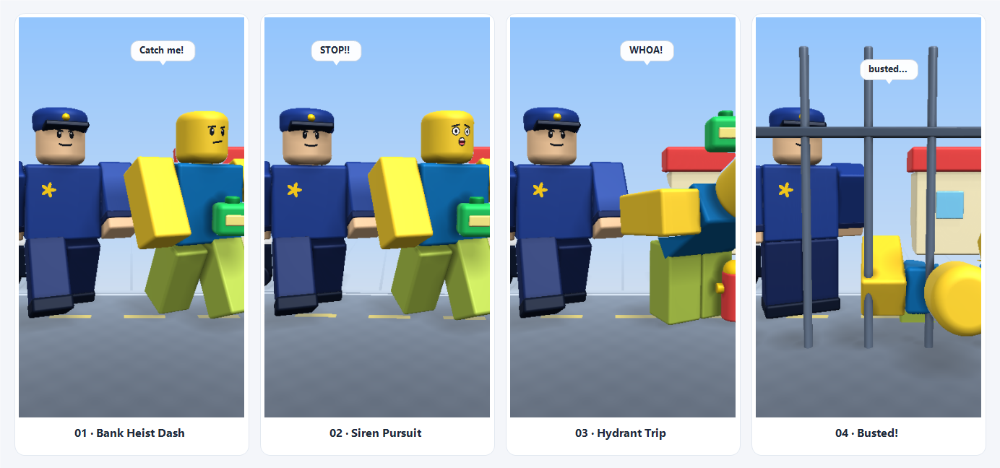
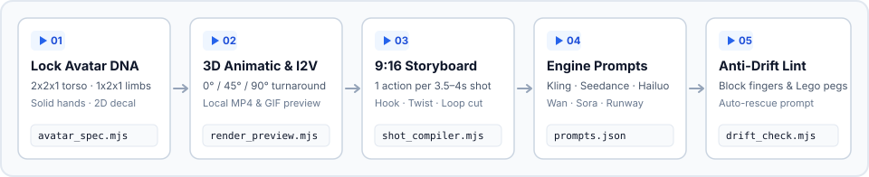

<div align="center">

# Roblox Style Video Skill

An installable Agent Skill for **Roblox video generation** in Claude Code, Cursor, GitHub Copilot, and Codex. It turns a story into consistent R6/R15 blocky-avatar characters, 9:16 storyboards, offline MP4/GIF animatics, and optional Kling, Seedance, Hailuo, Wan, Sora, or Runway I2V/T2V prompt packs.

[](skills/roblox-style-video/SKILL.md)
[](https://github.com/yuzhang-zhong/roblox-style-video/actions/workflows/skill-validation.yml)
[](#skill-workflow-and-quick-start)
[](LICENSE)

**[See the subway comparison](#subway-acting-comparison)** · [Install v1.7.0](#install-as-an-agent-skill) · [Video examples](#video-examples) · [Skill guide](skills/roblox-style-video/SKILL.md)

**English** · [简体中文](README.zh-CN.md) · [繁體中文](docs/i18n/README.zh-TW.md) · [日本語](docs/i18n/README.ja.md) · [한국어](docs/i18n/README.ko.md) · [Español](docs/i18n/README.es.md) · [Français](docs/i18n/README.fr.md) · [Deutsch](docs/i18n/README.de.md) · [Português](docs/i18n/README.pt-BR.md) · [Русский](docs/i18n/README.ru.md)

</div>

The local renderer needs no Roblox Studio, manual keyframing, or video-model API key. It runs on Node.js 18+ and uses `ffmpeg` to package MP4/GIF previews.

<a name="subway-acting-comparison"></a>

## One subway scene, rendered twice

Both local animatics use the same cast, set, camera and timing. In the acting version, Mo looks from the empty seat to Noob, raises a brow and points to the seat.

[Geometry-only baseline (MP4)](examples/subway-acting-versus-baseline/assets/baseline/subway_baseline.mp4) · [Acting version (MP4)](examples/subway-acting-versus-baseline/assets/acting_rich/subway_acting_rich.mp4) · [Comparison sheet and inputs](examples/subway-acting-versus-baseline/README.md)

## Install as an Agent Skill

Use the [v1.7.0 Git tag](https://github.com/yuzhang-zhong/roblox-style-video/tree/v1.7.0) for the acting workflow shown above. The version pin avoids resolving to an older published GitHub Release.

```bash
gh skill install yuzhang-zhong/roblox-style-video roblox-style-video@v1.7.0
```

If your host has no installer, copy the entire [tagged Skill directory](https://github.com/yuzhang-zhong/roblox-style-video/tree/v1.7.0/skills/roblox-style-video) into its Skills folder. Keep `SKILL.md`, `scripts/`, `references/`, `templates/`, and `assets/` together.

To install from the repository's default branch with the cross-agent Skills CLI instead:

```bash
npx skills add https://github.com/yuzhang-zhong/roblox-style-video --skill roblox-style-video
```

Try this in your agent chat:

```text
Use $roblox-style-video to generate a 15-second 9:16 short set in a dim hotel corridor (doors-horror):
an R6 avatar in a blue hoodie sweeps a flashlight past Door 050 when the lights flicker.
Produce the local MP4/GIF animatic, character geometry lock, 4-shot storyboard, and optional Sora / Kling I2V prompts.
```

<a name="examples-and-local-3d-previews"></a>

## Video examples

When invoked in an AI coding agent, this skill turns a short-video idea into a 15-second, four-shot vertical (`9:16`) package across 12 classic blocky story formats. The **4-second MP4s** and GIFs below are offline 3D animatics rendered by the skill's `scripts/render_preview.mjs` tool so you can check R6 proportions, multi-part props, camera moves, and overhead `BillboardGui` chat bubbles before spending credits in an external video model.

<p align="center">
  <a href="examples/monday-alarm-meltdown/assets/monday_alarm_meltdown.mp4"></a>
  <a href="examples/obby-sky-run/assets/obby_sky_run.mp4"></a>
  <a href="examples/duo-bestie-contrast/assets/duo_bestie_contrast.mp4"></a>
  <a href="examples/cozy-cafe-tycoon/assets/cozy_cafe_tycoon.mp4"></a>
  <a href="examples/runway-outfit-drop/assets/runway_outfit_drop.mp4"></a>
  <a href="examples/burnt-pizza-slapstick/assets/burnt_pizza_slapstick.mp4"></a>
  <br />
  <a href="examples/disaster-tower-tornado/assets/disaster_tower_tornado.mp4"></a>
  <a href="examples/brookhaven-police-chase/assets/brookhaven_police_chase.mp4"></a>
  <a href="examples/doors-flashlight-hallway/assets/doors_flashlight_hallway.mp4"></a>
  <a href="examples/crossroads-sword-duel/assets/crossroads_sword_duel.mp4"></a>
  <a href="examples/classroom-exam-panic/assets/classroom_exam_panic.mp4"></a>
  <a href="examples/red-light-freeze/assets/red_light_freeze.mp4"></a>
</p>

## Scene boards and shot pacing

Video models break rigid blocky limbs when a single 4–5 second prompt stacks three or four sequential verbs. Each short splits the story into four single-action beats (`0–3.5s` hook, two escalation shots, and a `11.5–15s` payoff or loop return):

| Shot 01 · Hook (`0–3.5s`) | Shot 02 · Action (`3.5–7.5s`) | Shot 03 · Twist (`7.5–11.5s`) | Shot 04 · Loop (`11.5–15s`) |
| :---: | :---: | :---: | :---: |
|  |  |  |  |

Four-shot contact sheets across six game genres, pairing camera angle changes with overhead speech bubbles:

| 02 · Sky Obby (`Hailuo` · Speed Coil & Killbrick) | 08 · Brookhaven Police Chase (`Hailuo` · Street Pursuit) |
| :---: | :---: |
| <a href="examples/obby-sky-run/"></a> | <a href="examples/brookhaven-police-chase/"></a> |
| **07 · Natural Disaster Tower (`Kling` · Tornado Survival)** | **09 · Doors Hotel Hallway (`Sora` · Flashlight Flicker)** |
| <a href="examples/disaster-tower-tornado/"></a> | <a href="examples/doors-flashlight-hallway/"></a> |
| **10 · Crossroads Sword Duel (`Seedance` · Linked Sword 1v1)** | **12 · Red Light Freeze (`Runway` · Arena Sprint & Freeze)** |
| <a href="examples/crossroads-sword-duel/"></a> | <a href="examples/red-light-freeze/"></a> |

## Skill workflow and quick start

<p align="center">
  
</p>

### Run the skill's CLI tools directly

Every helper script bundled inside the skill also runs standalone from the repository root on Node.js 18+ using only the standard library (no `npm install` or API keys).

```bash
node scripts/render_preview.mjs --spec templates/custom_story_spec.json --out-dir out/subway-demo --force
node scripts/shot_compiler.mjs --spec templates/custom_story_spec.json --engine local3d --lang en
node scripts/drift_check.mjs --pack templates/custom_story_spec.json --engine local3d --lang en
```

## Skill scripts, anti-drift checks, and references

Generic video prompts often produce human fingers, circular Lego floor/head studs and C-claws, or Minecraft voxel cubes instead of clean blocky R6 geometry (`2x2x1` torso, flush `1x2x1` legs, solid block hands, `1:1` barrel head, smooth architectural floors, and multi-part props). The skill's `drift_check.mjs` linter flags these failure modes before generation:

<p align="center">
  
</p>

| Skill component | Output |
| --- | --- |
| [`SKILL.md`](skills/roblox-style-video/SKILL.md) | Main Agent Skill entry point defining the 6 production modes (`Avatar`, `Storyboard`, `Prompt-Compile`, `Rescue`, `Remix`, `Render`) and 8 geometry invariants. |
| [`shot_compiler.mjs`](scripts/shot_compiler.mjs) | Acting-prioritized prompt compiler (`Beat Intent -> Gaze -> Camera-Facing Interaction -> Character DNA -> Single Action -> Geometry Guard`) for custom `--spec <episode.json>` stories or 12 built-in templates across `local3d`, Kling, Seedance, Hailuo, Wan, Sora, and Runway. |
| [`avatar_spec.mjs`](scripts/avatar_spec.mjs) | Two-layer Character DNA (`Visual DNA` + `Performance DNA`), `--cast` multi-character locks, optional shared-canvas **Cast Acting Sheet** prompts, `--companion` blocky pets, and [three-view turnaround](assets/showcase/momo_turnaround_sheet.en.png) prompts. |
| [`drift_check.mjs`](scripts/drift_check.mjs) | 10-gate Unicode-safe linter reporting separate **Geometry Gates (1–8)** and **Acting & Readability Gates (9–10)** (`gazeTarget`, camera-facing prop `interaction`, 9:16 safe zone, and `64×64` PNG thumbnail contrast via `--assets-dir`). |
| [`render_preview.mjs`](scripts/render_preview.mjs) | Direct local 3D `.mp4` / `.gif` renderer (`--spec <episode.json> --out-dir <dir>`) with 1st-class 2D pupil tracking, asymmetrical brows, Cast Acting Sheets, `256×256` avatar crops, and exact per-shot timing (see [controlled A/B acting study](examples/subway-acting-versus-baseline/)). |

[Avatar geometry and materials](references/avatar-geometry-and-materials.md) · [Classic gear and props](references/classic-roblox-catalog.md) · [Model prompt playbook](references/model-prompt-playbook.md) · [Drift fixes](references/rescue-and-anti-drift.md) · [Pacing and audio](references/short-video-beats-and-audio.md) · [12 story templates](references/viral-archetypes-catalog.md)

## Frequently asked

- **Is this only a prompt collection?** No. The local 3D renderer produces 9:16 MP4/GIF animatics, storyboard sheets, turnaround images, and synthesized audio; external-model prompt packs are optional.
- **Which Roblox video use cases does it match?** Roblox AI video generation, R6/R15 or blocky-avatar animation, machinima, Obby stories, Roblox-style comedy, horror, action, and TikTok/YouTube/Douyin short-video storyboards.
- **Does the local workflow require API keys?** No video-model account or API key is required. Node.js 18+ runs the CLI; MP4/GIF packaging additionally requires `ffmpeg`.
- **Which agents and video models are supported?** The Skill format works with GitHub Copilot, Codex, Claude Code, Cursor, Gemini CLI, and other Agent Skills hosts. Prompt compilation covers Kling, Seedance/Jimeng, Hailuo MiniMax, Wan, Sora, and Runway.

## Verification and reproducibility

| Check | Current evidence | Last verified |
| --- | --- | --- |
| Package validation and tests | `npm run validate` and 9/9 Node tests on `v1.7.0` pass, including a PNG render smoke test | 2026-11-27 |
| Standard GitHub Skill package | The `v1.7.0` bundle was installed from a Git archive with `gh skill install --from-local`. Remote installation of `v1.7.0` was not verified in that run. | 2026-11-27 |
| Linux and Windows compatibility | CI matrix covers Node 18 and 22 after this release | Each push and pull request |
| Agent UI recommendation | Manual query protocol is provided; no automated pass is claimed until results are recorded | Per release |
| Web-model discovery | Monthly measurement is defined; search placement is not yet inferred from local metadata tests | Monthly / after placement changes |

Run the deterministic discovery preflight with:

```bash
npm run test:discovery
```

After a release has propagated, run the live GitHub registry audit:

```bash
npm run test:discovery:remote -- --out discovery-report.json
```

See [the discovery evaluation protocol](docs/discovery-evaluation.md) and [fixed test queries](tests/discovery_queries.json). The live audit intentionally fails on missing results or rate limits so an unverified search is never recorded as a pass.

## 中文简介

`roblox-style-video`（v1.7.0）是面向 GitHub Copilot、Claude Code、Codex 与 Cursor 的**罗布乐思（Roblox）R6/R15 方块人（方块小人）9:16 竖屏短视频生成与 AI 视频防串味 Agent Skill 及零依赖 Node.js 本地 3D 动画引擎**（无需安装 Roblox Studio 或手动 K 帧，无需任何视频模型账号或 API Key，轻松制作 Roblox R6/R15 抽象小剧场与 TikTok/抖音爆款短片）。内置 12 套爆款竖屏模板（Obby 跑酷、Bacon Hair / 萌新与大佬反差小剧场、Brookhaven 警察追逐、DOORS 恐怖酒店走廊、双人剑斗、灾难塔龙卷风等）、2D 贴花瞳孔视线追踪（`gazeTarget`）与群像表演卡（Cast Acting Sheet），通过 **10 门几何防串味与表演可读性检查（`drift_check.mjs`）**拦截 AI 视频常见的「方块手长出五根人类手指、乐高积木圆凸点与 C 型爪、MC 体素方块头串味、眼神呆滞木讷」等翻车问题，并支持导出本地 MP4/GIF 动态分镜或编译可灵（Kling）、即梦（Seedance）、海螺（Hailuo）、通义万相（Wan）、Sora、Runway 图生视频/文生视频提示词。详见[简体中文完整说明](README.zh-CN.md)与 [`llms.txt`](llms.txt)。

## Languages

Agent Skill replies and CLI `--lang` output support `en`, `zh`, `zh-tw`, `ja`, `ko`, `es`, `fr`, `de`, `pt`, and `ru`.

**English** · [简体中文](README.zh-CN.md) · [繁體中文](docs/i18n/README.zh-TW.md) · [日本語](docs/i18n/README.ja.md) · [한국어](docs/i18n/README.ko.md) · [Español](docs/i18n/README.es.md) · [Français](docs/i18n/README.fr.md) · [Deutsch](docs/i18n/README.de.md) · [Português](docs/i18n/README.pt-BR.md) · [Русский](docs/i18n/README.ru.md)

[MIT License](LICENSE). Independent open-source Agent Skill; uses original geometric triangle emblems and is not affiliated with or endorsed by Roblox Corporation.
