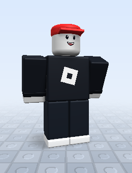
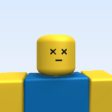

# roblox-style-video

**English** · [简体中文](README.zh-CN.md) · [繁體中文](docs/i18n/README.zh-TW.md) · [日本語](docs/i18n/README.ja.md) · [한국어](docs/i18n/README.ko.md) · [Español](docs/i18n/README.es.md) · [Français](docs/i18n/README.fr.md) · [Deutsch](docs/i18n/README.de.md) · [Português](docs/i18n/README.pt-BR.md) · [Русский](docs/i18n/README.ru.md)

Agent skill and Node.js CLI tools for planning 9:16 Roblox-style short videos. Prompting a video generator with a generic "Roblox character" often produces five human fingers, Lego C-hook hands and top head studs, sharp Minecraft voxels, or separated legs in sneakers. `roblox-style-video` locks standard Roblox Studio geometry (`2x2x1` torso, flush `1x2x1` legs, solid block hands, `1:1` barrel head with flat 2D face decals, and studded baseplates), compiles shot-by-shot prompts for Kling, Seedance, Hailuo, Wan, Sora, and Runway, and renders local 3D preview sheets before you spend video generation credits.

## Quick start

Clone into your local skills folder (works with Codex, Claude Code, Cursor, and GitHub Copilot):

```bash
git clone https://github.com/yuzhang-zhong/roblox-style-video.git ~/.codex/skills/roblox-style-video
```

Ask your agent with `$roblox-style-video`:

```text
Use $roblox-style-video to plan a 15-second 9:16 short about two friends shopping:
a Y2K streetwear avatar and a yellow Classic Noob. Give me the character cards,
3-view turnaround prompts, and a 4-shot Kling I2V storyboard.
```

Or run the standalone CLI scripts directly from a regular clone (requires Node.js 18+; uses only the standard library with no `npm install` or API keys):

```bash
node scripts/avatar_spec.mjs --archetype corporate-worker --rig chibi-blocky --material smooth-plastic --name "Momo" --lang en
node scripts/shot_compiler.mjs --template daily-meltdown --duration 15 --engine kling --rig chibi-blocky --lang en
node scripts/drift_check.mjs --prompt "A cute Roblox girl with C-shaped claw hands drinks coffee with five fingers" --engine kling --mode t2v --lang en
```

## Examples and local 3D previews

All `.png`, `.gif`, and `.mp4` files in this repository are offline 3D previews rendered by `scripts/render_preview.mjs` to check R6 proportions, camera framing, and overhead `BillboardGui` chat bubbles; final diffusion video clips require an external video model.

| 3-view R6 turnaround (`0° / 45° / 90°`) | Geometry check (`FAIL` drift vs. `PASS` R6) |
| :---: | :---: |
|  |  |

Six 15-second (`9:16`, 4-shot) example packages covering each built-in story template and target video engine:

| 01 · Monday Alarm (`Kling`) | 02 · Sky Obby (`Hailuo`) | 03 · Y2K vs. Noob (`Seedance`) |
| :---: | :---: | :---: |
|  |  |  |
| [Sheet](examples/monday-alarm-meltdown/assets/storyboard_contact_sheet.en.png) · [MP4](examples/monday-alarm-meltdown/assets/monday_alarm_meltdown.mp4) · [Files](examples/monday-alarm-meltdown/) | [Sheet](examples/obby-sky-run/assets/obby_storyboard_sheet.en.png) · [MP4](examples/obby-sky-run/assets/obby_sky_run.mp4) · [Files](examples/obby-sky-run/) | [Sheet](examples/duo-bestie-contrast/assets/duo_storyboard_sheet.en.png) · [MP4](examples/duo-bestie-contrast/assets/duo_bestie_contrast.mp4) · [Files](examples/duo-bestie-contrast/) |
| **04 · Cozy Cafe (`Wan`)** | **05 · Runway Drop (`Sora`)** | **06 · Burnt Pizza (`Runway`)** |
|  |  |  |
| [Sheet](examples/cozy-cafe-tycoon/assets/cafe_storyboard_sheet.en.png) · [MP4](examples/cozy-cafe-tycoon/assets/cozy_cafe_tycoon.mp4) · [Files](examples/cozy-cafe-tycoon/) | [Sheet](examples/runway-outfit-drop/assets/runway_storyboard_sheet.en.png) · [MP4](examples/runway-outfit-drop/assets/runway_outfit_drop.mp4) · [Files](examples/runway-outfit-drop/) | [Sheet](examples/burnt-pizza-slapstick/assets/pizza_storyboard_sheet.en.png) · [MP4](examples/burnt-pizza-slapstick/assets/burnt_pizza_slapstick.mp4) · [Files](examples/burnt-pizza-slapstick/) |

## Classic Roblox asset library

Pre-rendered in [`assets/library/catalog.json`](assets/library/catalog.json) and documented in [`references/classic-roblox-catalog.md`](references/classic-roblox-catalog.md) ([avatar sheet](assets/showcase/classic_avatars_lineup.en.png) · [face sheet](assets/showcase/classic_faces_atlas.en.png)):

| Classic Noob (2006) | Classic Guest (2008) | Bacon Hair (2014) |
| :---: | :---: | :---: |
|  |  |  |
| **Builderman Hard Hat** | **Obby + Speed Coil** | **Storytime Hoodie** |
|  |  |  |

| `Smile :)` | `Chill -_-` | `Check It` | `Grin :D` |
| :---: | :---: | :---: | :---: |
|  |  |  |  |
| **`Shocked O_O`** | **`Waterfall Tears`** | **`Angry Bloxxer`** | **`KO Dizzy X_X`** |
|  |  |  |  |

## CLI scripts, limits, and references

- [`scripts/avatar_spec.mjs`](scripts/avatar_spec.mjs): generate a Character DNA card (`BrickColor` palette, `2x2x1` / `1x2x1` stud locks) and 3-view turnaround prompt.
- [`scripts/shot_compiler.mjs`](scripts/shot_compiler.mjs): compile 9:16 beat sheets and I2V/T2V prompts for `kling`, `seedance`, `hailuo`, `wan`, `sora`, and `runway`.
- [`scripts/drift_check.mjs`](scripts/drift_check.mjs): check draft prompts for human fingers, Lego claws/studs, voxel heads, and multi-action overload, then output a patched prompt.
- [`scripts/render_preview.mjs`](scripts/render_preview.mjs): render offline 3D turnaround sheets, comparison boards, contact sheets, and `.gif` / `.mp4` animatics (Windows composition uses PowerShell `System.Drawing` and `ffmpeg`).

Keep each 4 to 5 second clip to one primary action, and lock a 3-view turnaround sheet before running multi-shot I2V so outfits and 2D face decals stay consistent. Agent replies and CLI `--lang` output support 10 languages (`en`, `zh`, `zh-tw`, `ja`, `ko`, `es`, `fr`, `de`, `pt`, `ru`). Independent open-source project under the [MIT License](LICENSE), not affiliated with or endorsed by Roblox Corporation.

- [`SKILL.md`](SKILL.md): end-to-end workflow and eight Roblox geometry rules
- [`references/avatar-geometry-and-materials.md`](references/avatar-geometry-and-materials.md): R6/R15/Plushie stud ratios, `BrickColor` codes, and `SmoothPlastic` / `Studs` materials
- [`references/classic-roblox-catalog.md`](references/classic-roblox-catalog.md): classic avatars, 2D face decals, and gear prompt tokens
- [`references/model-prompt-playbook.md`](references/model-prompt-playbook.md): prompt syntax and camera tags across six video models
- [`references/rescue-and-anti-drift.md`](references/rescue-and-anti-drift.md): fixes for eight common anatomy and style drift failures
- [`references/short-video-beats-and-audio.md`](references/short-video-beats-and-audio.md) · [`references/viral-archetypes-catalog.md`](references/viral-archetypes-catalog.md): 9:16 pacing, audio cues, and six story templates
