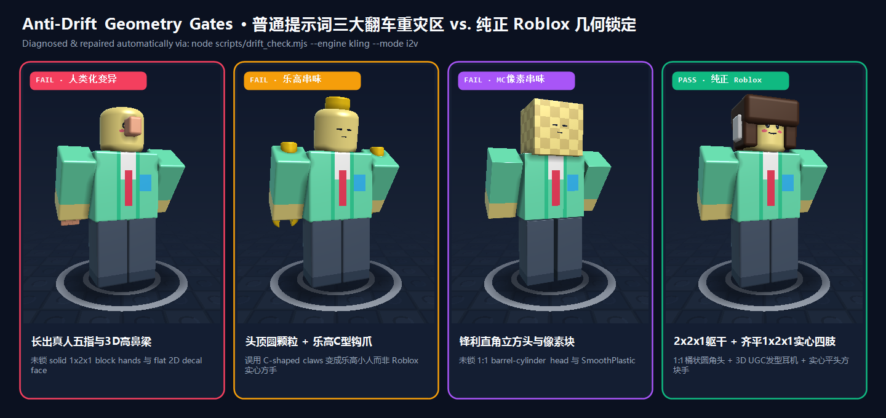
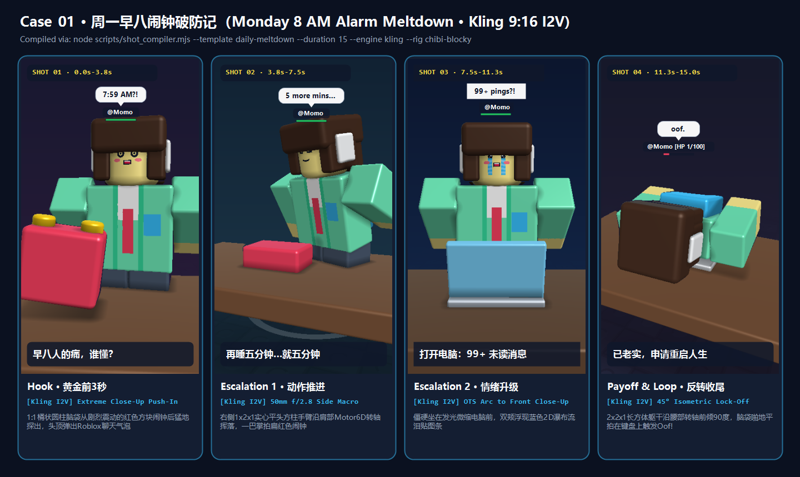
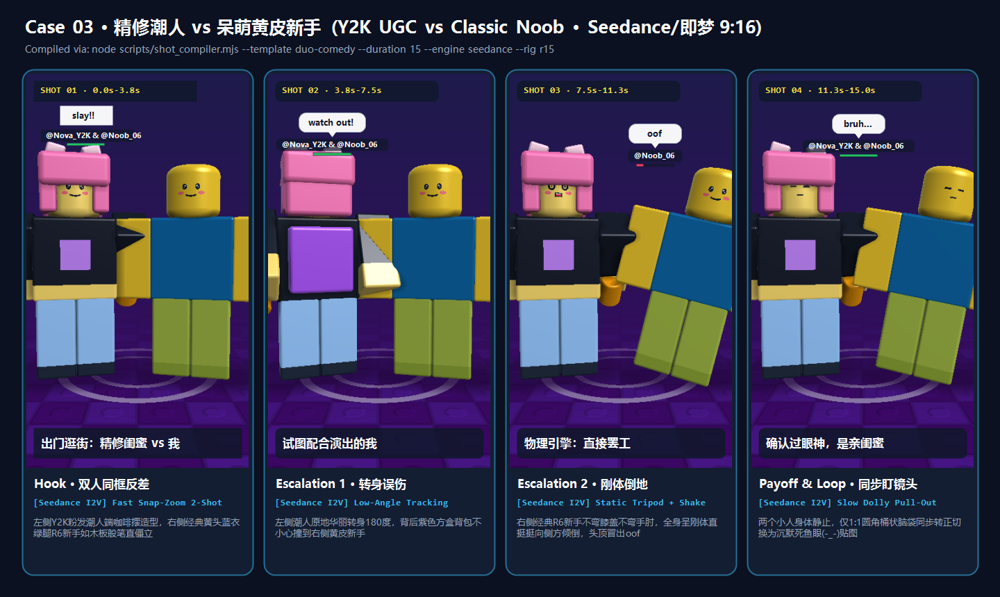

<div align="center">


# 方块片场 · Roblox Shorts Skill

**简体中文** · [English (full README)](README.en.md)

**锁住标准 `2×2×1` 躯干、并拢 `1×2×1` 实心方柱四肢与 `1:1` 桶状圆角头，告别乐高钩爪和真人手指，生成一眼地道的 Roblox 小人短视频。**

A bilingual Agent Skill, 3D Studio Renderer, and CLI toolkit for authentic Roblox-style AI short videos.

[](SKILL.md)
[](#四个可以独立运行的小工具)
[](LICENSE)

[实际渲染效果](#实际渲染素材与动态视频结果) · [开始使用](#三步开始) · [分镜编译实例](#一分钟看懂分镜与防串味编译) · [六种模式](#六种模式一套片场) · [独立工具](#四个可以独立运行的小工具) · [生成边界](#生成边界与说明) · [English](#english)

</div>

直接对视频模型写一句「生成一个可爱的 Roblox 小人喝咖啡」，或者误加一句「C-shaped claw hands（C 型夹爪手）」，通常会遇到四大翻车：手部长出真人五指、串味成带 C 型钩爪与头顶圆颗粒的乐高小人、变成直角马赛克的《我的世界》方块人，或者双腿分叉穿了真人运动鞋。

**方块片场（Roblox Shorts Skill）**由 [`SKILL.md`](SKILL.md)、五份深度参考手册和四个零依赖 Node.js 命令行工具组成。它严格锁定正统 Roblox Studio Stud 几何比例（`2×2×1` 宽扁躯干、并拢齐平且与躯干同宽的 `1×2×1` 实心方柱双腿、紧贴肩侧的 `1×2×1` 平头实心方块手、`1:1` 上下大圆角桶状圆柱头、`SmoothPlastic` 材质配 `Studs` 方格底板与头顶 `BillboardGui` 聊天气泡），支持一键生成角色三视图、9:16 分镜表、多模型图生视频（I2V）提示词以及 3D 预览短片。


## 实际渲染素材与动态视频结果

以下三视图、防串味对比图、9:16 分镜联系表与动态短片（`.gif` / 带音效 `.mp4`）均由本仓库工具链（`avatar_spec.mjs` + `shot_compiler.mjs` + `drift_check.mjs` + `render_preview.mjs`）实际生成并检入仓库：

### 1. 角色 DNA 与正统 Roblox 三视图设定卡 (`momo_turnaround_sheet.png`)

在跑多镜头图生视频（I2V）前，先生成 **0° 正面 / 45° 斜侧 / 90° 正侧面**三视图，锁死 `2×2×1` 躯干、并拢 `1×2×1` 方腿、1x2x1 实心平头方块手、3D UGC 刘海发型与耳机，以及脚下的经典 Roblox `Studs` 方格底板和 `SpawnLocation` 重生环：


### 2. 三大翻车重灾区 vs. 纯正 Roblox 几何锁定 (`drift_rescue_comparison.png`)

直观对比为什么普通提示词容易「不像 Roblox」：拦截**真人五指与 3D 鼻子**、拦截**乐高头顶圆颗粒与乐高 C 型钩爪**、拦截**MC 直角像素块**，锁定纯正 Roblox `2×2×1` / `1×2×1` 比例：



### 3. 三套 9:16 竖屏短视频动态成片与分镜实测 (`examples/`)

| Case 01 · 周一早八闹钟破防记 (`Kling`) | Case 02 · 多巴胺天空跑酷闯关 (`Hailuo`) | Case 03 · 精修潮人 vs 黄皮新手 (`Seedance`) |
| :---: | :---: | :---: |
|  |  |  |
| `chibi-blocky` · 3D短发耳机 + 聊天气泡 | `r6` · 红色遮阳帽 + 右臂发光加速弹簧(`Speed Coil`) | `r15` + `r6` · Y2K粉发潮人 vs 经典黄头蓝衣绿腿Noob |
| [分镜大图](examples/monday-alarm-meltdown/assets/storyboard_contact_sheet.png) · [带音效 MP4](examples/monday-alarm-meltdown/assets/monday_alarm_meltdown.mp4) · [提示词包](examples/monday-alarm-meltdown/) | [分镜大图](examples/obby-sky-run/assets/obby_storyboard_sheet.png) · [带音效 MP4](examples/obby-sky-run/assets/obby_sky_run.mp4) · [提示词包](examples/obby-sky-run/) | [分镜大图](examples/duo-bestie-contrast/assets/duo_storyboard_sheet.png) · [带音效 MP4](examples/duo-bestie-contrast/assets/duo_bestie_contrast.mp4) · [提示词包](examples/duo-bestie-contrast/) |

<details>
<summary>展开查看三套实测案例的 4 镜头完整分镜联系表大图</summary>

#### Case 01 · 《周一早八闹钟破防记》4 镜头分镜表


#### Case 02 · 《多巴胺天空跑酷闯关剧场》4 镜头分镜表


#### Case 03 · 《精修潮人 vs 呆萌黄皮新手》4 镜头分镜表


</details>

## 一分钟看懂分镜与防串味编译

**示例条件：15 秒竖屏（9:16）、打工人早八闹钟破防模板（`daily-meltdown`）、正统 Roblox 方块比例、目标模型为可灵（`kling`）。** 下表来自仓库脚本实际运行输出：

| 镜头 | 时间段 | 叙事功能 | 单一核心刚体动作（每镜限 1 个动词） | 头顶聊天气泡 | 运镜指令与花字 |
| :---: | :---: | --- | --- | :---: | --- |
| 01 | `0.0s–3.8s` | Hook / 黄金前3秒 | 从剧烈震动的红色方块闹钟后方猛地探出 `1:1` 桶状圆角脑袋 | `"7:59 AM?!"` | 大特写极速推近 ·「早八人的痛，谁懂？」 |
| 02 | `3.8s–7.5s` | Escalation 1 / 推进 | 右侧 `1×2×1` 实心平头方柱手臂沿肩部转轴挥落，一巴掌拍扁闹钟 | `"5 more mins..."` | 中景侧面微距 ·「再睡五分钟…」 |
| 03 | `7.5s–11.3s` | Escalation 2 / 升级 | 僵硬坐在发光微缩电脑前，双颊浮现蓝色 2D 瀑布流泪贴图条 | `"99+ pings?!"` | 越肩环绕至正面中近景 ·「打开电脑：99+ 未读」 |
| 04 | `11.3s–15.0s` | Payoff / 反转收尾 | `2×2×1` 躯干沿腰部转轴直挺挺前倾 90 度，脑袋平拍在键盘上触发残血条 | `"oof."` | 45 度固定俯拍（衔接首镜循环）·「已老实，申请重启」 |

```bash
node scripts/shot_compiler.mjs \
  --template daily-meltdown --duration 15 --engine kling \
  --rig chibi-blocky --lang zh-en
```

脚本同时为每个镜头生成**首帧静态图提示词**、**对应视频模型的动态提示词**与**统一负向防漂移词**。它根据预置的 Roblox Stud 几何锁与短视频留存节奏做确定性编译，不直接调用外部付费视频 API。

## 三步开始

### 1. 安装到 Agent 或克隆运行

将仓库放入本地 Skills 目录（支持 Codex、Claude Code、Cursor 与 GitHub Copilot）：

```bash
git clone https://github.com/yuzhang-zhong/roblox-shorts-skill.git ~/.codex/skills/roblox-shorts-skill
```

若该目录已存在，请在原目录执行 `git pull` 更新。仅试用三个命令行工具时，普通克隆即可：

```bash
git clone https://github.com/yuzhang-zhong/roblox-shorts-skill.git
cd roblox-shorts-skill
node scripts/shot_compiler.mjs --help
```

需要 Node.js 18+；三个脚本仅使用 Node.js 标准库，无需 `npm install` 或 API Key。

### 2. 用一句话脑洞开场

```text
使用 $roblox-shorts-skill。我想做一个 15 秒的小红书爆款风 Roblox 小人短视频，
主题是「和闺蜜出门逛街：精修潮人 vs 呆萌黄皮新手」，打算用即梦生成首帧图、可灵跑图生视频。
请先给我双人角色设定与三视图提示词，再出 4 个镜头的分镜表和中英提示词。
```

### 3. 生成翻车了，直接救场

```text
我刚用可灵跑了一镜「小人端起冰美式喝咖啡」，结果手部长出了五根真人手指，嘴唇也变成了 3D 真人嘴。
帮我定位原因并重写这镜的首帧提示词、动态提示词和负向词。
```

```text
小人走路时脚底一直在地板上打滑像太空步，而且胳膊弯曲得像面条一样，怎么改提示词和机位？
```

## 六种模式，一套片场

| 模式 | 适合什么时候 | 输出什么产物 |
| --- | --- | --- |
| **Avatar · 捏人设定** | 开拍前固定角色外观与材质 | 角色 DNA 设定卡、配色色板、UGC 配饰锁与正/侧/45° 三视图提示词 |
| **Storyboard · 黄金分镜** | 只有主题或文案，还没拆镜头 | 9:16 竖屏三段式分镜表（0–3s 钩子、单动作推进、反转或无缝循环） |
| **Prompt-Compile · 提示词编译** | 需要适配特定视频工具语法 | 针对可灵、即梦、海螺、万相、Sora、Runway 的首帧词 + I2V 动态词 + 负向词 |
| **Rescue · 翻车救场** | 长手指、像乐高、滑步、换装变形 | 5 项防漂移闸门诊断（PASS / WARN / FAIL）与可直接替换的救场提示词 |
| **Remix · 爆款拆解与二创** | 想套用短视频平台高赞剧场结构 | 6 套验证过的短视频剧场模板（打工人破防、双人反差、跑酷故事会、微缩经营等） |
| **Package · 交付归档** | 需要沉淀可复用的剧集资产包 | 包含 `character_card.md`、`storyboard.md` 与 `prompts.json` 的标准目录 |

## 四个可以独立运行的小工具

| 工具 | 做什么 | 不做什么 |
| --- | --- | --- |
| [`avatar_spec.mjs`](scripts/avatar_spec.mjs) | 按 7 种角色原型（含 `classic-noob`、`bacon-hair`、`chibi-plush` 等）、骨架比例与官方 `BrickColor` 色号生成角色 DNA 卡与三视图提示词 | 不导出闭源 `.rbxm` 游戏资产包 |
| [`shot_compiler.mjs`](scripts/shot_compiler.mjs) | 按 6 种剧场模板、时长与目标视频模型编译分镜表、头顶聊天气泡和首帧 I2V 提示词 | 不连接云端视频平台自动扣费生成视频 |
| [`drift_check.mjs`](scripts/drift_check.mjs) | 检查提示词中的真人五指、乐高 C 型钩爪/头顶圆颗粒、MC 像素块与动作超载风险并输出纯正 Roblox 重写版 | 不对外部黑盒 MP4 做云端视觉检测 |
| [`render_preview.mjs`](scripts/render_preview.mjs) | 使用内置 3D SDF 光线步进渲染器生成正统 `2×2×1`/`1×2×1` 比例 Roblox 角色三视图、防串味对比图、9:16 分镜表与动态 `.gif`/`.mp4` 样片 | 不替代最终商业级云端视频大模型渲染 |

<details>
<summary>展开查看捏人三视图生成、翻车体检与本地 3D 样片渲染命令演示</summary>

生成正统 Roblox 比例角色设定卡与三视图提示词（支持 Midjourney / Flux / 即梦 / 可灵参考图）：

```bash
node scripts/avatar_spec.mjs \
  --archetype corporate-worker --rig chibi-blocky --material smooth-plastic \
  --name "Momo" --lang zh-en
```

对容易翻车的草稿提示词做防串味体检（自动拦截 `C-shaped claw hands` 乐高钩爪、`five fingers` 真人五指与多动词超载）：

```bash
node scripts/drift_check.mjs \
  --prompt "A cute Roblox girl with C-shaped claw hands walks into the room then sits down and drinks coffee with five fingers" \
  --engine kling --mode t2v --lang zh-en
```

一键在本地重新渲染全套 3D 角色三视图、防串味对比图、分镜联系表与动态短片预览：

```bash
node scripts/render_preview.mjs
```

运行仓库完整性校验与自动化测试：

```bash
node scripts/validate_skill.mjs
node --test tests/run_tests.mjs
```

</details>

## 检入仓库的三套完整样例包

- [`examples/monday-alarm-meltdown/`](examples/monday-alarm-meltdown/)：《周一早八闹钟破防记》（`Kling` 首帧 I2V · 含 3D 三视图、4 张关键帧静帧、分镜联系表、防串味体检报告、`.gif` 与带音效 `.mp4`）
- [`examples/obby-sky-run/`](examples/obby-sky-run/)：《多巴胺天空跑酷闯关剧场》（`Hailuo Director` · 经典 `R6` 比例 + 红色遮阳帽 + 右臂发光 `Speed Coil` + 红色 `Killbrick` 激光块）
- [`examples/duo-bestie-contrast/`](examples/duo-bestie-contrast/)：《精修潮人 vs 呆萌黄皮新手》（`Seedance/即梦` · `R15` Y2K 粉发潮人与经典黄头蓝衣绿腿 `R6` Noob 同框反差）

## 生成边界与说明

- **首帧图生视频（I2V）优先于纯文生视频（T2V）。** 多镜头短视频如果要保持同一个 Roblox 小人的衣服、帽子和 2D 贴图五官不变，应先用 `avatar_spec.mjs` 生成角色三视图，固定各镜头首帧图片后再送入视频模型。
- **单镜头单动作限制。** 当前主流视频生成模型在单个 4 至 5 秒片段内只能稳定完成 1 个主要肢体动作和 1 次运镜。连续动作请拆分为多个分镜。
- **独立开源提示词工程工具。** 本仓库提供提示词工程规范、分镜模板与本地命令行辅助脚本，与 Roblox Corporation 无官方隶属或背书关系。

## 按需要阅读

- [Skill 核心规则与六种模式 (`SKILL.md`)](SKILL.md)
- [骨架比例、C 型手与四类潮玩材质规范 (`references/avatar-geometry-and-materials.md`)](references/avatar-geometry-and-materials.md)
- [可灵、即梦、海螺、万相、Sora、Runway 提示词手册 (`references/model-prompt-playbook.md`)](references/model-prompt-playbook.md)
- [八大翻车症状（长手指/乐高颗粒/滑步/面条手）救场指南 (`references/rescue-and-anti-drift.md`)](references/rescue-and-anti-drift.md)
- [竖屏黄金前 3 秒钩子、微距布光与音效卡点 (`references/short-video-beats-and-audio.md`)](references/short-video-beats-and-audio.md)
- [六大短视频平台爆款剧场模板库 (`references/viral-archetypes-catalog.md`)](references/viral-archetypes-catalog.md)

## English

Roblox Shorts Skill (`roblox-shorts-skill`) helps creators build viral 9:16 Roblox-style blocky character shorts without anatomy drift. Naive video prompts often cause diffusion models to generate human fingers, realistic noses, Lego top studs, or Minecraft voxel blocks. This skill locks seven geometric invariants (rig proportions, fingerless C-shaped hands, flat 2D decal faces, studless chamfered plastic shaders, rigid hinge joints, single-action clip budgets, and First-Frame I2V anchors) across six production modes and three zero-dependency Node.js CLI tools. See the [full English README](README.en.md).
