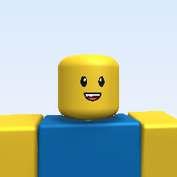

<div align="center">


# roblox-style-skill

**English** · [简体中文](README.zh-CN.md) · [繁體中文](docs/i18n/README.zh-TW.md) · [日本語](docs/i18n/README.ja.md) · [한국어](docs/i18n/README.ko.md) · [Español](docs/i18n/README.es.md) · [Français](docs/i18n/README.fr.md) · [Deutsch](docs/i18n/README.de.md) · [Português](docs/i18n/README.pt-BR.md) · [Русский](docs/i18n/README.ru.md)

Generate Roblox-style R6 and blocky avatar short videos with locked stud proportions, 9:16 storyboards, and model-specific prompts.

</div>

Video generators often turn a generic "Roblox character" prompt into a figure with five human fingers, Lego C-hook hands and top head studs, sharp Minecraft voxels, or separated legs in sneakers. `roblox-style-skill` locks standard Roblox Studio geometry before you animate: a `2x2x1` rectangular torso, two flush `1x2x1` leg blocks matching the torso width, solid `1x2x1` block hands without fingers or claws, a `1:1` barrel-beveled head with a flat 2D face decal, `SmoothPlastic` limbs on a `Studs` baseplate, and overhead `BillboardGui` chat bubbles.


## Visual Preview & 6 Short-Video Examples

| 3-View R6 Turnaround Anchor (`0° / 45° / 90°`) | Anti-Drift Geometry Check (`FAIL` vs. `PASS`) |
| :---: | :---: |
|  |  |

Six 9:16 vertical short-video packages covering all 6 templates and all 6 target video engines:

| 01 · Monday Alarm (`Kling`) | 02 · Sky Obby (`Hailuo`) | 03 · Y2K vs. Noob (`Seedance`) |
| :---: | :---: | :---: |
|  |  |  |
| [Sheet](examples/monday-alarm-meltdown/assets/storyboard_contact_sheet.en.png) · [MP4](examples/monday-alarm-meltdown/assets/monday_alarm_meltdown.mp4) · [Pack](examples/monday-alarm-meltdown/) | [Sheet](examples/obby-sky-run/assets/obby_storyboard_sheet.en.png) · [MP4](examples/obby-sky-run/assets/obby_sky_run.mp4) · [Pack](examples/obby-sky-run/) | [Sheet](examples/duo-bestie-contrast/assets/duo_storyboard_sheet.en.png) · [MP4](examples/duo-bestie-contrast/assets/duo_bestie_contrast.mp4) · [Pack](examples/duo-bestie-contrast/) |
| **04 · Cozy Cafe Tycoon (`Wan`)** | **05 · Runway Outfit Drop (`Sora`)** | **06 · Burnt Pizza (`Runway`)** |
|  |  |  |
| [Sheet](examples/cozy-cafe-tycoon/assets/cafe_storyboard_sheet.en.png) · [MP4](examples/cozy-cafe-tycoon/assets/cozy_cafe_tycoon.mp4) · [Pack](examples/cozy-cafe-tycoon/) | [Sheet](examples/runway-outfit-drop/assets/runway_storyboard_sheet.en.png) · [MP4](examples/runway-outfit-drop/assets/runway_outfit_drop.mp4) · [Pack](examples/runway-outfit-drop/) | [Sheet](examples/burnt-pizza-slapstick/assets/pizza_storyboard_sheet.en.png) · [MP4](examples/burnt-pizza-slapstick/assets/burnt_pizza_slapstick.mp4) · [Pack](examples/burnt-pizza-slapstick/) |

## Classic Roblox Asset Library

Pre-rendered in [`assets/library/`](assets/library/catalog.json) and documented in [`references/classic-roblox-catalog.md`](references/classic-roblox-catalog.md) ([full avatar sheet](assets/showcase/classic_avatars_lineup.en.png) · [full face sheet](assets/showcase/classic_faces_atlas.en.png)):

| Classic Noob | Classic Guest | Bacon Hair | Builderman | Speedrunner | Story Hoodie |
| :---: | :---: | :---: | :---: | :---: | :---: |
|  |  |  |  |  |  |

| `Smile :)` | `Chill -_-` | `Check It` | `Grin :D` | `Shocked` | `Tears` | `Bloxxer` | `KO X_X` |
| :---: | :---: | :---: | :---: | :---: | :---: | :---: | :---: |
|  |  |  |  |  |  |  |  |

## Quick Start

Install the skill in your local Skills directory (compatible with Claude Code, Codex, Cursor, and GitHub Copilot):

```bash
git clone https://github.com/yuzhang-zhong/roblox-style-skill.git ~/.codex/skills/roblox-style-skill
```

Trigger `$roblox-style-skill` in your agent:

```text
Use $roblox-style-skill to plan a 15-second 9:16 short about two friends shopping:
a Y2K streetwear avatar and a yellow Classic Noob. Give me the character cards,
3-view turnaround prompts, and a 4-shot Kling I2V storyboard.
```

## CLI Tools

All scripts require Node.js 18+ and use only the standard library:

| Script | Purpose |
| --- | --- |
| [`scripts/avatar_spec.mjs`](scripts/avatar_spec.mjs) | Build a Character DNA card (`BrickColor` palette, `2x2x1`/`1x2x1` locks) and 3-view turnaround prompt |
| [`scripts/shot_compiler.mjs`](scripts/shot_compiler.mjs) | Compile 9:16 storyboards and I2V/T2V prompts for `kling`, `seedance`, `hailuo`, `wan`, `sora`, and `runway` |
| [`scripts/drift_check.mjs`](scripts/drift_check.mjs) | Lint prompts for human fingers, Lego claws/studs, voxels, and multi-verb overload; output a fixed prompt |
| [`scripts/render_preview.mjs`](scripts/render_preview.mjs) | Render local 3D turnaround sheets, comparison boards, contact sheets, and `.gif` / `.mp4` previews |

```bash
node scripts/avatar_spec.mjs --archetype corporate-worker --rig chibi-blocky --material smooth-plastic --name "Momo" --lang en
node scripts/shot_compiler.mjs --template daily-meltdown --duration 15 --engine kling --rig chibi-blocky --lang en
node scripts/drift_check.mjs --prompt "A cute Roblox girl with C-shaped claw hands drinks coffee with five fingers" --engine kling --mode t2v --lang en
```

## Documentation & Supported Languages

Agent responses and CLI `--lang` output support 10 languages: `en`, `zh`, `zh-tw`, `ja`, `ko`, `es`, `fr`, `de`, `pt`, and `ru`. Keep each 4 to 5 second clip to one primary action, and generate a 3-view turnaround sheet before multi-shot I2V. Independent open-source project, unaffiliated with Roblox Corporation.

- [Core Skill Workflow (`SKILL.md`)](SKILL.md)
- [Avatar Geometry, Face Decals & Materials (`references/avatar-geometry-and-materials.md`)](references/avatar-geometry-and-materials.md)
- [Model Prompt Playbook (`references/model-prompt-playbook.md`)](references/model-prompt-playbook.md)
- [Drift Diagnosis & Prompt Patches (`references/rescue-and-anti-drift.md`)](references/rescue-and-anti-drift.md)
- [9:16 Pacing, Lighting & Audio Cues (`references/short-video-beats-and-audio.md`)](references/short-video-beats-and-audio.md)
- [Six Short-Video Story Templates (`references/viral-archetypes-catalog.md`)](references/viral-archetypes-catalog.md)


