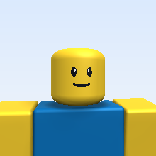

# roblox-style-video

[English](README.md) · **简体中文** · [繁體中文](docs/i18n/README.zh-TW.md) · [日本語](docs/i18n/README.ja.md) · [한국어](docs/i18n/README.ko.md) · [Español](docs/i18n/README.es.md) · [Français](docs/i18n/README.fr.md) · [Deutsch](docs/i18n/README.de.md) · [Português](docs/i18n/README.pt-BR.md) · [Русский](docs/i18n/README.ru.md)

用于规划 9:16 Roblox 风格竖屏短视频的 Agent Skill 与 Node.js 命令行工具。直接让视频模型生成「Roblox 小人」或在提示词里写 `C-shaped claw hands`，常会出现五根真人手指、乐高 C 型钩爪与头顶凸粒、《我的世界》直角像素块，或双腿分叉穿运动鞋。`roblox-style-video` 在生成动画前先锁住标准 Roblox Studio 比例（`2×2×1` 躯干、并拢与躯干同宽的 `1×2×1` 方腿、无手指无钩爪的实心平头方手、`1:1` 圆角桶状头配平面 2D 贴图五官、`Studs` 方格底板），编译适配可灵、即梦、海螺、通义万相、Sora 和 Runway 的分镜提示词，并可在本地先渲染 3D 预览图核对比例与机位。

## 安装与开始

克隆到本地 Skills 目录（支持 Codex、Claude Code、Cursor 和 GitHub Copilot）：

```bash
git clone https://github.com/yuzhang-zhong/roblox-style-video.git ~/.codex/skills/roblox-style-video
```

在对话中调用 `$roblox-style-video`：

```text
使用 $roblox-style-video 规划一支 15 秒 9:16 竖屏短片，主题是「和搭子逛街：Y2K 潮人 vs 黄皮新手」，
先用即梦出首帧图再用可灵跑图生视频。请给出双人角色设定卡、三视图提示词和 4 镜头分镜表。
```

也可以普通克隆后直接运行脚本（需 Node.js 18+，仅用标准库，无需 `npm install` 或 API Key）：

```bash
node scripts/avatar_spec.mjs --archetype corporate-worker --rig chibi-blocky --material smooth-plastic --name "Momo" --lang zh
node scripts/shot_compiler.mjs --template daily-meltdown --duration 15 --engine kling --rig chibi-blocky --lang zh
node scripts/drift_check.mjs --prompt "A cute Roblox girl with C-shaped claw hands drinks coffee with five fingers" --engine kling --mode t2v --lang zh
```

## 示例与本地 3D 预览

仓库内的 `.png`、`.gif` 和 `.mp4` 均由内置脚本 `scripts/render_preview.mjs` 在本地离线渲染，用来在调用外部付费视频模型前检查 R6 比例、镜头构图和头顶 `BillboardGui` 聊天气泡；最终扩散视频需在对应视频生成平台渲染。

| 角色三视图设定卡 (`0° / 45° / 90°`) | 几何防跑偏对比 (`× 跑偏` vs. `✓ 标准 R6`) |
| :---: | :---: |
|  |  |

6 套 15 秒（`9:16`，4 镜头）短片样例包，覆盖内置的 6 种剧场模板与 6 款视频模型：

| 01 · 早八闹钟破防 (`Kling`) | 02 · 天空跑酷闯关 (`Hailuo`) | 03 · 潮人搭子与新手 (`Seedance`) |
| :---: | :---: | :---: |
|  |  |  |
| [分镜图](examples/monday-alarm-meltdown/assets/storyboard_contact_sheet.zh.png) · [MP4](examples/monday-alarm-meltdown/assets/monday_alarm_meltdown.mp4) · [文件](examples/monday-alarm-meltdown/) | [分镜图](examples/obby-sky-run/assets/obby_storyboard_sheet.zh.png) · [MP4](examples/obby-sky-run/assets/obby_sky_run.mp4) · [文件](examples/obby-sky-run/) | [分镜图](examples/duo-bestie-contrast/assets/duo_storyboard_sheet.zh.png) · [MP4](examples/duo-bestie-contrast/assets/duo_bestie_contrast.mp4) · [文件](examples/duo-bestie-contrast/) |
| **04 · 微缩甜品小店 (`Wan`)** | **05 · 走秀卡点换装 (`Sora`)** | **06 · 焦黑披萨翻车 (`Runway`)** |
|  |  |  |
| [分镜图](examples/cozy-cafe-tycoon/assets/cafe_storyboard_sheet.zh.png) · [MP4](examples/cozy-cafe-tycoon/assets/cozy_cafe_tycoon.mp4) · [文件](examples/cozy-cafe-tycoon/) | [分镜图](examples/runway-outfit-drop/assets/runway_storyboard_sheet.zh.png) · [MP4](examples/runway-outfit-drop/assets/runway_outfit_drop.mp4) · [文件](examples/runway-outfit-drop/) | [分镜图](examples/burnt-pizza-slapstick/assets/pizza_storyboard_sheet.zh.png) · [MP4](examples/burnt-pizza-slapstick/assets/burnt_pizza_slapstick.mp4) · [文件](examples/burnt-pizza-slapstick/) |

## 经典形象、服饰与表情素材库

预渲染文件与提示词索引位于 [`assets/library/catalog.json`](assets/library/catalog.json) 和 [`references/classic-roblox-catalog.md`](references/classic-roblox-catalog.md)（[角色全览图](assets/showcase/classic_avatars_lineup.zh.png) · [表情全览图](assets/showcase/classic_faces_atlas.zh.png)）：

| 经典新手 Noob (2006) | 经典游客 Guest (2008) | 培根头 Bacon Hair (2014) |
| :---: | :---: | :---: |
|  |  |  |
| **建造者安全帽 Builderman** | **跑酷手 + 加速弹簧** | **抽绳卫衣故事主角** |
|  |  |  |

| 默认笑脸 `Smile :)` | 死鱼眼 `Chill -_-` | 挑眉 `Check It` | 露齿笑 `Grin :D` |
| :---: | :---: | :---: | :---: |
|  |  |  |  |
| **震惊 `Shocked O_O`** | **瀑布流泪 `Tears`** | **愤怒皱眉 `Bloxxer`** | **眩晕 `KO X_X`** |
|  |  |  |  |

## 命令行脚本、限制与参考文档

- [`scripts/avatar_spec.mjs`](scripts/avatar_spec.mjs)：输出角色 DNA 设定卡（`BrickColor` 色号、`2×2×1` / `1×2×1` 比例锁）与三视图提示词。
- [`scripts/shot_compiler.mjs`](scripts/shot_compiler.mjs)：按模板、时长和目标模型（`kling`、`seedance`、`hailuo`、`wan`、`sora`、`runway`）编译 9:16 分镜与 I2V/T2V 提示词。
- [`scripts/drift_check.mjs`](scripts/drift_check.mjs)：检查草稿提示词里的真人五指、乐高钩爪/头顶凸粒、体素方块头和单镜多动作超载，并输出修正版。
- [`scripts/render_preview.mjs`](scripts/render_preview.mjs)：在本地渲染 3D 三视图、对比图、双语分镜联系表与 `.gif` / `.mp4` 预览短片（Windows 图版合成调用系统 `System.Drawing` 与 `ffmpeg`）。

单个 4 至 5 秒生成片段建议只保留 1 个核心动作；多镜头短片请先用三视图固定首帧再跑图生视频（I2V），避免切镜换装。Agent 回复与命令行 `--lang` 参数支持 10 种语言（`en`、`zh`、`zh-tw`、`ja`、`ko`、`es`、`fr`、`de`、`pt`、`ru`）。独立开源项目，采用 [MIT 许可证](LICENSE)，与 Roblox Corporation 无隶属或背书关系。

- [`SKILL.md`](SKILL.md)：完整工作流与八项 Roblox 几何约束
- [`references/avatar-geometry-and-materials.md`](references/avatar-geometry-and-materials.md)：R6/R15/Plushie 比例、`BrickColor` 色板与 `SmoothPlastic` / `Studs` 材质
- [`references/classic-roblox-catalog.md`](references/classic-roblox-catalog.md)：经典角色、2D 表情贴图与经典道具提示词索引
- [`references/model-prompt-playbook.md`](references/model-prompt-playbook.md)：六款视频模型的提示词结构与运镜指令
- [`references/rescue-and-anti-drift.md`](references/rescue-and-anti-drift.md)：八类常见跑偏症状诊断与修补对照
- [`references/short-video-beats-and-audio.md`](references/short-video-beats-and-audio.md) · [`references/viral-archetypes-catalog.md`](references/viral-archetypes-catalog.md)：9:16 竖屏节奏、音效卡点与六套分镜模板
