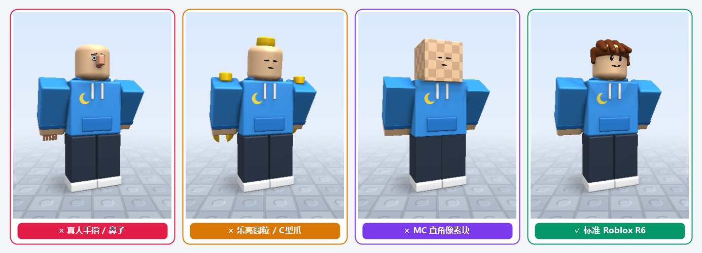

<div align="center">


# roblox-style-skill

[English](README.md) · **简体中文** · [繁體中文](docs/i18n/README.zh-TW.md) · [日本語](docs/i18n/README.ja.md) · [한국어](docs/i18n/README.ko.md) · [Español](docs/i18n/README.es.md) · [Français](docs/i18n/README.fr.md) · [Deutsch](docs/i18n/README.de.md) · [Português](docs/i18n/README.pt-BR.md) · [Русский](docs/i18n/README.ru.md)

生成标准 Roblox R6 与盲盒方块比例的 9:16 竖屏短视频分镜、角色三视图设定与多模型提示词。

</div>

直接让视频模型生成「可爱的 Roblox 小人」，或者在提示词里写 `C-shaped claw hands`，画面经常出现四种跑偏：长出五根真人手指、变成带 C 型钩爪与头顶圆凸粒的乐高小人、退化成《我的世界》直角像素块，或者双腿分开穿上真人运动鞋。`roblox-style-skill` 在动效前先把 Roblox Studio 的几何特征锁死：`2×2×1` 宽扁躯干、并拢且与躯干同宽的 `1×2×1` 实心方腿、无手指无钩爪的 `1×2×1` 平头方手、`1:1` 上下圆角桶状头、脚下 `Studs` 方格底板与头顶 `BillboardGui` 聊天气泡。


## 效果预览与 6 套短片案例

| 角色三视图设定卡 (`0° / 45° / 90°`) | 防串味几何对比 (`× 跑偏` vs. `✓ 标准 R6`) |
| :---: | :---: |
|  |  |

仓库脚本生成的 6 套 9:16 竖屏短片案例（覆盖全部 6 种剧场模板与 6 款视频模型）：

| 01 · 早八闹钟破防 (`Kling`) | 02 · 天空跑酷闯关 (`Hailuo`) | 03 · 潮人搭子与新手 (`Seedance`) |
| :---: | :---: | :---: |
|  |  |  |
| [分镜表](examples/monday-alarm-meltdown/assets/storyboard_contact_sheet.zh.png) · [MP4](examples/monday-alarm-meltdown/assets/monday_alarm_meltdown.mp4) · [目录](examples/monday-alarm-meltdown/) | [分镜表](examples/obby-sky-run/assets/obby_storyboard_sheet.zh.png) · [MP4](examples/obby-sky-run/assets/obby_sky_run.mp4) · [目录](examples/obby-sky-run/) | [分镜表](examples/duo-bestie-contrast/assets/duo_storyboard_sheet.zh.png) · [MP4](examples/duo-bestie-contrast/assets/duo_bestie_contrast.mp4) · [目录](examples/duo-bestie-contrast/) |
| **04 · 微缩甜品小店 (`Wan`)** | **05 · 走秀卡点换装 (`Sora`)** | **06 · 焦黑披萨翻车 (`Runway`)** |
|  |  |  |
| [分镜表](examples/cozy-cafe-tycoon/assets/cafe_storyboard_sheet.zh.png) · [MP4](examples/cozy-cafe-tycoon/assets/cozy_cafe_tycoon.mp4) · [目录](examples/cozy-cafe-tycoon/) | [分镜表](examples/runway-outfit-drop/assets/runway_storyboard_sheet.zh.png) · [MP4](examples/runway-outfit-drop/assets/runway_outfit_drop.mp4) · [目录](examples/runway-outfit-drop/) | [分镜表](examples/burnt-pizza-slapstick/assets/pizza_storyboard_sheet.zh.png) · [MP4](examples/burnt-pizza-slapstick/assets/burnt_pizza_slapstick.mp4) · [目录](examples/burnt-pizza-slapstick/) |

## Roblox 经典形象、服饰与表情素材库

内置于 [`assets/library/`](assets/library/catalog.json) 与 [`references/classic-roblox-catalog.md`](references/classic-roblox-catalog.md)（[角色大图](assets/showcase/classic_avatars_lineup.zh.png) · [表情大图](assets/showcase/classic_faces_atlas.zh.png)）：

| 经典新手 Noob | 经典游客 Guest | 培根头 Bacon | 建造者安全帽 | 加速弹簧跑酷 | 抽绳卫衣主角 |
| :---: | :---: | :---: | :---: | :---: | :---: |
|  |  |  |  |  |  |

| 默认笑脸 `:)` | 死鱼眼 `-_-` | 挑眉 `Check It` | 露齿笑 `:D` | 震惊 `O_O` | 瀑布泪 `T_T` | 皱眉 `Bloxxer` | 眩晕 `X_X` |
| :---: | :---: | :---: | :---: | :---: | :---: | :---: | :---: |
|  |  |  |  |  |  |  |  |

## 快速开始

克隆到本地 Skills 目录（支持 Claude Code、Codex、Cursor 和 GitHub Copilot）：

```bash
git clone https://github.com/yuzhang-zhong/roblox-style-skill.git ~/.codex/skills/roblox-style-skill
```

在 Agent 中调用 `$roblox-style-skill`：

```text
使用 $roblox-style-skill 做一个 15 秒 9:16 竖屏短片，主题是「和闺蜜逛街：Y2K 潮人 vs 呆萌黄皮新手」，
先用即梦出首帧图再用可灵跑图生视频。请给出双人角色设定卡、三视图提示词和 4 镜头分镜表。
```

## 命令行工具

四个脚本基于 Node.js 18+ 标准库运行，零第三方依赖：

| 脚本 | 用途 |
| --- | --- |
| [`scripts/avatar_spec.mjs`](scripts/avatar_spec.mjs) | 生成角色 DNA 设定卡（`BrickColor` 色号、`2×2×1`/`1×2×1` 比例锁）与三视图提示词 |
| [`scripts/shot_compiler.mjs`](scripts/shot_compiler.mjs) | 编译 9:16 分镜表与适配 `kling`、`seedance`、`hailuo`、`wan`、`sora`、`runway` 的提示词 |
| [`scripts/drift_check.mjs`](scripts/drift_check.mjs) | 检查真人五指、乐高钩爪、头顶凸粒和单镜多动作超载问题，输出修正后的提示词 |
| [`scripts/render_preview.mjs`](scripts/render_preview.mjs) | 本地渲染 3D 角色三视图、防串味对比图、双语分镜表和 `.gif` / `.mp4` 预览短片 |

```bash
node scripts/avatar_spec.mjs --archetype corporate-worker --rig chibi-blocky --material smooth-plastic --name "Momo" --lang zh
node scripts/shot_compiler.mjs --template daily-meltdown --duration 15 --engine kling --rig chibi-blocky --lang zh
node scripts/drift_check.mjs --prompt "A cute Roblox girl with C-shaped claw hands drinks coffee with five fingers" --engine kling --mode t2v --lang zh
```

## 文档与多语言支持

Agent 回复与命令行 `--lang` 参数支持 10 种语言：`en`、`zh`、`zh-tw`、`ja`、`ko`、`es`、`fr`、`de`、`pt`、`ru`。每个 4 到 5 秒镜头只放一个核心动作，多镜头短片请先生成三视图固定首帧。独立开源项目，与 Roblox Corporation 无关。

- [Skill 工作流说明 (`SKILL.md`)](SKILL.md)
- [方块比例、贴图五官与材质规范 (`references/avatar-geometry-and-materials.md`)](references/avatar-geometry-and-materials.md)
- [多模型提示词写法 (`references/model-prompt-playbook.md`)](references/model-prompt-playbook.md)
- [常见跑偏问题与修补清单 (`references/rescue-and-anti-drift.md`)](references/rescue-and-anti-drift.md)
- [9:16 竖屏节奏、布光与音效卡点 (`references/short-video-beats-and-audio.md`)](references/short-video-beats-and-audio.md)
- [六套竖屏短片分镜模板 (`references/viral-archetypes-catalog.md`)](references/viral-archetypes-catalog.md)
