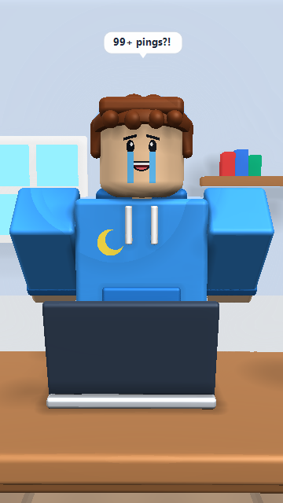
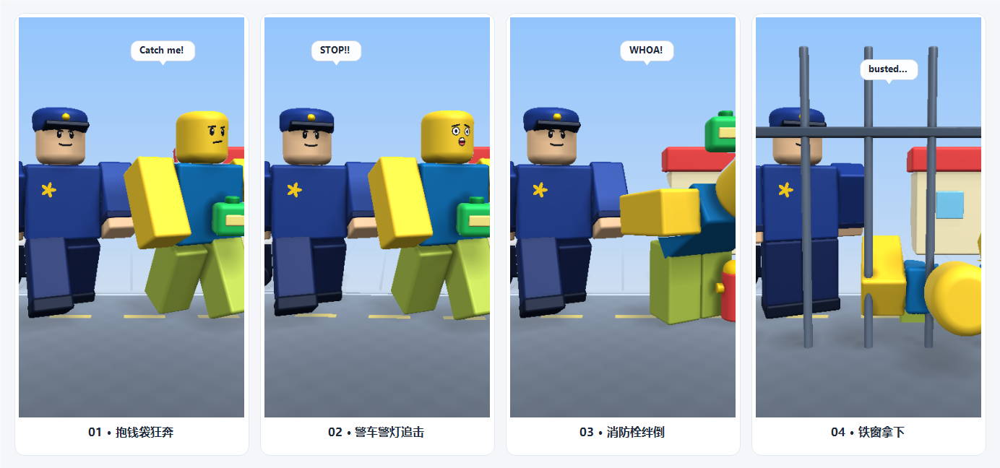
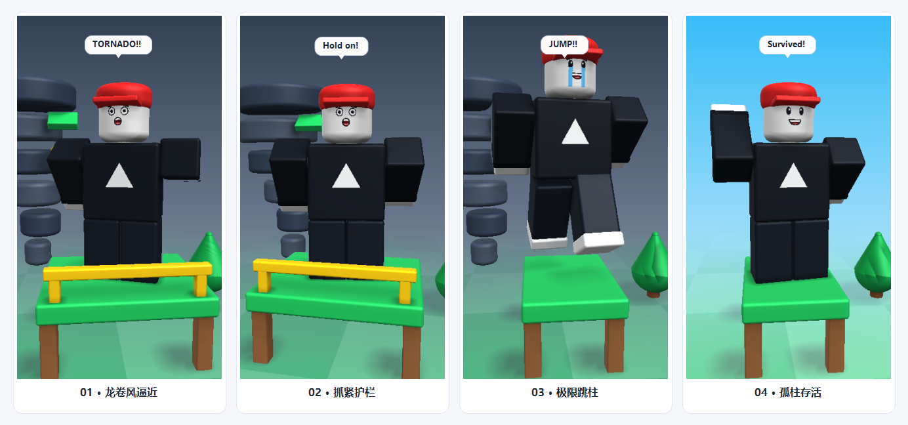

<div align="center">

# Roblox Style Video Skill

一套面向 Claude Code、Cursor、GitHub Copilot 与 Codex 的 **Agent Skill**（`SKILL.md` + 领域词库 + 零依赖命令行脚本）：锁住 R6 方块比例，拆解 9:16 竖屏四镜分镜，逐镜编译视频生成提示词，并在本地离线预演动态成片。

[](SKILL.md)
[](#skill-工作流与安装使用)
[](LICENSE)

**[短片示例](#短片示例)** · [分镜与场景图](#分镜拆解与多题材场景表) · [Skill 工作流与安装](#skill-工作流与安装使用) · [Skill 指南](SKILL.md)

[English](README.md) · **简体中文** · [繁體中文](docs/i18n/README.zh-TW.md) · [日本語](docs/i18n/README.ja.md) · [한국어](docs/i18n/README.ko.md) · [Español](docs/i18n/README.es.md) · [Français](docs/i18n/README.fr.md) · [Deutsch](docs/i18n/README.de.md) · [Português](docs/i18n/README.pt-BR.md) · [Русский](docs/i18n/README.ru.md)

</div>

<a name="示例与本地-3d-预览"></a>

## 短片示例

作为可挂载的 Agent Skill，本项目在对话中可直接将创意拆解为 15 秒、4 镜头（`9:16` 竖屏）的完整短片包，内置 12 套高频短剧模板。下方的 **4 秒 MP4** 与动图均由本 Skill 自带的 `scripts/render_preview.mjs` 在本地离线渲染，用来在调用外部付费视频模型前验证 R6 比例、多部件场景道具、运镜切换和头顶 `BillboardGui` 聊天气泡。

<p align="center">
  <a href="examples/monday-alarm-meltdown/assets/monday_alarm_meltdown.mp4"></a>
  <a href="examples/obby-sky-run/assets/obby_sky_run.mp4"></a>
  <a href="examples/duo-bestie-contrast/assets/duo_bestie_contrast.mp4"></a>
  <a href="examples/cozy-cafe-tycoon/assets/cozy_cafe_tycoon.mp4"></a>
  <a href="examples/runway-outfit-drop/assets/runway_outfit_drop.mp4"></a>
  <a href="examples/burnt-pizza-slapstick/assets/burnt_pizza_slapstick.mp4"></a>
  <br />
  <a href="examples/disaster-tower-tornado/assets/disaster_tower_tornado.mp4"></a>
  <a href="examples/brookhaven-police-chase/assets/brookhaven_police_chase.mp4"></a>
  <a href="examples/doors-flashlight-hallway/assets/doors_flashlight_hallway.mp4"></a>
  <a href="examples/crossroads-sword-duel/assets/crossroads_sword_duel.mp4"></a>
  <a href="examples/classroom-exam-panic/assets/classroom_exam_panic.mp4"></a>
  <a href="examples/red-light-freeze/assets/red_light_freeze.mp4"></a>
</p>

## 分镜拆解与多题材场景表

视频生成模型在单个 4 至 5 秒片段里如果塞入三四个连续动作，很容易出现关节软化或穿模。每支 15 秒短片固定拆成四个单动作片段（`0–3.5s` 开场钩子、两镜动作推进、`11.5–15s` 反转或循环收尾）：

| 镜头 01 · 开场钩子 (`0–3.5s`) | 镜头 02 · 动作推进 (`3.5–7.5s`) | 镜头 03 · 情绪升级 (`7.5–11.5s`) | 镜头 04 · 循环收尾 (`11.5–15s`) |
| :---: | :---: | :---: | :---: |
|  |  |  |  |

六种常见 Roblox 游戏与短剧题材的四格分镜联系表：

| 02 · 天空跑酷闯关 (`海螺` · 加速弹簧与红砖急停) | 08 · 小镇警匪追逐 (`海螺` · 警灯追击与消防栓平地摔) |
| :---: | :---: |
| <a href="examples/obby-sky-run/"></a> | <a href="examples/brookhaven-police-chase/"></a> |
| **07 · 自然灾害高塔龙卷风 (`可灵` · 护栏掀飞与孤柱存活)** | **09 · 惊悚酒店闪灯走廊 (`Sora` · 手电筒扫光与躲柜)** |
| <a href="examples/disaster-tower-tornado/"></a> | <a href="examples/doors-flashlight-hallway/"></a> |
| **10 · 十字路口长剑对决 (`即梦` · 岩浆石桥拼刀与可乐言和)** | **12 · 木头人极限急停 (`Runway` · 红绿灯单腿定格)** |
| <a href="examples/crossroads-sword-duel/"></a> | <a href="examples/red-light-freeze/"></a> |

## Skill 工作流与安装使用

<p align="center">
  
</p>

### 作为 Agent Skill 安装调用

将本仓库克隆到宿主工具的 Skills 目录后，AI 编程助手会自动按需读取 [`SKILL.md`](SKILL.md) 与 [`references/`](references/) 参考手册并调用本地脚本。下方路径用于 Codex；GitHub Copilot 使用 `~/.copilot/skills/roblox-style-video`，Claude Code 与 Cursor 放入各自配置的 Skills 目录即可。

```bash
git clone https://github.com/yuzhang-zhong/roblox-style-video.git ~/.codex/skills/roblox-style-video
```

在 Agent 对话中直接调用 `roblox-style-video` Skill：

```text
使用 $roblox-style-video 规划一支 15 秒 9:16 竖屏短片，场景用惊悚酒店走廊（doors-horror）：
穿蓝卫衣的 R6 小人举着手电筒走过 050 号木门时壁灯突然闪烁，身后出现白眼，最后躲进木衣柜。
请给出角色比例锁、4 镜头分镜表和可灵 / Sora 图生视频提示词。
```

### 直接运行 Skill 内置命令行脚本

Skill 内附的四支脚本也可在普通克隆的仓库根目录独立运行，基于 Node.js 18+ 标准库，无需 `npm install` 或 API Key。

```bash
node scripts/shot_compiler.mjs --template brookhaven-chase --duration 15 --engine hailuo --rig r6 --lang zh
node scripts/drift_check.mjs --prompt "A cute Roblox girl with C-shaped claw hands drinks coffee with five fingers" --engine kling --mode t2v --lang zh
node scripts/render_preview.mjs --only tornado,chase,doors
```

## Skill 脚本、防跑偏检查与参考文档

直接写「Roblox 小人」常会长出真人五指、乐高 C 型钩爪、地面/头顶乐高圆粒凸起，或退化成直角体素方头。本 Skill 锁住标准 R6 方块比例（`2×2×1` 躯干、并拢同宽 `1×2×1` 方腿、实心平头方手、`1:1` 圆角桶状头）以及平整无凸粒的木板/地砖/柏油材质与多部件场景道具。`drift_check.mjs` 会在生成前拦截这些跑偏项：

<p align="center">
  
</p>

| Skill 组件 | 输出 |
| --- | --- |
| [`SKILL.md`](SKILL.md) | Agent Skill 主入口说明，定义 6 种工作模式（角色设定、分镜、提示词编译、翻车修复、二创、3D 预演）与 8 项几何防变形约束。 |
| [`shot_compiler.mjs`](scripts/shot_compiler.mjs) | 内置 12 套短片模板，编译适配可灵、即梦、海螺、通义万相、Sora 和 Runway 的 9:16 分镜与 I2V/T2V 提示词。 |
| [`avatar_spec.mjs`](scripts/avatar_spec.mjs) | 角色设定卡、`BrickColor` 色号、方块比例锁与首帧[三视图参考卡](assets/showcase/momo_turnaround_sheet.zh.png)提示词。 |
| [`drift_check.mjs`](scripts/drift_check.mjs) | 检查真人手指、乐高圆粒/钩爪、品牌水印与单镜多动作超载，输出修补后的提示词。 |
| [`render_preview.mjs`](scripts/render_preview.mjs) | 本地渲染分镜联系表、对比图、GIF 和 MP4 预览（Windows 合成使用 PowerShell `System.Drawing` 与 `ffmpeg`）。 |

[角色比例与材质](references/avatar-geometry-and-materials.md) · [经典道具词库](references/classic-roblox-catalog.md) · [各模型提示词](references/model-prompt-playbook.md) · [跑偏修复](references/rescue-and-anti-drift.md) · [镜头节奏与音效](references/short-video-beats-and-audio.md) · [12 套分镜模板](references/viral-archetypes-catalog.md)

## 语言

Agent Skill 回复与命令行 `--lang` 支持 `en`、`zh`、`zh-tw`、`ja`、`ko`、`es`、`fr`、`de`、`pt`、`ru`。

[English](README.md) · **简体中文** · [繁體中文](docs/i18n/README.zh-TW.md) · [日本語](docs/i18n/README.ja.md) · [한국어](docs/i18n/README.ko.md) · [Español](docs/i18n/README.es.md) · [Français](docs/i18n/README.fr.md) · [Deutsch](docs/i18n/README.de.md) · [Português](docs/i18n/README.pt-BR.md) · [Русский](docs/i18n/README.ru.md)

[MIT 许可证](LICENSE)。独立开源 Agent Skill 项目，内置原创几何三角形徽章，不使用官方商标，与 Roblox Corporation 无隶属或背书关系。
