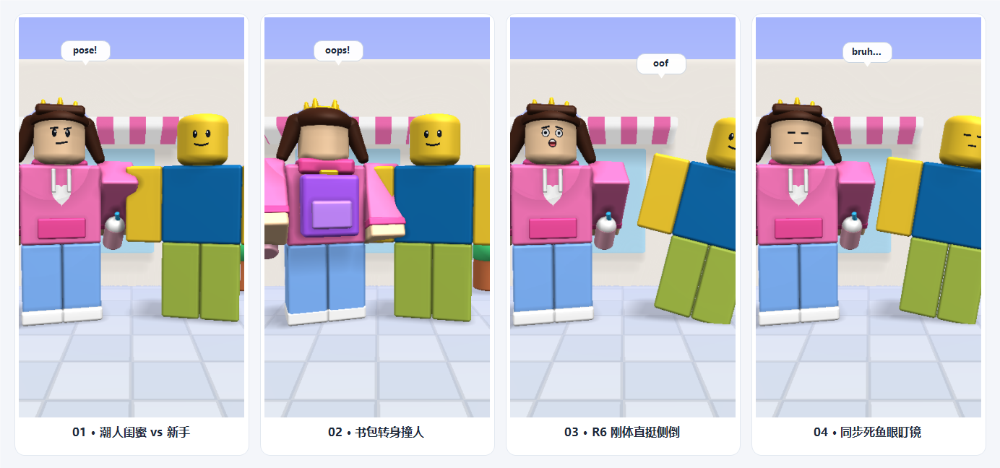

<div align="center">


# Roblox Style Video

做一支 9:16 竖屏短片：固定方块角色的比例，逐镜写提示词，先在本地看一遍分镜。

[](#安装与开始)
[](LICENSE)

**[看短片](#短片示例)** · [安装与开始](#安装与开始) · [Skill 指南](SKILL.md)

[English](README.md) · **简体中文** · [更多语言](#语言)

</div>

[](examples/duo-bestie-contrast/)

<a name="示例与本地-3d-预览"></a>

## 短片示例

每份分镜按 15 秒、4 镜头规划。**4 秒 MP4** 和 GIF 都是本地 3D 预览，用来检查角色比例、构图和头顶的 `BillboardGui` 聊天气泡。表里的模型名指提示词适配的模型，成片需要在外部视频模型生成。

<p align="center">
  <a href="examples/monday-alarm-meltdown/assets/monday_alarm_meltdown.mp4"></a>
  <a href="examples/obby-sky-run/assets/obby_sky_run.mp4"></a>
  <a href="examples/runway-outfit-drop/assets/runway_outfit_drop.mp4"></a>
</p>
<p align="center">点动图打开对应的 MP4。</p>

| 短片与提示词适配 | 可以看什么 |
| --- | --- |
| [早八闹钟破防](examples/monday-alarm-meltdown/) · 可灵<br>[MP4](examples/monday-alarm-meltdown/assets/monday_alarm_meltdown.mp4) · [分镜图](examples/monday-alarm-meltdown/assets/storyboard_contact_sheet.zh.png) | Momo 拍扁闹钟，最后一镜回到开场的桌面构图。 |
| [天空跑酷闯关](examples/obby-sky-run/) · 海螺<br>[MP4](examples/obby-sky-run/assets/obby_sky_run.mp4) · [分镜图](examples/obby-sky-run/assets/obby_storyboard_sheet.zh.png) | 跳过浮空平台，比较起跳和落到存档点时的机位。 |
| [潮人搭子与新手](examples/duo-bestie-contrast/) · 即梦<br>[MP4](examples/duo-bestie-contrast/assets/duo_bestie_contrast.mp4) · [分镜图](examples/duo-bestie-contrast/assets/duo_storyboard_sheet.zh.png) | 潮人转身时撞上黄皮新手，看两个角色在同一镜头里的反差。 |
| [微缩甜品小店](examples/cozy-cafe-tycoon/) · 通义万相<br>[MP4](examples/cozy-cafe-tycoon/assets/cozy_cafe_tycoon.mp4) · [分镜图](examples/cozy-cafe-tycoon/assets/cafe_storyboard_sheet.zh.png) | 从可颂摆盘的特写切到拿铁沿吧台滑过去。 |
| [走秀卡点换装](examples/runway-outfit-drop/) · Sora<br>[MP4](examples/runway-outfit-drop/assets/runway_outfit_drop.mp4) · [分镜图](examples/runway-outfit-drop/assets/runway_storyboard_sheet.zh.png) | 落地踩中重音，灰色基础款换成亮粉色外套。 |
| [烤焦披萨翻车](examples/burnt-pizza-slapstick/) · Runway<br>[MP4](examples/burnt-pizza-slapstick/assets/burnt_pizza_slapstick.mp4) · [分镜图](examples/burnt-pizza-slapstick/assets/pizza_storyboard_sheet.zh.png) | 端出焦黑披萨，最后角色不弯关节、直挺挺地侧倒。 |

## 安装与开始

### 作为 Agent Skill 使用

克隆到宿主的 Skills 目录。下方路径用于 Codex；GitHub Copilot 用 `~/.copilot/skills/roblox-style-video`。Claude Code 和 Cursor 用各自配置的 Skills 目录。

```bash
git clone https://github.com/yuzhang-zhong/roblox-style-video.git ~/.codex/skills/roblox-style-video
```

在对话里调用 `roblox-style-video`。以 Codex 为例：

```text
使用 $roblox-style-video 规划一支 15 秒 9:16 竖屏短片，主题是「和搭子逛街：Y2K 潮人 vs 黄皮新手」，
先用即梦出首帧图再用可灵跑图生视频。请给出双人角色设定卡、三视图提示词和 4 镜头分镜表。
```

### 直接使用命令行

在普通克隆的仓库根目录运行。以下三个命令只用 Node.js 18+ 的标准库，无需 `npm install` 或 API Key。

```bash
node scripts/avatar_spec.mjs --archetype corporate-worker --rig chibi-blocky --material smooth-plastic --name "Momo" --lang zh
node scripts/shot_compiler.mjs --template daily-meltdown --duration 15 --engine kling --rig chibi-blocky --lang zh
node scripts/drift_check.mjs --prompt "A cute Roblox girl with C-shaped claw hands drinks coffee with five fingers" --engine kling --mode t2v --lang zh
```

依次得到角色设定卡和三视图提示词、四镜头分镜，以及一份修正了钩爪与真人手指描述的提示词。

## 命令行脚本、限制与参考文档

先锁 R6 比例：`2×2×1` 躯干、并拢同宽的 `1×2×1` 方腿、实心方手、`1:1` 圆角桶状头和平面五官。凸粒放在场景底板，不放在角色头顶。多镜头图生视频（I2V）从[角色三视图](assets/showcase/momo_turnaround_sheet.zh.png)开始，每个 4 至 5 秒片段只留一个主要动作。[几何对比图](assets/showcase/drift_rescue_comparison.zh.png)列出了真人手指、C 型钩爪和体素方头等跑偏情况。

| 脚本 | 输出 |
| --- | --- |
| [`avatar_spec.mjs`](scripts/avatar_spec.mjs) | 角色设定卡、`BrickColor` 色号、方块比例和三视图提示词。 |
| [`shot_compiler.mjs`](scripts/shot_compiler.mjs) | 9:16 分镜，适配可灵、即梦、海螺、通义万相、Sora 和 Runway 的 I2V/T2V 提示词。 |
| [`drift_check.mjs`](scripts/drift_check.mjs) | 检查角色造型跑偏或单镜动作过多，输出修正版提示词。 |
| [`render_preview.mjs`](scripts/render_preview.mjs) | 本地三视图、对比图、分镜图、GIF 和 MP4。Windows 合成使用 PowerShell `System.Drawing` 和 `ffmpeg`。 |

[角色比例与材质](references/avatar-geometry-and-materials.md) · [各模型提示词](references/model-prompt-playbook.md) · [跑偏修复](references/rescue-and-anti-drift.md) · [镜头节奏与音效](references/short-video-beats-and-audio.md) · [分镜模板](references/viral-archetypes-catalog.md)

## 语言

Agent 回复与命令行 `--lang` 支持 `en`、`zh`、`zh-tw`、`ja`、`ko`、`es`、`fr`、`de`、`pt`、`ru`。

[English](README.md) · **简体中文** · [繁體中文](docs/i18n/README.zh-TW.md) · [日本語](docs/i18n/README.ja.md) · [한국어](docs/i18n/README.ko.md) · [Español](docs/i18n/README.es.md) · [Français](docs/i18n/README.fr.md) · [Deutsch](docs/i18n/README.de.md) · [Português](docs/i18n/README.pt-BR.md) · [Русский](docs/i18n/README.ru.md)

[MIT 许可证](LICENSE)。独立项目，与 Roblox Corporation 无隶属或背书关系。
