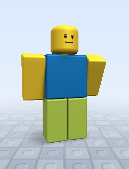

<div align="center">


# roblox-style-skill

[English](../../README.md) · [简体中文](../../README.zh-CN.md) · [繁體中文](README.zh-TW.md) · [日本語](README.ja.md) · [한국어](README.ko.md) · [Español](README.es.md) · [Français](README.fr.md) · **Deutsch** · [Português](README.pt-BR.md) · [Русский](README.ru.md)

Erstelle 9:16-Kurzvideos mit Roblox-R6- und Blocky-Avataren durch feste Stud-Proportionen, Storyboards und modellspezifische Prompts.

</div>

Ein allgemeiner Prompt wie „niedlicher Roblox-Charakter trinkt Kaffee" oder der Zusatz `C-shaped claw hands` führt bei Videomodellen oft zu vier Fehlern: fünf menschlichen Fingern, Lego-Greifhänden mit Kopf-Noppe, scharfkantigen Minecraft-Voxeln oder getrennten Beinen mit Turnschuhen. `roblox-style-skill` legt vor der Animation die Roblox-Studio-Geometrie fest: `2x2x1`-Torso, zwei bündig anliegende `1x2x1`-Beinblöcke in Torsobreite, massive `1x2x1`-Blockhände ohne Finger oder Klauen, abgerundeter `1:1`-Zylinderkopf mit flachem 2D-Gesichtsdecal, `SmoothPlastic`-Oberflächen auf einer `Studs`-Grundplatte und `BillboardGui`-Sprechblasen.


## Visuelle Vorschau & 6 Kurzvideo-Beispiele

| 3-Ansichten-R6-Bogen (`0° / 45° / 90°`) | Geometrie-Prüfung (`FAIL` vs. `PASS`) |
| :---: | :---: |
|  |  |

Sechs vertikale 9:16-Pakete für alle 6 Story-Vorlagen und 6 Video-Engines:

| 01 · Montagswecker (`Kling`) | 02 · Sky Obby (`Hailuo`) | 03 · Y2K vs. Noob (`Seedance`) |
| :---: | :---: | :---: |
|  |  |  |
| [Storyboard](../../examples/monday-alarm-meltdown/assets/storyboard_contact_sheet.en.png) · [MP4](../../examples/monday-alarm-meltdown/assets/monday_alarm_meltdown.mp4) · [Paket](../../examples/monday-alarm-meltdown/) | [Storyboard](../../examples/obby-sky-run/assets/obby_storyboard_sheet.en.png) · [MP4](../../examples/obby-sky-run/assets/obby_sky_run.mp4) · [Paket](../../examples/obby-sky-run/) | [Storyboard](../../examples/duo-bestie-contrast/assets/duo_storyboard_sheet.en.png) · [MP4](../../examples/duo-bestie-contrast/assets/duo_bestie_contrast.mp4) · [Paket](../../examples/duo-bestie-contrast/) |
| **04 · Café Tycoon (`Wan`)** | **05 · Laufsteg-Drop (`Sora`)** | **06 · Verbrannte Pizza (`Runway`)** |
|  |  |  |
| [Storyboard](../../examples/cozy-cafe-tycoon/assets/cafe_storyboard_sheet.en.png) · [MP4](../../examples/cozy-cafe-tycoon/assets/cozy_cafe_tycoon.mp4) · [Paket](../../examples/cozy-cafe-tycoon/) | [Storyboard](../../examples/runway-outfit-drop/assets/runway_storyboard_sheet.en.png) · [MP4](../../examples/runway-outfit-drop/assets/runway_outfit_drop.mp4) · [Paket](../../examples/runway-outfit-drop/) | [Storyboard](../../examples/burnt-pizza-slapstick/assets/pizza_storyboard_sheet.en.png) · [MP4](../../examples/burnt-pizza-slapstick/assets/burnt_pizza_slapstick.mp4) · [Paket](../../examples/burnt-pizza-slapstick/) |

## Klassische Roblox-Avatare, Outfits & Gesichter

Vorgerendert in [`assets/library/`](../../assets/library/catalog.json) und [`references/classic-roblox-catalog.md`](../../references/classic-roblox-catalog.md) ([Avatar-Bogen](../../assets/showcase/classic_avatars_lineup.en.png) · [Gesichter-Bogen](../../assets/showcase/classic_faces_atlas.en.png)):

| Classic Noob | Classic Guest | Bacon Hair | Builderman | Speedrunner | Story Hoodie |
| :---: | :---: | :---: | :---: | :---: | :---: |
|  |  |  |  |  |  |

| `Smile :)` | `Chill -_-` | `Check It` | `Grin :D` | `Shocked` | `Tears` | `Bloxxer` | `KO X_X` |
| :---: | :---: | :---: | :---: | :---: | :---: | :---: | :---: |
|  |  |  |  |  |  |  |  |

## Schnellstart

Klone das Repository in dein lokales Skills-Verzeichnis (kompatibel mit Claude Code, Codex, Cursor und GitHub Copilot):

```bash
git clone https://github.com/yuzhang-zhong/roblox-style-skill.git ~/.codex/skills/roblox-style-skill
```

Rufe `$roblox-style-skill` im Agenten auf:

```text
Nutze $roblox-style-skill für ein 15-sekündiges 9:16-Kurzvideo über zwei Freunde beim Shopping:
einen Y2K-Streetwear-Avatar und einen gelben Classic Noob. Erstelle Charakterkarten, 3-Ansichten-Prompts und ein 4-Shot-Storyboard für Kling I2V.
```

## CLI-Werkzeuge

Alle vier Skripte benötigen nur Node.js 18+ und die Standardbibliothek:

| Skript | Funktion |
| --- | --- |
| [`scripts/avatar_spec.mjs`](../../scripts/avatar_spec.mjs) | Erstellt eine Charakter-DNA-Karte (`BrickColor`-Palette, `2x2x1`/`1x2x1`-Sperren) und einen 3-Ansichten-Prompt |
| [`scripts/shot_compiler.mjs`](../../scripts/shot_compiler.mjs) | Kompiliert 9:16-Storyboards und I2V/T2V-Prompts für `kling`, `seedance`, `hailuo`, `wan`, `sora` und `runway` |
| [`scripts/drift_check.mjs`](../../scripts/drift_check.mjs) | Prüft Prompts auf menschliche Finger, Lego-Klauen/Noppen, Voxel und Aktionsüberladung; gibt eine Korrektur aus |
| [`scripts/render_preview.mjs`](../../scripts/render_preview.mjs) | Rendert lokal 3D-Charakterblätter, Vergleichstafeln, Storyboards sowie `.gif`- / `.mp4`-Vorschauen |

```bash
node scripts/avatar_spec.mjs --archetype corporate-worker --rig chibi-blocky --material smooth-plastic --name "Momo" --lang de
node scripts/shot_compiler.mjs --template daily-meltdown --duration 15 --engine kling --rig chibi-blocky --lang de
node scripts/drift_check.mjs --prompt "A cute Roblox girl with C-shaped claw hands drinks coffee with five fingers" --engine kling --mode t2v --lang de
```

## Dokumentation & unterstützte Sprachen

Agent-Antworten und die CLI-Option `--lang` unterstützen 10 Sprachen: `en`, `zh`, `zh-tw`, `ja`, `ko`, `es`, `fr`, `de`, `pt` und `ru`. Beschränke jeden 4- bis 5-Sekunden-Clip auf eine Hauptaktion und erstelle vor mehrteiligen I2V-Clips ein 3-Ansichten-Charakterblatt. Unabhängiges Open-Source-Projekt, nicht mit der Roblox Corporation verbunden.

- [Kern-Workflow (`SKILL.md`)](../../SKILL.md)
- [Avatargeometrie, 2D-Gesichter & Materialien (`references/avatar-geometry-and-materials.md`)](../../references/avatar-geometry-and-materials.md)
- [Modell-Prompt-Handbuch (`references/model-prompt-playbook.md`)](../../references/model-prompt-playbook.md)
- [Drift-Diagnose & Prompt-Korrekturen (`references/rescue-and-anti-drift.md`)](../../references/rescue-and-anti-drift.md)
- [9:16-Timing, Beleuchtung & Audio (`references/short-video-beats-and-audio.md`)](../../references/short-video-beats-and-audio.md)
- [Sechs Kurzvideo-Vorlagen (`references/viral-archetypes-catalog.md`)](../../references/viral-archetypes-catalog.md)
