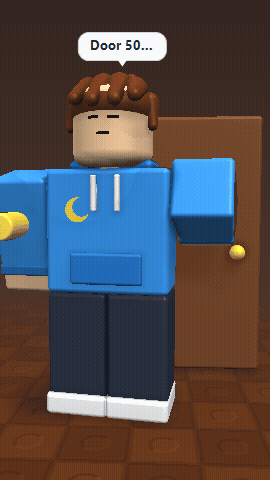

<div align="center">

# Roblox Style Video Skill

Ein **Agent Skill** (`SKILL.md` + Referenzhandbücher + abhängigkeitsfreie Offline-CLI-Tools) für Claude Code, Cursor, GitHub Copilot und Codex zum Planen vertikaler `9:16`-Shorts im Blocky-R6-Stil, Fixieren der Proportionen, Kompilieren modellspezifischer Shot-Prompts und lokalen 3D-Vorschau-Rendern.

[](../../SKILL.md)
[](#skill-workflow-und-schnellstart)
[](../../LICENSE)

**[Videobeispiele](#videobeispiele)** · [Szenenboards und Schnitt](#szenenboards-und-shot-taktung) · [Skill-Workflow & Schnellstart](#skill-workflow-und-schnellstart) · [Skill-Leitfaden](../../SKILL.md)

[English](../../README.md) · [简体中文](../../README.zh-CN.md) · [繁體中文](README.zh-TW.md) · [日本語](README.ja.md) · [한국어](README.ko.md) · [Español](README.es.md) · [Français](README.fr.md) · **Deutsch** · [Português](README.pt-BR.md) · [Русский](README.ru.md)

</div>

## Videobeispiele

Wird dieser Skill in einem KI-Coding-Agenten aufgerufen, verwandelt er eine Kurzvideo-Idee in ein 15-sekündiges vertikales Vier-Shot-Paket (`9:16`) entlang von 12 klassischen Blocky-Story-Formaten. Die **4-Sekunden-MP4s** und GIFs unten sind lokale 3D-Animatics aus `scripts/render_preview.mjs`, mit denen sich R6-Proportionen, mehrteilige Requisiten, Kamerafahrten und `BillboardGui`-Sprechblasen vor dem Einsatz kostenpflichtiger Videomodelle prüfen lassen.

<p align="center">
  <a href="../../examples/monday-alarm-meltdown/assets/monday_alarm_meltdown.mp4"></a>
  <a href="../../examples/obby-sky-run/assets/obby_sky_run.mp4"></a>
  <a href="../../examples/duo-bestie-contrast/assets/duo_bestie_contrast.mp4"></a>
  <a href="../../examples/cozy-cafe-tycoon/assets/cozy_cafe_tycoon.mp4"></a>
  <a href="../../examples/runway-outfit-drop/assets/runway_outfit_drop.mp4"></a>
  <a href="../../examples/burnt-pizza-slapstick/assets/burnt_pizza_slapstick.mp4"></a>
  <br />
  <a href="../../examples/disaster-tower-tornado/assets/disaster_tower_tornado.mp4"></a>
  <a href="../../examples/brookhaven-police-chase/assets/brookhaven_police_chase.mp4"></a>
  <a href="../../examples/doors-flashlight-hallway/assets/doors_flashlight_hallway.mp4"></a>
  <a href="../../examples/crossroads-sword-duel/assets/crossroads_sword_duel.mp4"></a>
  <a href="../../examples/classroom-exam-panic/assets/classroom_exam_panic.mp4"></a>
  <a href="../../examples/red-light-freeze/assets/red_light_freeze.mp4"></a>
</p>

## Szenenboards und Shot-Taktung

Videomodelle verbiegen starre Block-Gliedmaßen wie Gummi, sobald ein einzelner 4–5-Sekunden-Prompt drei oder vier aufeinanderfolgende Aktionen stapelt. Jeder Short teilt die Handlung deshalb in vier Einzelaktions-Beats (`0–3.5s` Hook, zwei Steigerungs-Shots und `11.5–15s` Pointe oder nahtloser Loop):

| Shot 01 · Hook (`0–3.5s`) | Shot 02 · Aktion (`3.5–7.5s`) | Shot 03 · Wendung (`7.5–11.5s`) | Shot 04 · Loop (`11.5–15s`) |
| :---: | :---: | :---: | :---: |
|  |  |  |  |

Vier-Shot-Kontaktbögen über sechs Spielgenres hinweg mit Perspektivwechseln und englischen Sprechblasen:

| 02 · Sky Obby (`Hailuo` · Speed Coil & Killbrick) | 08 · Brookhaven Police Chase (`Hailuo` · Straßenverfolgung) |
| :---: | :---: |
| <a href="../../examples/obby-sky-run/"></a> | <a href="../../examples/brookhaven-police-chase/"></a> |
| **07 · Natural Disaster Tower (`Kling` · Tornado-Überleben)** | **09 · Doors Hotel Hallway (`Sora` · Taschenlampe & Flackern)** |
| <a href="../../examples/disaster-tower-tornado/"></a> | <a href="../../examples/doors-flashlight-hallway/"></a> |
| **10 · Crossroads Sword Duel (`Seedance` · 1v1-Schwertduell)** | **12 · Red Light Freeze (`Runway` · Rotes Licht, Grünes Licht)** |
| <a href="../../examples/crossroads-sword-duel/"></a> | <a href="../../examples/red-light-freeze/"></a> |

## Skill-Workflow und Schnellstart

<p align="center">
  
</p>

### Als Agent Skill installieren

Klonen Sie dieses Repository in das Skills-Verzeichnis Ihres Agent-Hosts. Nach der Installation liest der Agent [`SKILL.md`](../../SKILL.md), lädt die Leitfäden aus [`references/`](../../references/) und führt die Node.js-Skripte automatisch aus. Dieser Pfad gilt für Codex; nutzen Sie `~/.copilot/skills/roblox-style-video` für GitHub Copilot oder den konfigurierten Skills-Ordner in Claude Code und Cursor.

```bash
git clone https://github.com/yuzhang-zhong/roblox-style-video.git ~/.codex/skills/roblox-style-video
```

Rufen Sie den Skill `roblox-style-video` im Agent-Chat auf:

```text
Nutze $roblox-style-video, um einen 15-sekündigen vertikalen 9:16-Short in einem dunklen Hotelflur (doors-horror) zu planen:
Ein R6-Avatar im blauen Hoodie leuchtet mit einer Taschenlampe auf Tür 050, als das Licht flackert, und versteckt sich im Schrank.
Gib mir den Geometrie-Lock der Figur, ein 4-Shot-Storyboard und Sora- / Kling-I2V-Prompts.
```

### CLI-Tools des Skills direkt ausführen

Alle enthaltenen Skripte laufen eigenständig im Repository-Stammverzeichnis mit Node.js 18+ und der Standardbibliothek (ohne `npm install` oder API-Schlüssel).

```bash
node scripts/shot_compiler.mjs --template brookhaven-chase --duration 15 --engine hailuo --rig r6 --lang de
node scripts/drift_check.mjs --prompt "A cute Roblox girl with C-shaped claw hands drinks coffee with five fingers" --engine kling --mode t2v --lang de
node scripts/render_preview.mjs --only tornado,chase,doors
```

## Skill-Skripte, Anti-Drift-Prüfung und Referenzen

Allgemeine Prompts erzeugen häufig menschliche Finger, Lego-C-Klauen oder runde Bodennoppen sowie Minecraft-Voxelköpfe statt präziser Blocky-R6-Geometrie (`2x2x1`-Torso, bündige `1x2x1`-Beine, fingerlose Blockhände, `1:1`-Fasskopf, glatte Böden und mehrteilige Requisiten). `drift_check.mjs` erkennt diese Fehler vor der Videoerzeugung:

<p align="center">
  
</p>

| Skill-Komponente | Ausgabe |
| --- | --- |
| [`SKILL.md`](../../SKILL.md) | Haupteinstieg des Agent Skills mit 6 Produktionsmodi (`Avatar`, `Storyboard`, `Prompt-Compile`, `Rescue`, `Remix`, `Render`) und 8 Geometrie-Invarianten. |
| [`shot_compiler.mjs`](../../scripts/shot_compiler.mjs) | `9:16`-Beat-Sheet und I2V/T2V-Prompts über 12 Vorlagen für Kling, Seedance, Hailuo, Wan, Sora und Runway. |
| [`avatar_spec.mjs`](../../scripts/avatar_spec.mjs) | Charakter-DNA-Karte mit `BrickColor`-Codes, Proportions-Lock und Prompt für einen [Drei-Seiten-Turnaround-Bogen](../../assets/showcase/momo_turnaround_sheet.en.png). |
| [`drift_check.mjs`](../../scripts/drift_check.mjs) | Diagnosebericht und korrigierter Prompt bei Fingerwuchs, Lego-Klauen/-Noppen, Markenlogos oder zu vielen Verben pro Clip. |
| [`render_preview.mjs`](../../scripts/render_preview.mjs) | Offline-3D-Kontaktbögen, Vergleichstafeln, GIFs und MP4-Animatics (Windows-Komposition nutzt PowerShell `System.Drawing` und `ffmpeg`). |

[Avatar-Geometrie und Materialien](../../references/avatar-geometry-and-materials.md) · [Klassische Ausrüstung & Requisiten](../../references/classic-roblox-catalog.md) · [Modell-Prompt-Playbook](../../references/model-prompt-playbook.md) · [Drift-Korrekturen](../../references/rescue-and-anti-drift.md) · [Taktung und Audio](../../references/short-video-beats-and-audio.md) · [12 Story-Vorlagen](../../references/viral-archetypes-catalog.md)

## Sprachen

Antworten des Agent Skills und die CLI-Option `--lang` unterstützen `en`, `zh`, `zh-tw`, `ja`, `ko`, `es`, `fr`, `de`, `pt` und `ru`.

[English](../../README.md) · [简体中文](../../README.zh-CN.md) · [繁體中文](README.zh-TW.md) · [日本語](README.ja.md) · [한국어](README.ko.md) · [Español](README.es.md) · [Français](README.fr.md) · **Deutsch** · [Português](README.pt-BR.md) · [Русский](README.ru.md)

[MIT-Lizenz](../../LICENSE). Unabhängiger Open-Source-Agent-Skill mit eigenem geometrischem Dreiecks-Emblem; nicht mit der Roblox Corporation verbunden oder von ihr unterstützt.
