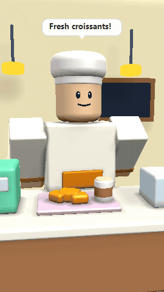

<p></p>

# roblox-style-video

[English](../../README.md) · [简体中文](../../README.zh-CN.md) · [繁體中文](README.zh-TW.md) · [日本語](README.ja.md) · [한국어](README.ko.md) · [Español](README.es.md) · [Français](README.fr.md) · **Deutsch** · [Português](README.pt-BR.md) · [Русский](README.ru.md)

Agent-Skill und Node.js-CLI-Werkzeuge für vertikale 9:16-Kurzvideos im Roblox-Stil. Ein allgemeiner Prompt wie „Roblox-Figur“ erzeugt in Videomodellen oft fünf menschliche Finger, Lego-C-Greifhände und Kopfnoppen, scharfe Minecraft-Voxel oder gespreizte Beine mit Turnschuhen. `roblox-style-video` fixiert die Roblox-Studio-Proportionen (`2x2x1`-Torso, bündige `1x2x1`-Beine, massive Blockhände, `1:1`-Zylinderkopf mit flachem 2D-Gesichtsdecal und `Studs`-Bodenplatte), erstellt Prompts für Kling, Seedance, Hailuo, Wan, Sora und Runway und rendert lokale 3D-Vorschauen vor dem Einsatz von Video-Credits.

## Schnellstart

In das lokale Skills-Verzeichnis klonen (kompatibel mit Codex, Claude Code, Cursor und GitHub Copilot):

```bash
git clone https://github.com/yuzhang-zhong/roblox-style-video.git ~/.codex/skills/roblox-style-video
```

`$roblox-style-video` im Agenten aufrufen:

```text
Nutze $roblox-style-video für ein 15-sekündiges 9:16-Kurzvideo über zwei Freunde beim Shopping:
ein Y2K-Streetwear-Avatar und ein gelber Classic Noob. Erstelle Charakterkarten, 3-Ansichten-Prompts und ein 4-Shot-Storyboard für Kling I2V.
```

Oder die Skripte direkt ausführen (benötigt Node.js 18+, nur Standardbibliothek, kein `npm install` oder API-Key):

```bash
node scripts/avatar_spec.mjs --archetype corporate-worker --rig chibi-blocky --material smooth-plastic --name "Momo" --lang de
node scripts/shot_compiler.mjs --template daily-meltdown --duration 15 --engine kling --rig chibi-blocky --lang de
node scripts/drift_check.mjs --prompt "A cute Roblox girl with C-shaped claw hands drinks coffee with five fingers" --engine kling --mode t2v --lang de
```

## Beispiele und lokale 3D-Vorschauen

Alle `.png`-, `.gif`- und `.mp4`-Dateien im Repository sind lokal mit `scripts/render_preview.mjs` berechnete 3D-Vorschauen zur Prüfung von R6-Proportionen, Kamera und Chatblasen; für das fertige Diffusionsvideo wird ein externes Videomodell benötigt.

| 3-Ansichten-R6-Bogen (`0° / 45° / 90°`) | Geometrie-Prüfung (`FAIL` vs. `PASS`) |
| :---: | :---: |
|  |  |

Sechs Beispiele für sechs Vorlagen und Video-Engines. Jedes Storyboard ist auf 15 Sekunden ausgelegt (`9:16`, 4 Einstellungen); die lokalen MP4-Vorschauen dauern je 4 Sekunden.

| 01 · Montagswecker (`Kling`) | 02 · Sky Obby (`Hailuo`) | 03 · Y2K vs. Noob (`Seedance`) |
| :---: | :---: | :---: |
|  |  |  |
| [Bogen](../../examples/monday-alarm-meltdown/assets/storyboard_contact_sheet.en.png) · [MP4](../../examples/monday-alarm-meltdown/assets/monday_alarm_meltdown.mp4) · [Dateien](../../examples/monday-alarm-meltdown/) | [Bogen](../../examples/obby-sky-run/assets/obby_storyboard_sheet.en.png) · [MP4](../../examples/obby-sky-run/assets/obby_sky_run.mp4) · [Dateien](../../examples/obby-sky-run/) | [Bogen](../../examples/duo-bestie-contrast/assets/duo_storyboard_sheet.en.png) · [MP4](../../examples/duo-bestie-contrast/assets/duo_bestie_contrast.mp4) · [Dateien](../../examples/duo-bestie-contrast/) |
| **04 · Café Tycoon (`Wan`)** | **05 · Laufsteg-Drop (`Sora`)** | **06 · Verbrannte Pizza (`Runway`)** |
|  |  |  |
| [Bogen](../../examples/cozy-cafe-tycoon/assets/cafe_storyboard_sheet.en.png) · [MP4](../../examples/cozy-cafe-tycoon/assets/cozy_cafe_tycoon.mp4) · [Dateien](../../examples/cozy-cafe-tycoon/) | [Bogen](../../examples/runway-outfit-drop/assets/runway_storyboard_sheet.en.png) · [MP4](../../examples/runway-outfit-drop/assets/runway_outfit_drop.mp4) · [Dateien](../../examples/runway-outfit-drop/) | [Bogen](../../examples/burnt-pizza-slapstick/assets/pizza_storyboard_sheet.en.png) · [MP4](../../examples/burnt-pizza-slapstick/assets/burnt_pizza_slapstick.mp4) · [Dateien](../../examples/burnt-pizza-slapstick/) |

## CLI-Skripte, Grenzen und Referenzen

- [`scripts/avatar_spec.mjs`](../../scripts/avatar_spec.mjs): erstellt Charakter-DNA-Karten (`BrickColor`, `2x2x1`- / `1x2x1`-Sperren) und 3-Ansichten-Prompts.
- [`scripts/shot_compiler.mjs`](../../scripts/shot_compiler.mjs): kompiliert 9:16-Storyboards und I2V/T2V-Prompts für `kling`, `seedance`, `hailuo`, `wan`, `sora` und `runway`.
- [`scripts/drift_check.mjs`](../../scripts/drift_check.mjs): prüft Entwürfe auf Finger, Lego-Greifer, Voxel-Köpfe sowie Aktionsüberladung und gibt Korrekturen aus.
- [`scripts/render_preview.mjs`](../../scripts/render_preview.mjs): rendert lokal 3D-Dreiansichten, Vergleichstafeln, Kontaktbögen und `.gif`- / `.mp4`-Vorschauen.

Pro 4–5-Sekunden-Clip nur eine Hauptaktion einplanen und vor Multi-Shot-I2V einen 3-Ansichten-Bogen festlegen. Unterstützt 10 Sprachen (`en`, `zh`, `zh-tw`, `ja`, `ko`, `es`, `fr`, `de`, `pt`, `ru`). Unabhängiges Open-Source-Projekt unter [MIT-Lizenz](../../LICENSE), nicht mit der Roblox Corporation verbunden.

- [`SKILL.md`](../../SKILL.md)
- [`references/avatar-geometry-and-materials.md`](../../references/avatar-geometry-and-materials.md)
- [`references/model-prompt-playbook.md`](../../references/model-prompt-playbook.md)
- [`references/rescue-and-anti-drift.md`](../../references/rescue-and-anti-drift.md)
- [`references/short-video-beats-and-audio.md`](../../references/short-video-beats-and-audio.md) · [`references/viral-archetypes-catalog.md`](../../references/viral-archetypes-catalog.md)
