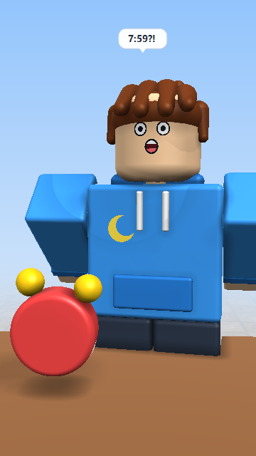
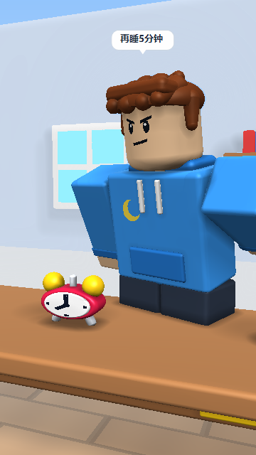
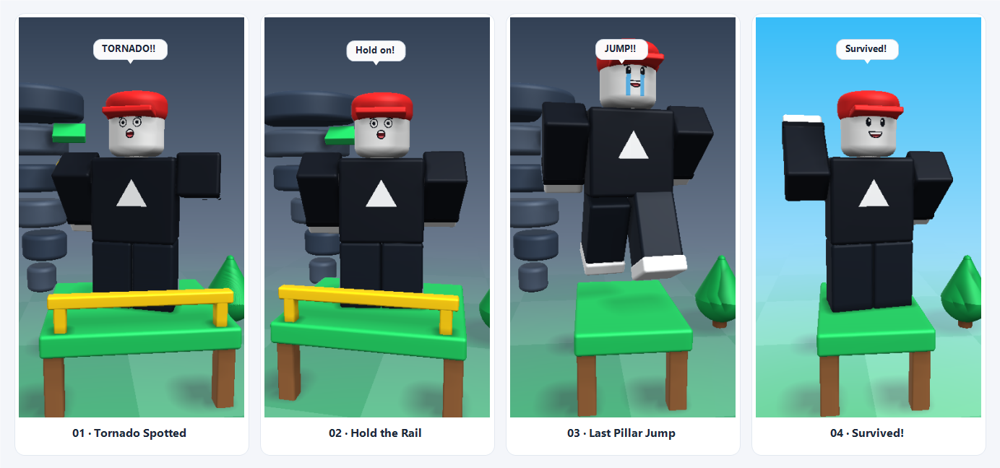

<div align="center">

# Roblox Style Video Skill

Un **Agent Skill** (`SKILL.md` + guías de referencia + herramientas CLI offline sin dependencias) para Claude Code, Cursor, GitHub Copilot y Codex que permite planificar cortos verticales `9:16` de avatares blocky estilo Roblox, fijar proporciones R6, compilar prompts plano por plano y previsualizar el montaje en 3D localmente.

[](../../skills/roblox-style-video/SKILL.md)
[](#flujo-del-skill-e-inicio-rápido)
[](../../LICENSE)

**[Ejemplos en vídeo](#ejemplos-en-vídeo)** · [Láminas de escenas](#láminas-de-escenas-y-ritmo-de-planos) · [Flujo del Skill e inicio rápido](#flujo-del-skill-e-inicio-rápido) · [Guía del Skill](../../skills/roblox-style-video/SKILL.md)

[English](../../README.md) · [简体中文](../../README.zh-CN.md) · [繁體中文](README.zh-TW.md) · [日本語](README.ja.md) · [한국어](README.ko.md) · **Español** · [Français](README.fr.md) · [Deutsch](README.de.md) · [Português](README.pt-BR.md) · [Русский](README.ru.md)

</div>

## Ejemplos en vídeo

Al invocarlo desde un agente de código con IA, este Skill convierte una idea en un paquete vertical (`9:16`) de 15 segundos y cuatro planos basado en 12 formatos clásicos de historias blocky. Los **MP4 de 4 segundos** y los GIF siguientes son animáticas 3D offline generadas por `scripts/render_preview.mjs` para comprobar proporciones R6, objetos multipieza, movimientos de cámara y bocadillos `BillboardGui` antes de gastar créditos en un modelo externo de vídeo.

<p align="center">
  <a href="../../examples/monday-alarm-meltdown/assets/monday_alarm_meltdown.mp4"></a>
  <a href="../../examples/obby-sky-run/assets/obby_sky_run.mp4"></a>
  <a href="../../examples/duo-bestie-contrast/assets/duo_bestie_contrast.mp4"></a>
  <a href="../../examples/cozy-cafe-tycoon/assets/cozy_cafe_tycoon.mp4"></a>
  <a href="../../examples/runway-outfit-drop/assets/runway_outfit_drop.mp4"></a>
  <a href="../../examples/burnt-pizza-slapstick/assets/burnt_pizza_slapstick.mp4"></a>
  <br />
  <a href="../../examples/disaster-tower-tornado/assets/disaster_tower_tornado.mp4"></a>
  <a href="../../examples/brookhaven-police-chase/assets/brookhaven_police_chase.mp4"></a>
  <a href="../../examples/doors-flashlight-hallway/assets/doors_flashlight_hallway.mp4"></a>
  <a href="../../examples/crossroads-sword-duel/assets/crossroads_sword_duel.mp4"></a>
  <a href="../../examples/classroom-exam-panic/assets/classroom_exam_panic.mp4"></a>
  <a href="../../examples/red-light-freeze/assets/red_light_freeze.mp4"></a>
</p>

## Láminas de escenas y ritmo de planos

Los modelos de difusión de vídeo deforman las extremidades rígidas cuando un solo prompt de 4–5 segundos acumula tres o cuatro verbos seguidos. Cada corto divide la historia en cuatro tiempos de una sola acción (`0–3.5s` gancho inicial, dos planos de escalada y `11.5–15s` remate o bucle continuo):

| Plano 01 · Gancho (`0–3.5s`) | Plano 02 · Acción (`3.5–7.5s`) | Plano 03 · Giro (`7.5–11.5s`) | Plano 04 · Bucle (`11.5–15s`) |
| :---: | :---: | :---: | :---: |
|  |  |  |  |

Hojas de contacto de cuatro planos en seis géneros clásicos, combinando cambios de cámara y bocadillos de chat en inglés:

| 02 · Sky Obby (`Hailuo` · Speed Coil y Killbrick) | 08 · Brookhaven Police Chase (`Hailuo` · Persecución urbana) |
| :---: | :---: |
| <a href="../../examples/obby-sky-run/"></a> | <a href="../../examples/brookhaven-police-chase/"></a> |
| **07 · Natural Disaster Tower (`Kling` · Supervivencia al tornado)** | **09 · Doors Hotel Hallway (`Sora` · Linterna y parpadeo)** |
| <a href="../../examples/disaster-tower-tornado/"></a> | <a href="../../examples/doors-flashlight-hallway/"></a> |
| **10 · Crossroads Sword Duel (`Seedance` · Duelo de espadas 1v1)** | **12 · Red Light Freeze (`Runway` · Luz roja, luz verde)** |
| <a href="../../examples/crossroads-sword-duel/"></a> | <a href="../../examples/red-light-freeze/"></a> |

## Flujo del Skill e inicio rápido

<p align="center">
  
</p>

### Instalar como Agent Skill

Instálalo con el comando oficial de Skills de GitHub. El paquete independiente está en [`skills/roblox-style-video/`](../../skills/roblox-style-video/) y su entrada es [`SKILL.md`](../../skills/roblox-style-video/SKILL.md).

```bash
gh skill install yuzhang-zhong/roblox-style-video roblox-style-video@v1.7.0
```

Invoca el skill `roblox-style-video` en el chat de tu agente:

```text
Usa $roblox-style-video para planificar un corto vertical 9:16 de 15 segundos en un pasillo oscuro de hotel (doors-horror):
un avatar R6 con sudadera azul alumbra la puerta 050 con una linterna cuando las luces parpadean y se esconde en el armario.
Dame el bloqueo geométrico del personaje, un storyboard de 4 planos y prompts I2V para Sora / Kling.
```

### Ejecutar directamente las herramientas CLI del Skill

Todos los scripts incluidos funcionan de forma autónoma desde la raíz del repositorio con Node.js 18+ y la biblioteca estándar (sin `npm install` ni claves de API).

```bash
node scripts/shot_compiler.mjs --template brookhaven-chase --duration 15 --engine hailuo --rig r6 --lang es
node scripts/drift_check.mjs --prompt "A cute Roblox girl with C-shaped claw hands drinks coffee with five fingers" --engine kling --mode t2v --lang es
node scripts/render_preview.mjs --only tornado,chase,doors
```

## Scripts del Skill, control anti-deriva y referencias

Los prompts genéricos suelen producir dedos humanos, pinzas en C o botones circulares de Lego en el suelo y cubos vóxel estilo Minecraft en lugar de la geometría blocky R6 (`torso 2x2x1`, piernas `1x2x1` alineadas sin hueco, manos sólidas sin dedos, cabeza cilíndrica biselada `1:1`, suelos lisos y accesorios multipieza). `drift_check.mjs` detecta y corrige estos fallos antes de generar:

<p align="center">
  
</p>

| Componente del Skill | Salida |
| --- | --- |
| [`SKILL.md`](../../skills/roblox-style-video/SKILL.md) | Punto de entrada del Agent Skill con los 6 modos de producción (`Avatar`, `Storyboard`, `Prompt-Compile`, `Rescue`, `Remix`, `Render`) y las 8 invariantes geométricas. |
| [`shot_compiler.mjs`](../../scripts/shot_compiler.mjs) | Escaleta `9:16` y prompts I2V/T2V en 12 plantillas para Kling, Seedance, Hailuo, Wan, Sora y Runway. |
| [`avatar_spec.mjs`](../../scripts/avatar_spec.mjs) | Ficha ADN del personaje con códigos `BrickColor`, proporciones bloqueadas y prompt de [hoja turnaround de tres vistas](../../assets/showcase/momo_turnaround_sheet.en.png). |
| [`drift_check.mjs`](../../scripts/drift_check.mjs) | Informe diagnóstico y prompt corregido ante aparición de dedos humanos, piezas Lego, logotipos de marca o exceso de verbos por plano. |
| [`render_preview.mjs`](../../scripts/render_preview.mjs) | Renderizador 3D offline de hojas de contacto, comparativas, GIF y MP4 (la composición en Windows utiliza PowerShell `System.Drawing` y `ffmpeg`). |

[Geometría y materiales](../../references/avatar-geometry-and-materials.md) · [Catálogo de accesorios clásicos](../../references/classic-roblox-catalog.md) · [Manual de prompts por modelo](../../references/model-prompt-playbook.md) · [Corrección de deriva](../../references/rescue-and-anti-drift.md) · [Ritmo y audio](../../references/short-video-beats-and-audio.md) · [12 plantillas de historias](../../references/viral-archetypes-catalog.md)

## Idiomas

Las respuestas del Agent Skill y la opción `--lang` de la CLI admiten `en`, `zh`, `zh-tw`, `ja`, `ko`, `es`, `fr`, `de`, `pt` y `ru`.

[English](../../README.md) · [简体中文](../../README.zh-CN.md) · [繁體中文](README.zh-TW.md) · [日本語](README.ja.md) · [한국어](README.ko.md) · **Español** · [Français](README.fr.md) · [Deutsch](README.de.md) · [Português](README.pt-BR.md) · [Русский](README.ru.md)

[Licencia MIT](../../LICENSE). Agent Skill independiente de código abierto; emplea emblemas geométricos triangulares propios y no está afiliado ni respaldado por Roblox Corporation.
