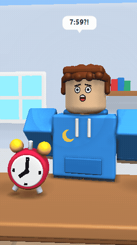

<div align="center">


# roblox-style-skill

[English](../../README.md) · [简体中文](../../README.zh-CN.md) · [繁體中文](README.zh-TW.md) · [日本語](README.ja.md) · [한국어](README.ko.md) · **Español** · [Français](README.fr.md) · [Deutsch](README.de.md) · [Português](README.pt-BR.md) · [Русский](README.ru.md)

Genera videos cortos 9:16 de avatares estilo Roblox R6 y blocky con proporciones stud bloqueadas, storyboards y prompts ajustados por modelo.

</div>

Pedir a un modelo de video "un personaje de Roblox tomando café" o incluir `C-shaped claw hands` suele producir cuatro fallos: cinco dedos humanos, manos en garra y botón superior de Lego, vóxeles cuadrados de Minecraft o piernas separadas con zapatillas. `roblox-style-skill` fija la geometría estándar de Roblox Studio antes de animar: torso rectangular `2x2x1`, dos piernas `1x2x1` juntas del mismo ancho que el torso, manos `1x2x1` macizas sin dedos ni garras, cabeza cilíndrica biselada `1:1` con rostro 2D impreso, acabado `SmoothPlastic` sobre placa `Studs` y burbujas de chat `BillboardGui`.


## Vista previa y 6 ejemplos de cortos 9:16

| Hoja de 3 vistas R6 (`0° / 45° / 90°`) | Control geométrico (`FAIL` vs. `PASS`) |
| :---: | :---: |
|  |  |

Seis paquetes verticales 9:16 generados para 6 plantillas y 6 motores de vídeo:

| 01 · Alarma del lunes (`Kling`) | 02 · Sky Obby (`Hailuo`) | 03 · Y2K vs. Noob (`Seedance`) |
| :---: | :---: | :---: |
|  |  |  |
| [Storyboard](../../examples/monday-alarm-meltdown/assets/storyboard_contact_sheet.en.png) · [MP4](../../examples/monday-alarm-meltdown/assets/monday_alarm_meltdown.mp4) · [Paquete](../../examples/monday-alarm-meltdown/) | [Storyboard](../../examples/obby-sky-run/assets/obby_storyboard_sheet.en.png) · [MP4](../../examples/obby-sky-run/assets/obby_sky_run.mp4) · [Paquete](../../examples/obby-sky-run/) | [Storyboard](../../examples/duo-bestie-contrast/assets/duo_storyboard_sheet.en.png) · [MP4](../../examples/duo-bestie-contrast/assets/duo_bestie_contrast.mp4) · [Paquete](../../examples/duo-bestie-contrast/) |
| **04 · Café Tycoon (`Wan`)** | **05 · Pasarela Y2K (`Sora`)** | **06 · Pizza quemada (`Runway`)** |
|  |  |  |
| [Storyboard](../../examples/cozy-cafe-tycoon/assets/cafe_storyboard_sheet.en.png) · [MP4](../../examples/cozy-cafe-tycoon/assets/cozy_cafe_tycoon.mp4) · [Paquete](../../examples/cozy-cafe-tycoon/) | [Storyboard](../../examples/runway-outfit-drop/assets/runway_storyboard_sheet.en.png) · [MP4](../../examples/runway-outfit-drop/assets/runway_outfit_drop.mp4) · [Paquete](../../examples/runway-outfit-drop/) | [Storyboard](../../examples/burnt-pizza-slapstick/assets/pizza_storyboard_sheet.en.png) · [MP4](../../examples/burnt-pizza-slapstick/assets/burnt_pizza_slapstick.mp4) · [Paquete](../../examples/burnt-pizza-slapstick/) |

## Biblioteca clásica de avatares, ropa y caras Roblox

Pre-renderizada en [`assets/library/`](../../assets/library/catalog.json) y [`references/classic-roblox-catalog.md`](../../references/classic-roblox-catalog.md) ([lámina de avatares](../../assets/showcase/classic_avatars_lineup.en.png) · [lámina de caras](../../assets/showcase/classic_faces_atlas.en.png)):

| Classic Noob | Classic Guest | Bacon Hair | Builderman | Speedrunner | Story Hoodie |
| :---: | :---: | :---: | :---: | :---: | :---: |
|  |  |  |  |  |  |

| `Smile :)` | `Chill -_-` | `Check It` | `Grin :D` | `Shocked` | `Tears` | `Bloxxer` | `KO X_X` |
| :---: | :---: | :---: | :---: | :---: | :---: | :---: | :---: |
|  |  |  |  |  |  |  |  |

## Inicio rápido

Clona el repositorio en tu carpeta local de Skills (compatible con Claude Code, Codex, Cursor y GitHub Copilot):

```bash
git clone https://github.com/yuzhang-zhong/roblox-style-skill.git ~/.codex/skills/roblox-style-skill
```

Invoca `$roblox-style-skill` en tu agente:

```text
Usa $roblox-style-skill para planificar un corto vertical 9:16 de 15 segundos sobre dos amigos de compras:
un avatar Y2K y un Noob amarillo clásico. Dame las fichas de personaje, prompts de 3 vistas y un storyboard de 4 planos para Kling I2V.
```

## Herramientas CLI

Los cuatro scripts funcionan con Node.js 18+ usando únicamente la biblioteca estándar:

| Script | Función |
| --- | --- |
| [`scripts/avatar_spec.mjs`](../../scripts/avatar_spec.mjs) | Genera la ficha ADN del personaje (colores `BrickColor`, bloqueo `2x2x1`/`1x2x1`) y el prompt de 3 vistas |
| [`scripts/shot_compiler.mjs`](../../scripts/shot_compiler.mjs) | Compila storyboards 9:16 y prompts I2V/T2V para `kling`, `seedance`, `hailuo`, `wan`, `sora` y `runway` |
| [`scripts/drift_check.mjs`](../../scripts/drift_check.mjs) | Detecta dedos humanos, garras de Lego, vóxeles y exceso de verbos por toma; devuelve el prompt corregido |
| [`scripts/render_preview.mjs`](../../scripts/render_preview.mjs) | Renderiza localmente hojas de 3 vistas, tablas comparativas, storyboards y vistas previas `.gif` / `.mp4` |

```bash
node scripts/avatar_spec.mjs --archetype corporate-worker --rig chibi-blocky --material smooth-plastic --name "Momo" --lang es
node scripts/shot_compiler.mjs --template daily-meltdown --duration 15 --engine kling --rig chibi-blocky --lang es
node scripts/drift_check.mjs --prompt "A cute Roblox girl with C-shaped claw hands drinks coffee with five fingers" --engine kling --mode t2v --lang es
```

## Documentación e idiomas soportados

Las respuestas del agente y la opción `--lang` del CLI admiten 10 idiomas: `en`, `zh`, `zh-tw`, `ja`, `ko`, `es`, `fr`, `de`, `pt` y `ru`. Limita cada clip de 4 a 5 segundos a una sola acción principal y usa una hoja de 3 vistas antes de generar múltiples planos I2V. Proyecto de código abierto independiente, no afiliado a Roblox Corporation.

- [Flujo de trabajo principal (`SKILL.md`)](../../SKILL.md)
- [Geometría, rostros 2D y materiales (`references/avatar-geometry-and-materials.md`)](../../references/avatar-geometry-and-materials.md)
- [Manual de prompts por modelo (`references/model-prompt-playbook.md`)](../../references/model-prompt-playbook.md)
- [Diagnóstico y corrección de deriva (`references/rescue-and-anti-drift.md`)](../../references/rescue-and-anti-drift.md)
- [Ritmo 9:16, iluminación y audio (`references/short-video-beats-and-audio.md`)](../../references/short-video-beats-and-audio.md)
- [Seis plantillas de cortos (`references/viral-archetypes-catalog.md`)](../../references/viral-archetypes-catalog.md)
