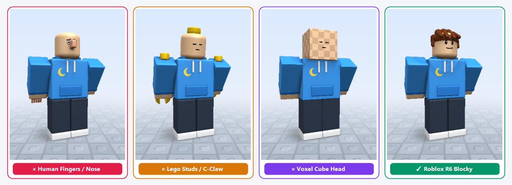
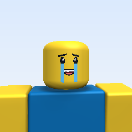

# roblox-style-video

[English](../../README.md) · [简体中文](../../README.zh-CN.md) · [繁體中文](README.zh-TW.md) · [日本語](README.ja.md) · [한국어](README.ko.md) · **Español** · [Français](README.fr.md) · [Deutsch](README.de.md) · [Português](README.pt-BR.md) · [Русский](README.ru.md)

Skill para agentes y herramientas CLI en Node.js para planificar vídeos cortos 9:16 al estilo Roblox. Pedir simplemente un "personaje de Roblox" suele generar cinco dedos humanos, pinzas en C y botones de Lego, cubos vóxel de Minecraft o piernas separadas con zapatillas. `roblox-style-video` fija las proporciones estándar de Roblox Studio (torso `2x2x1`, piernas `1x2x1` juntas, manos de bloque macizo, cabeza cilíndrica `1:1` con cara 2D plana y placa `Studs`), compila prompts para Kling, Seedance, Hailuo, Wan, Sora y Runway, y genera vistas previas 3D locales antes de gastar créditos.

## Inicio rápido

Clona el repositorio en tu carpeta local de skills (compatible con Codex, Claude Code, Cursor y GitHub Copilot):

```bash
git clone https://github.com/yuzhang-zhong/roblox-style-video.git ~/.codex/skills/roblox-style-video
```

Invoca `$roblox-style-video` en tu agente:

```text
Usa $roblox-style-video para planificar un corto vertical 9:16 de 15 segundos sobre dos amigos de compras:
un avatar Y2K y un Classic Noob amarillo. Dame las fichas de personaje, prompts de 3 vistas y storyboard de 4 planos para Kling I2V.
```

O ejecuta los scripts directamente (requiere Node.js 18+, solo biblioteca estándar, sin `npm install` ni claves API):

```bash
node scripts/avatar_spec.mjs --archetype corporate-worker --rig chibi-blocky --material smooth-plastic --name "Momo" --lang es
node scripts/shot_compiler.mjs --template daily-meltdown --duration 15 --engine kling --rig chibi-blocky --lang es
node scripts/drift_check.mjs --prompt "A cute Roblox girl with C-shaped claw hands drinks coffee with five fingers" --engine kling --mode t2v --lang es
```

## Ejemplos y vistas previas 3D locales

Todos los archivos `.png`, `.gif` y `.mp4` de este repositorio son vistas previas 3D renderizadas localmente por `scripts/render_preview.mjs` para verificar proporciones R6, encuadres y bocadillos de chat; el vídeo final por difusión requiere un modelo externo.

| Hoja R6 de 3 vistas (`0° / 45° / 90°`) | Control geométrico (`FAIL` vs. `PASS`) |
| :---: | :---: |
|  |  |

Seis paquetes de ejemplo de 15 segundos (`9:16`, 4 planos) para las 6 plantillas y 6 motores de vídeo:

| 01 · Alarma lunes (`Kling`) | 02 · Sky Obby (`Hailuo`) | 03 · Y2K vs. Noob (`Seedance`) |
| :---: | :---: | :---: |
|  |  |  |
| [Hoja](../../examples/monday-alarm-meltdown/assets/storyboard_contact_sheet.en.png) · [MP4](../../examples/monday-alarm-meltdown/assets/monday_alarm_meltdown.mp4) · [Archivos](../../examples/monday-alarm-meltdown/) | [Hoja](../../examples/obby-sky-run/assets/obby_storyboard_sheet.en.png) · [MP4](../../examples/obby-sky-run/assets/obby_sky_run.mp4) · [Archivos](../../examples/obby-sky-run/) | [Hoja](../../examples/duo-bestie-contrast/assets/duo_storyboard_sheet.en.png) · [MP4](../../examples/duo-bestie-contrast/assets/duo_bestie_contrast.mp4) · [Archivos](../../examples/duo-bestie-contrast/) |
| **04 · Café Tycoon (`Wan`)** | **05 · Pasarela Y2K (`Sora`)** | **06 · Pizza quemada (`Runway`)** |
|  |  |  |
| [Hoja](../../examples/cozy-cafe-tycoon/assets/cafe_storyboard_sheet.en.png) · [MP4](../../examples/cozy-cafe-tycoon/assets/cozy_cafe_tycoon.mp4) · [Archivos](../../examples/cozy-cafe-tycoon/) | [Hoja](../../examples/runway-outfit-drop/assets/runway_storyboard_sheet.en.png) · [MP4](../../examples/runway-outfit-drop/assets/runway_outfit_drop.mp4) · [Archivos](../../examples/runway-outfit-drop/) | [Hoja](../../examples/burnt-pizza-slapstick/assets/pizza_storyboard_sheet.en.png) · [MP4](../../examples/burnt-pizza-slapstick/assets/burnt_pizza_slapstick.mp4) · [Archivos](../../examples/burnt-pizza-slapstick/) |

## Biblioteca clásica de avatares y caras Roblox

Indexada en [`assets/library/catalog.json`](../../assets/library/catalog.json) y [`references/classic-roblox-catalog.md`](../../references/classic-roblox-catalog.md) ([lámina avatares](../../assets/showcase/classic_avatars_lineup.en.png) · [lámina caras](../../assets/showcase/classic_faces_atlas.en.png)):

| Classic Noob (2006) | Classic Guest (2008) | Bacon Hair (2014) |
| :---: | :---: | :---: |
|  |  |  |
| **Builderman Hard Hat** | **Obby + Speed Coil** | **Storytime Hoodie** |
|  |  |  |

| `Smile :)` | `Chill -_-` | `Check It` | `Grin :D` |
| :---: | :---: | :---: | :---: |
|  |  |  |  |
| **`Shocked O_O`** | **`Waterfall Tears`** | **`Angry Bloxxer`** | **`KO Dizzy X_X`** |
|  |  |  |  |

## Scripts CLI, límites y referencias

- [`scripts/avatar_spec.mjs`](../../scripts/avatar_spec.mjs): genera la ficha DNA del personaje (paleta `BrickColor`, bloqueos `2x2x1` / `1x2x1`) y el prompt de 3 vistas.
- [`scripts/shot_compiler.mjs`](../../scripts/shot_compiler.mjs): compila storyboards 9:16 y prompts I2V/T2V para `kling`, `seedance`, `hailuo`, `wan`, `sora` y `runway`.
- [`scripts/drift_check.mjs`](../../scripts/drift_check.mjs): detecta dedos humanos, pinzas Lego, cabezas vóxel y exceso de verbos, devolviendo un prompt corregido.
- [`scripts/render_preview.mjs`](../../scripts/render_preview.mjs): renderiza en local hojas de 3 vistas, comparativas, storyboards y previas `.gif` / `.mp4`.

Mantén una sola acción principal por cada clip de 4 a 5 segundos y fija una hoja de 3 vistas antes de animar múltiples planos en I2V. Soporta 10 idiomas (`en`, `zh`, `zh-tw`, `ja`, `ko`, `es`, `fr`, `de`, `pt`, `ru`). Proyecto independiente bajo [licencia MIT](../../LICENSE), no afiliado a Roblox Corporation.

- [`SKILL.md`](../../SKILL.md)
- [`references/avatar-geometry-and-materials.md`](../../references/avatar-geometry-and-materials.md)
- [`references/classic-roblox-catalog.md`](../../references/classic-roblox-catalog.md)
- [`references/model-prompt-playbook.md`](../../references/model-prompt-playbook.md)
- [`references/rescue-and-anti-drift.md`](../../references/rescue-and-anti-drift.md)
- [`references/short-video-beats-and-audio.md`](../../references/short-video-beats-and-audio.md) · [`references/viral-archetypes-catalog.md`](../../references/viral-archetypes-catalog.md)
