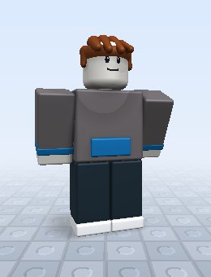

<div align="center">


# roblox-style-skill

[English](../../README.md) · [简体中文](../../README.zh-CN.md) · [繁體中文](README.zh-TW.md) · [日本語](README.ja.md) · [한국어](README.ko.md) · [Español](README.es.md) · **Français** · [Deutsch](README.de.md) · [Português](README.pt-BR.md) · [Русский](README.ru.md)

Générez des courts-métrages 9:16 d'avatars Roblox R6 et blocky avec proportions stud verrouillées, storyboards et prompts adaptés à chaque modèle.

</div>

Demander simplement « un personnage Roblox qui boit un café » ou mentionner `C-shaped claw hands` dans un générateur vidéo produit souvent quatre dérives : cinq doigts humains, des pinces en C et un tenon Lego sur la tête, des voxels cubiques façon Minecraft, ou des jambes écartées avec des baskets. `roblox-style-skill` verrouille la géométrie standard de Roblox Studio avant l'animation : torse rectangulaire `2x2x1`, deux jambes `1x2x1` jointives de même largeur que le torse, mains `1x2x1` pleines sans doigts ni pinces, tête cylindrique biseautée `1:1` avec visage 2D imprimé, matériau `SmoothPlastic` sur plaque `Studs` et bulles de chat `BillboardGui`.


## Aperçu visuel et 6 exemples de shorts 9:16

| Planche 3 vues R6 (`0° / 45° / 90°`) | Contrôle géométrique (`FAIL` vs. `PASS`) |
| :---: | :---: |
|  |  |

Six exemples verticaux 9:16 couvrant les 6 modèles narratifs et 6 moteurs vidéo :

| 01 · Réveil du lundi (`Kling`) | 02 · Sky Obby (`Hailuo`) | 03 · Y2K vs. Noob (`Seedance`) |
| :---: | :---: | :---: |
|  |  |  |
| [Planche](../../examples/monday-alarm-meltdown/assets/storyboard_contact_sheet.en.png) · [MP4](../../examples/monday-alarm-meltdown/assets/monday_alarm_meltdown.mp4) · [Dossier](../../examples/monday-alarm-meltdown/) | [Planche](../../examples/obby-sky-run/assets/obby_storyboard_sheet.en.png) · [MP4](../../examples/obby-sky-run/assets/obby_sky_run.mp4) · [Dossier](../../examples/obby-sky-run/) | [Planche](../../examples/duo-bestie-contrast/assets/duo_storyboard_sheet.en.png) · [MP4](../../examples/duo-bestie-contrast/assets/duo_bestie_contrast.mp4) · [Dossier](../../examples/duo-bestie-contrast/) |
| **04 · Café Tycoon (`Wan`)** | **05 · Défilé Y2K (`Sora`)** | **06 · Pizza brûlée (`Runway`)** |
|  |  |  |
| [Planche](../../examples/cozy-cafe-tycoon/assets/cafe_storyboard_sheet.en.png) · [MP4](../../examples/cozy-cafe-tycoon/assets/cozy_cafe_tycoon.mp4) · [Dossier](../../examples/cozy-cafe-tycoon/) | [Planche](../../examples/runway-outfit-drop/assets/runway_storyboard_sheet.en.png) · [MP4](../../examples/runway-outfit-drop/assets/runway_outfit_drop.mp4) · [Dossier](../../examples/runway-outfit-drop/) | [Planche](../../examples/burnt-pizza-slapstick/assets/pizza_storyboard_sheet.en.png) · [MP4](../../examples/burnt-pizza-slapstick/assets/burnt_pizza_slapstick.mp4) · [Dossier](../../examples/burnt-pizza-slapstick/) |

## Bibliothèque classique d'avatars, tenues et visages Roblox

Pré-rendue dans [`assets/library/`](../../assets/library/catalog.json) et [`references/classic-roblox-catalog.md`](../../references/classic-roblox-catalog.md) ([planche avatars](../../assets/showcase/classic_avatars_lineup.en.png) · [planche visages](../../assets/showcase/classic_faces_atlas.en.png)) :

| Classic Noob | Classic Guest | Bacon Hair | Builderman | Speedrunner | Story Hoodie |
| :---: | :---: | :---: | :---: | :---: | :---: |
|  |  |  |  |  |  |

| `Smile :)` | `Chill -_-` | `Check It` | `Grin :D` | `Shocked` | `Tears` | `Bloxxer` | `KO X_X` |
| :---: | :---: | :---: | :---: | :---: | :---: | :---: | :---: |
|  |  |  |  |  |  |  |  |

## Démarrage rapide

Clonez le dépôt dans votre dossier local de Skills (compatible avec Claude Code, Codex, Cursor et GitHub Copilot) :

```bash
git clone https://github.com/yuzhang-zhong/roblox-style-skill.git ~/.codex/skills/roblox-style-skill
```

Appelez `$roblox-style-skill` dans votre agent :

```text
Utilise $roblox-style-skill pour concevoir un court-métrage 9:16 de 15 secondes sur deux amis en shopping :
un avatar streetwear Y2K et un Noob jaune classique. Génère les fiches personnages, les prompts 3 vues et un storyboard 4 plans pour Kling I2V.
```

## Outils CLI

Les quatre scripts fonctionnent sous Node.js 18+ uniquement avec la bibliothèque standard :

| Script | Rôle |
| --- | --- |
| [`scripts/avatar_spec.mjs`](../../scripts/avatar_spec.mjs) | Génère la fiche ADN du personnage (palette `BrickColor`, géométrie `2x2x1`/`1x2x1`) et le prompt 3 vues |
| [`scripts/shot_compiler.mjs`](../../scripts/shot_compiler.mjs) | Compile les storyboards 9:16 et les prompts I2V/T2V pour `kling`, `seedance`, `hailuo`, `wan`, `sora` et `runway` |
| [`scripts/drift_check.mjs`](../../scripts/drift_check.mjs) | Détecte doigts humains, pinces Lego, voxels et surcharge d'actions ; produit un prompt corrigé |
| [`scripts/render_preview.mjs`](../../scripts/render_preview.mjs) | Effectue le rendu local 3D des planches 3 vues, comparatifs, storyboards et aperçus `.gif` / `.mp4` |

```bash
node scripts/avatar_spec.mjs --archetype corporate-worker --rig chibi-blocky --material smooth-plastic --name "Momo" --lang fr
node scripts/shot_compiler.mjs --template daily-meltdown --duration 15 --engine kling --rig chibi-blocky --lang fr
node scripts/drift_check.mjs --prompt "A cute Roblox girl with C-shaped claw hands drinks coffee with five fingers" --engine kling --mode t2v --lang fr
```

## Documentation et langues prises en charge

Les réponses de l'agent et l'option `--lang` prennent en charge 10 langues : `en`, `zh`, `zh-tw`, `ja`, `ko`, `es`, `fr`, `de`, `pt` et `ru`. Limitez chaque clip de 4 à 5 secondes à une seule action principale et générez une planche 3 vues avant un montage I2V multi-plans. Projet open-source indépendant, non affilié à Roblox Corporation.

- [Flux de travail principal (`SKILL.md`)](../../SKILL.md)
- [Géométrie, visages 2D et matériaux (`references/avatar-geometry-and-materials.md`)](../../references/avatar-geometry-and-materials.md)
- [Guide de prompts par modèle (`references/model-prompt-playbook.md`)](../../references/model-prompt-playbook.md)
- [Diagnostic et correction de dérive (`references/rescue-and-anti-drift.md`)](../../references/rescue-and-anti-drift.md)
- [Rythme 9:16, éclairage et audio (`references/short-video-beats-and-audio.md`)](../../references/short-video-beats-and-audio.md)
- [Six modèles de courts-métrages (`references/viral-archetypes-catalog.md`)](../../references/viral-archetypes-catalog.md)
