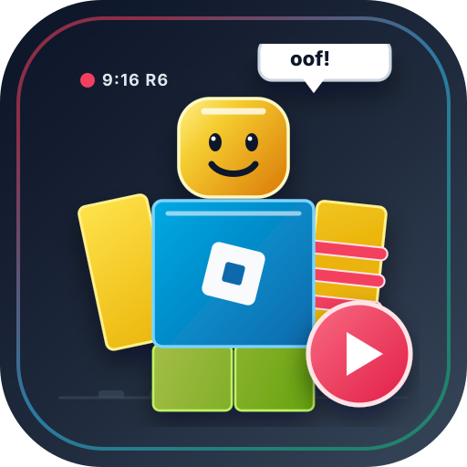

<p></p>

# roblox-style-video

[English](../../README.md) · [简体中文](../../README.zh-CN.md) · [繁體中文](README.zh-TW.md) · [日本語](README.ja.md) · [한국어](README.ko.md) · [Español](README.es.md) · **Français** · [Deutsch](README.de.md) · [Português](README.pt-BR.md) · [Русский](README.ru.md)

Skill d'agent et outils CLI Node.js pour préparer des vidéos courtes 9:16 de style Roblox. Un prompt vague du type « personnage Roblox » produit souvent cinq doigts humains, des pinces Lego en C et tenons sur la tête, des cubes voxel Minecraft ou des jambes écartées en baskets. `roblox-style-video` verrouille les proportions Roblox Studio (`2x2x1` pour le torse, jambes `1x2x1` jointes, mains blocs pleins, tête cylindrique `1:1` à visage 2D plat et plaque `Studs`), compile les prompts pour Kling, Seedance, Hailuo, Wan, Sora et Runway, et génère des aperçus 3D locaux avant d'utiliser vos crédits vidéo.

## Démarrage rapide

Clonez dans votre dossier local de skills (compatible Codex, Claude Code, Cursor et GitHub Copilot) :

```bash
git clone https://github.com/yuzhang-zhong/roblox-style-video.git ~/.codex/skills/roblox-style-video
```

Appelez `$roblox-style-video` dans votre agent :

```text
Utilise $roblox-style-video pour planifier un short 9:16 de 15 secondes sur deux amis en shopping :
un avatar streetwear Y2K et un Classic Noob jaune. Donne les fiches personnages, prompts 3 vues et storyboard Kling I2V en 4 plans.
```

Ou lancez directement les scripts CLI (Node.js 18+ requis, bibliothèque standard uniquement, sans `npm install` ni clé API) :

```bash
node scripts/avatar_spec.mjs --archetype corporate-worker --rig chibi-blocky --material smooth-plastic --name "Momo" --lang fr
node scripts/shot_compiler.mjs --template daily-meltdown --duration 15 --engine kling --rig chibi-blocky --lang fr
node scripts/drift_check.mjs --prompt "A cute Roblox girl with C-shaped claw hands drinks coffee with five fingers" --engine kling --mode t2v --lang fr
```

## Exemples et aperçus 3D locaux

Les fichiers `.png`, `.gif` et `.mp4` du dépôt sont des aperçus 3D calculés hors ligne par `scripts/render_preview.mjs` afin de vérifier les proportions R6, le cadrage et les bulles de chat ; le rendu vidéo final nécessite un modèle externe.

| Planche R6 3 vues (`0° / 45° / 90°`) | Contrôle géométrique (`FAIL` vs. `PASS`) |
| :---: | :---: |
|  |  |

Six exemples pour six gabarits et moteurs vidéo. Chaque storyboard prévoit 15 secondes (`9:16`, 4 plans) ; chaque MP4 est un aperçu local de 4 secondes.

| 01 · Réveil lundi (`Kling`) | 02 · Sky Obby (`Hailuo`) | 03 · Y2K vs. Noob (`Seedance`) |
| :---: | :---: | :---: |
|  |  |  |
| [Planche](../../examples/monday-alarm-meltdown/assets/storyboard_contact_sheet.en.png) · [MP4](../../examples/monday-alarm-meltdown/assets/monday_alarm_meltdown.mp4) · [Fichiers](../../examples/monday-alarm-meltdown/) | [Planche](../../examples/obby-sky-run/assets/obby_storyboard_sheet.en.png) · [MP4](../../examples/obby-sky-run/assets/obby_sky_run.mp4) · [Fichiers](../../examples/obby-sky-run/) | [Planche](../../examples/duo-bestie-contrast/assets/duo_storyboard_sheet.en.png) · [MP4](../../examples/duo-bestie-contrast/assets/duo_bestie_contrast.mp4) · [Fichiers](../../examples/duo-bestie-contrast/) |
| **04 · Café Tycoon (`Wan`)** | **05 · Défilé Y2K (`Sora`)** | **06 · Pizza brûlée (`Runway`)** |
|  |  |  |
| [Planche](../../examples/cozy-cafe-tycoon/assets/cafe_storyboard_sheet.en.png) · [MP4](../../examples/cozy-cafe-tycoon/assets/cozy_cafe_tycoon.mp4) · [Fichiers](../../examples/cozy-cafe-tycoon/) | [Planche](../../examples/runway-outfit-drop/assets/runway_storyboard_sheet.en.png) · [MP4](../../examples/runway-outfit-drop/assets/runway_outfit_drop.mp4) · [Fichiers](../../examples/runway-outfit-drop/) | [Planche](../../examples/burnt-pizza-slapstick/assets/pizza_storyboard_sheet.en.png) · [MP4](../../examples/burnt-pizza-slapstick/assets/burnt_pizza_slapstick.mp4) · [Fichiers](../../examples/burnt-pizza-slapstick/) |

## Scripts CLI, limites et références

- [`scripts/avatar_spec.mjs`](../../scripts/avatar_spec.mjs) : génère une fiche personnage (`BrickColor`, verrous `2x2x1` / `1x2x1`) et le prompt 3 vues.
- [`scripts/shot_compiler.mjs`](../../scripts/shot_compiler.mjs) : compile les storyboards 9:16 et prompts I2V/T2V pour `kling`, `seedance`, `hailuo`, `wan`, `sora` et `runway`.
- [`scripts/drift_check.mjs`](../../scripts/drift_check.mjs) : détecte doigts humains, pinces Lego, têtes voxel et surcharge d'actions, puis propose un prompt corrigé.
- [`scripts/render_preview.mjs`](../../scripts/render_preview.mjs) : calcule en local les planches 3 vues, comparatifs, storyboards et aperçus `.gif` / `.mp4`.

Limitez chaque plan de 4 à 5 secondes à une seule action principale et fixez une planche 3 vues avant un montage I2V multi-plans. Prend en charge 10 langues (`en`, `zh`, `zh-tw`, `ja`, `ko`, `es`, `fr`, `de`, `pt`, `ru`). Projet open-source sous [licence MIT](../../LICENSE), non affilié à Roblox Corporation.

- [`SKILL.md`](../../SKILL.md)
- [`references/avatar-geometry-and-materials.md`](../../references/avatar-geometry-and-materials.md)
- [`references/model-prompt-playbook.md`](../../references/model-prompt-playbook.md)
- [`references/rescue-and-anti-drift.md`](../../references/rescue-and-anti-drift.md)
- [`references/short-video-beats-and-audio.md`](../../references/short-video-beats-and-audio.md) · [`references/viral-archetypes-catalog.md`](../../references/viral-archetypes-catalog.md)
