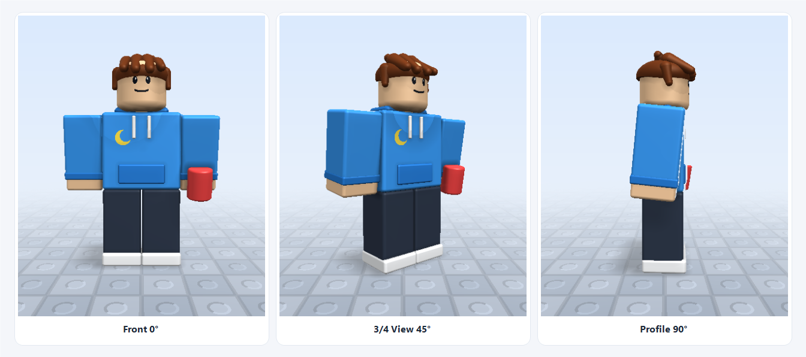

<p></p>

# roblox-style-video

[English](../../README.md) · [简体中文](../../README.zh-CN.md) · [繁體中文](README.zh-TW.md) · **日本語** · [한국어](README.ko.md) · [Español](README.es.md) · [Français](README.fr.md) · [Deutsch](README.de.md) · [Português](README.pt-BR.md) · [Русский](README.ru.md)

9:16 縦型 Roblox 風ショート動画向けの Agent Skill と Node.js CLI ツールです。動画生成 AI に漠然と「Roblox キャラ」と指示したり `C-shaped claw hands` と書いたりすると、人間の5本指、レゴのC字爪や頭頂ポッチ、Minecraft のボクセル頭、隙間のある細い脚になりがちです。`roblox-style-video` は Roblox Studio の標準比率（`2x2x1` 胴体、隙間なく並ぶ `1x2x1` 脚、指や爪のないブロック手、`1:1` 円筒ヘッドと平面 2D デカール顔、`Studs` ベースプレート）を固定し、Kling・Seedance・Hailuo・Wan・Sora・Runway 向けプロンプトとローカル 3D プレビューを生成します。

## クイックスタート

ローカルの Skills ディレクトリにクローンします（Codex、Claude Code、Cursor、GitHub Copilot 対応）：

```bash
git clone https://github.com/yuzhang-zhong/roblox-style-video.git ~/.codex/skills/roblox-style-video
```

エージェントで `$roblox-style-video` を指定して実行：

```text
$roblox-style-video を使って、Y2K ストリート系アバターと黄色い Classic Noob が買い物に行く
15秒の 9:16 ショート動画を企画して。キャラ設定カード、三面図プロンプト、Kling I2V 用の4カット絵コンテを出して。
```

単体スクリプトとして直接実行することもできます（Node.js 18+ 標準ライブラリのみ、`npm install`・APIキー不要）：

```bash
node scripts/avatar_spec.mjs --archetype corporate-worker --rig chibi-blocky --material smooth-plastic --name "Momo" --lang ja
node scripts/shot_compiler.mjs --template daily-meltdown --duration 15 --engine kling --rig chibi-blocky --lang ja
node scripts/drift_check.mjs --prompt "A cute Roblox girl with C-shaped claw hands drinks coffee with five fingers" --engine kling --mode t2v --lang ja
```

## サンプルとローカル 3D プレビュー

リポジトリ内の `.png`・`.gif`・`.mp4` は外部の動画生成クレジットを消費する前に比率・構図・頭上チャット吹き出しを確認するため `scripts/render_preview.mjs` でオフライン描画した 3D プレビューです。最終動画は各動画生成モデルでレンダリングします。

| 3面図リファレンス (`0° / 45° / 90°`) | 形状崩れチェック (`FAIL` vs. `PASS`) |
| :---: | :---: |
|  |  |

6つのテンプレートと動画エンジンに対応するサンプルです。絵コンテは15秒（`9:16`・4カット）構成で、各MP4は4秒のローカルプレビューです。

| 01 · 月曜アラーム (`Kling`) | 02 · スカイアスレ (`Hailuo`) | 03 · Y2K vs. Noob (`Seedance`) |
| :---: | :---: | :---: |
|  |  |  |
| [絵コンテ](../../examples/monday-alarm-meltdown/assets/storyboard_contact_sheet.en.png) · [MP4](../../examples/monday-alarm-meltdown/assets/monday_alarm_meltdown.mp4) · [ファイル](../../examples/monday-alarm-meltdown/) | [絵コンテ](../../examples/obby-sky-run/assets/obby_storyboard_sheet.en.png) · [MP4](../../examples/obby-sky-run/assets/obby_sky_run.mp4) · [ファイル](../../examples/obby-sky-run/) | [絵コンテ](../../examples/duo-bestie-contrast/assets/duo_storyboard_sheet.en.png) · [MP4](../../examples/duo-bestie-contrast/assets/duo_bestie_contrast.mp4) · [ファイル](../../examples/duo-bestie-contrast/) |
| **04 · カフェ経営 (`Wan`)** | **05 · ランウェイ変身 (`Sora`)** | **06 · 黒焦げピザ (`Runway`)** |
|  |  |  |
| [絵コンテ](../../examples/cozy-cafe-tycoon/assets/cafe_storyboard_sheet.en.png) · [MP4](../../examples/cozy-cafe-tycoon/assets/cozy_cafe_tycoon.mp4) · [ファイル](../../examples/cozy-cafe-tycoon/) | [絵コンテ](../../examples/runway-outfit-drop/assets/runway_storyboard_sheet.en.png) · [MP4](../../examples/runway-outfit-drop/assets/runway_outfit_drop.mp4) · [ファイル](../../examples/runway-outfit-drop/) | [絵コンテ](../../examples/burnt-pizza-slapstick/assets/pizza_storyboard_sheet.en.png) · [MP4](../../examples/burnt-pizza-slapstick/assets/burnt_pizza_slapstick.mp4) · [ファイル](../../examples/burnt-pizza-slapstick/) |

## CLI スクリプト・制約事項・リファレンス

- [`scripts/avatar_spec.mjs`](../../scripts/avatar_spec.mjs)：キャラクター DNA カード（`BrickColor`、`2x2x1` / `1x2x1` 比率）と三面図プロンプトを生成。
- [`scripts/shot_compiler.mjs`](../../scripts/shot_compiler.mjs)：`kling`・`seedance`・`hailuo`・`wan`・`sora`・`runway` 向けの 9:16 絵コンテと I2V/T2V プロンプトを出力。
- [`scripts/drift_check.mjs`](../../scripts/drift_check.mjs)：人間の指、レゴC字爪、ボクセル頭、1カット内の動作過多を検査して修正プロンプトを生成。
- [`scripts/render_preview.mjs`](../../scripts/render_preview.mjs)：三面図、比較ボード、絵コンテシート、`.gif` / `.mp4` プレビューをローカル描画。

4〜5秒のクリップごとに主要アクションは1つに絞り、マルチショット制作時は三面図から開始フレームを固定してください。応答と `--lang` は10言語（`en`, `zh`, `zh-tw`, `ja`, `ko`, `es`, `fr`, `de`, `pt`, `ru`）に対応。[MIT License](../../LICENSE) の独立したオープンソースであり、Roblox Corporation とは無関係です。

- [`SKILL.md`](../../SKILL.md)
- [`references/avatar-geometry-and-materials.md`](../../references/avatar-geometry-and-materials.md)
- [`references/model-prompt-playbook.md`](../../references/model-prompt-playbook.md)
- [`references/rescue-and-anti-drift.md`](../../references/rescue-and-anti-drift.md)
- [`references/short-video-beats-and-audio.md`](../../references/short-video-beats-and-audio.md) · [`references/viral-archetypes-catalog.md`](../../references/viral-archetypes-catalog.md)
