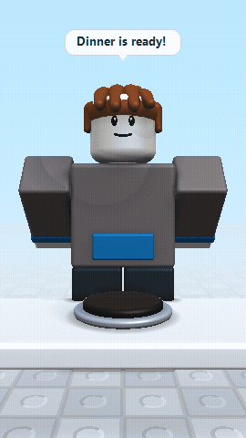

<div align="center">

# Roblox Style Video Skill

Claude Code・Cursor・GitHub Copilot・Codex 向けの **Agent Skill**（`SKILL.md` + リファレンスガイド + 依存関係ゼロの CLI ツール）。R6 ブロックアバターの比率固定、9:16 縦型ショート動画の 4 カット構成、モデル別プロンプト生成、ローカル 3D プレビューを一貫して行います。

[](../../skills/roblox-style-video/SKILL.md)
[](#skill-ワークフローとクイックスタート)
[](../../LICENSE)

**[動画サンプル](#動画サンプル)** · [シーンボードと尺配分](#シーンボードとカット割り) · [ワークフローと導入](#skill-ワークフローとクイックスタート) · [Skill ガイド](../../skills/roblox-style-video/SKILL.md)

[English](../../README.md) · [简体中文](../../README.zh-CN.md) · [繁體中文](README.zh-TW.md) · **日本語** · [한국어](README.ko.md) · [Español](README.es.md) · [Français](README.fr.md) · [Deutsch](README.de.md) · [Português](README.pt-BR.md) · [Русский](README.ru.md)

</div>

## 動画サンプル

AI コーディングエージェントから呼び出すと、アイデアを 12 種類の定番ストーリーフォーマットに沿った 15 秒・4 カットの縦型（`9:16`）パッケージへ変換します。以下の **4 秒 MP4** と GIF は同梱の `scripts/render_preview.mjs` でオフライン描画した 3D アニマティクスで、外部の動画生成モデルでクレジットを消費する前に R6 比率・マルチパーツ小物・カメラワーク・頭上の `BillboardGui` チャット吹き出しを確認できます。

<p align="center">
  <a href="../../examples/monday-alarm-meltdown/assets/monday_alarm_meltdown.mp4"></a>
  <a href="../../examples/obby-sky-run/assets/obby_sky_run.mp4"></a>
  <a href="../../examples/duo-bestie-contrast/assets/duo_bestie_contrast.mp4"></a>
  <a href="../../examples/cozy-cafe-tycoon/assets/cozy_cafe_tycoon.mp4"></a>
  <a href="../../examples/runway-outfit-drop/assets/runway_outfit_drop.mp4"></a>
  <a href="../../examples/burnt-pizza-slapstick/assets/burnt_pizza_slapstick.mp4"></a>
  <br />
  <a href="../../examples/disaster-tower-tornado/assets/disaster_tower_tornado.mp4"></a>
  <a href="../../examples/brookhaven-police-chase/assets/brookhaven_police_chase.mp4"></a>
  <a href="../../examples/doors-flashlight-hallway/assets/doors_flashlight_hallway.mp4"></a>
  <a href="../../examples/crossroads-sword-duel/assets/crossroads_sword_duel.mp4"></a>
  <a href="../../examples/classroom-exam-panic/assets/classroom_exam_panic.mp4"></a>
  <a href="../../examples/red-light-freeze/assets/red_light_freeze.mp4"></a>
</p>

## シーンボードとカット割り

4〜5 秒の単一クリップに複数の連続動作を詰め込むと、ブロック状の剛体手足がゴムのように曲がりやすくなります。各ショート動画は「1 カット 1 アクション」の 4 ビート（`0–3.5s` フック、展開 2 カット、`11.5–15s` オチまたはループ復帰）に分割しています：

| Shot 01 · フック (`0–3.5s`) | Shot 02 · アクション (`3.5–7.5s`) | Shot 03 · 展開 (`7.5–11.5s`) | Shot 04 · ループ (`11.5–15s`) |
| :---: | :---: | :---: | :---: |
|  |  |  |  |

6 つの定番ゲームジャンル別の 4 カット絵コンテシート（カメラ切り替えと英語チャット吹き出し付き）：

| 02 · Sky Obby (`Hailuo` · Speed Coil & Killbrick) | 08 · Brookhaven Police Chase (`Hailuo` · ストリート追跡) |
| :---: | :---: |
| <a href="../../examples/obby-sky-run/"></a> | <a href="../../examples/brookhaven-police-chase/"></a> |
| **07 · Natural Disaster Tower (`Kling` · 竜巻サバイバル)** | **09 · Doors Hotel Hallway (`Sora` · 懐中電灯と点滅廊下)** |
| <a href="../../examples/disaster-tower-tornado/"></a> | <a href="../../examples/doors-flashlight-hallway/"></a> |
| **10 · Crossroads Sword Duel (`Seedance` · 溶岩石橋の剣対決)** | **12 · Red Light Freeze (`Runway` · だるまさんがころんだ)** |
| <a href="../../examples/crossroads-sword-duel/"></a> | <a href="../../examples/red-light-freeze/"></a> |

## Skill ワークフローとクイックスタート

<p align="center">
  
</p>

### Agent Skill として導入する

GitHub の公式 Skill コマンドでインストールできます。自己完結型パッケージは [`skills/roblox-style-video/`](../../skills/roblox-style-video/) にあり、エントリポイントは [`SKILL.md`](../../skills/roblox-style-video/SKILL.md) です。

```bash
gh skill install yuzhang-zhong/roblox-style-video roblox-style-video
```

チャットから `roblox-style-video` スキルを呼び出します：

```text
$roblox-style-video を使って、薄暗いホテル廊下（doors-horror）を舞台にした 15 秒・9:16 のショート動画を設計して：
青いパーカーの R6 アバターが懐中電灯で 050 号室のドアを照らした瞬間に照明が点滅し、背後に白い目が現れてクローゼットに隠れる構成。
キャラクター形状ロック、4 カットの絵コンテ、Sora / Kling 用の I2V プロンプトを出して。
```

### 同梱 CLI ツールを直接実行する

リポジトリ直下から Node.js 18+ 標準ライブラリのみで実行できます（`npm install` や API キーは不要です）。

```bash
node scripts/shot_compiler.mjs --template brookhaven-chase --duration 15 --engine hailuo --rig r6 --lang ja
node scripts/drift_check.mjs --prompt "A cute Roblox girl with C-shaped claw hands drinks coffee with five fingers" --engine kling --mode t2v --lang ja
node scripts/render_preview.mjs --only tornado,chase,doors
```

## Skill スクリプト・形状崩れチェック・リファレンス

曖昧なプロンプトでは、人間の 5 本指、レゴ風の C 字ハンドや床の丸ポッチ、マイクラ風のボクセル頭が混入しがちです。本 Skill は標準的なブロック R6 比率（`2x2x1` 胴体、隙間なく並ぶ `1x2x1` 脚、指のない角柱ハンド、`1:1` バレル頭部、フラットな床材とマルチパーツ小物）を固定し、`drift_check.mjs` で生成前にスタイル崩れを検出します：

<p align="center">
  
</p>

| Skill コンポーネント | 出力内容 |
| --- | --- |
| [`SKILL.md`](../../skills/roblox-style-video/SKILL.md) | Agent Skill のエントリ定義。6 つの制作モード（`Avatar` / `Storyboard` / `Prompt-Compile` / `Rescue` / `Remix` / `Render`）と 8 つの形状ルールを規定。 |
| [`shot_compiler.mjs`](../../scripts/shot_compiler.mjs) | 12 種類のストーリーテンプレートから、Kling・Seedance・Hailuo・Wan・Sora・Runway 向けの 9:16 絵コンテと I2V/T2V プロンプトを生成。 |
| [`avatar_spec.mjs`](../../scripts/avatar_spec.mjs) | `BrickColor` コード・比率ロック付きのキャラクター DNA カードと、[三面図シート](../../assets/showcase/momo_turnaround_sheet.en.png)用プロンプトを生成。 |
| [`drift_check.mjs`](../../scripts/drift_check.mjs) | 5 本指の生成、レゴ風パーツ、ブランドロゴ混入、1 カット内の動作過多を診断し、修正済みプロンプトを出力。 |
| [`render_preview.mjs`](../../scripts/render_preview.mjs) | 3D 絵コンテシート、比較ボード、GIF、MP4 アニマティクスをオフライン描画（Windows 合成は PowerShell `System.Drawing` と `ffmpeg` を使用）。 |

[アバター形状とマテリアル](../../references/avatar-geometry-and-materials.md) · [定番ギア・小物カタログ](../../references/classic-roblox-catalog.md) · [モデル別プロンプト集](../../references/model-prompt-playbook.md) · [スタイル崩れ対策](../../references/rescue-and-anti-drift.md) · [カット割りと効果音](../../references/short-video-beats-and-audio.md) · [12 種類のストーリーテンプレート](../../references/viral-archetypes-catalog.md)

## 対応言語

Agent Skill の応答および CLI の `--lang` オプションは `en`・`zh`・`zh-tw`・`ja`・`ko`・`es`・`fr`・`de`・`pt`・`ru` の 10 言語に対応しています。

[English](../../README.md) · [简体中文](../../README.zh-CN.md) · [繁體中文](README.zh-TW.md) · **日本語** · [한국어](README.ko.md) · [Español](README.es.md) · [Français](README.fr.md) · [Deutsch](README.de.md) · [Português](README.pt-BR.md) · [Русский](README.ru.md)

[MIT License](../../LICENSE)。独自の三角形エンブレムを使用した独立オープンソースの Agent Skill であり、Roblox Corporation とは提携・関係していません。
