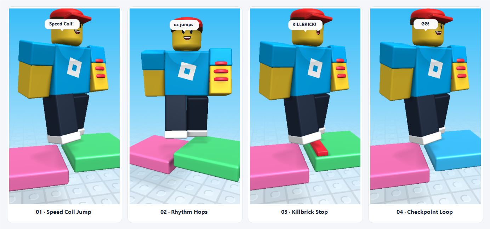

<div align="center">

# Roblox Style Video Skill

Claude Code, Cursor, GitHub Copilot, Codex용 **Agent Skill** (`SKILL.md` + 레퍼런스 가이드 + 무의존성 오프라인 CLI 도구). R6 블록 아바타 비율 고정, 9:16 세로형 숏폼 4컷 스토리보드 설계, 모델별 비디오 프롬프트 컴파일, 로컬 3D 애니매틱 프리뷰를 지원합니다.

[](../../SKILL.md)
[](#skill-워크플로-및-빠른-시작)
[](../../LICENSE)

**[비디오 예제](#비디오-예제)** · [장면 보드 및 컷 구성](#장면-보드-및-컷-템포) · [워크플로 및 빠른 시작](#skill-워크플로-및-빠른-시작) · [Skill 가이드](../../SKILL.md)

[English](../../README.md) · [简体中文](../../README.zh-CN.md) · [繁體中文](README.zh-TW.md) · [日本語](README.ja.md) · **한국어** · [Español](README.es.md) · [Français](README.fr.md) · [Deutsch](README.de.md) · [Português](README.pt-BR.md) · [Русский](README.ru.md)

</div>

## 비디오 예제

AI 코딩 에이전트에서 이 Skill을 호출하면, 숏폼 아이디어를 12가지 대표 블록 스토리 포맷에 맞춘 15초·4컷 세로형(`9:16`) 패키지로 변환합니다. 아래 **4초 MP4**와 GIF는 Skill에 포함된 `scripts/render_preview.mjs`가 로컬에서 오프라인 렌더링한 3D 애니매틱으로, 유료 비디오 생성 모델을 호출하기 전에 R6 비율, 다중 파츠 소품, 카메라 무빙, 머리 위 `BillboardGui` 말풍선을 미리 검증할 수 있습니다.

<p align="center">
  <a href="../../examples/monday-alarm-meltdown/assets/monday_alarm_meltdown.mp4"></a>
  <a href="../../examples/obby-sky-run/assets/obby_sky_run.mp4"></a>
  <a href="../../examples/duo-bestie-contrast/assets/duo_bestie_contrast.mp4"></a>
  <a href="../../examples/cozy-cafe-tycoon/assets/cozy_cafe_tycoon.mp4"></a>
  <a href="../../examples/runway-outfit-drop/assets/runway_outfit_drop.mp4"></a>
  <a href="../../examples/burnt-pizza-slapstick/assets/burnt_pizza_slapstick.mp4"></a>
  <br />
  <a href="../../examples/disaster-tower-tornado/assets/disaster_tower_tornado.mp4"></a>
  <a href="../../examples/brookhaven-police-chase/assets/brookhaven_police_chase.mp4"></a>
  <a href="../../examples/doors-flashlight-hallway/assets/doors_flashlight_hallway.mp4"></a>
  <a href="../../examples/crossroads-sword-duel/assets/crossroads_sword_duel.mp4"></a>
  <a href="../../examples/classroom-exam-panic/assets/classroom_exam_panic.mp4"></a>
  <a href="../../examples/red-light-freeze/assets/red_light_freeze.mp4"></a>
</p>

## 장면 보드 및 컷 템포

비디오 생성 모델은 4~5초 분량의 단일 프롬프트에 여러 연속 동작을 넣으면 단단한 블록 팔다리가 고무처럼 휘어지기 쉽습니다. 각 15초 숏폼은 컷당 하나의 핵심 동작만 수행하는 4비트(`0–3.5s` 훅, 전개 2컷, `11.5–15s` 반전 또는 루프 복귀)로 나뉩니다:

| Shot 01 · 훅 (`0–3.5s`) | Shot 02 · 액션 (`3.5–7.5s`) | Shot 03 · 반전 (`7.5–11.5s`) | Shot 04 · 루프 (`11.5–15s`) |
| :---: | :---: | :---: | :---: |
|  |  |  |  |

6가지 게임 장르별 4컷 스토리보드 시트(카메라 앵글 전환 및 영문 말풍선 포함):

| 02 · Sky Obby (`Hailuo` · Speed Coil & Killbrick) | 08 · Brookhaven Police Chase (`Hailuo` · 거리 추격전) |
| :---: | :---: |
| <a href="../../examples/obby-sky-run/"></a> | <a href="../../examples/brookhaven-police-chase/"></a> |
| **07 · Natural Disaster Tower (`Kling` · 토네이도 생존)** | **09 · Doors Hotel Hallway (`Sora` · 손전등 점멸 복도)** |
| <a href="../../examples/disaster-tower-tornado/"></a> | <a href="../../examples/doors-flashlight-hallway/"></a> |
| **10 · Crossroads Sword Duel (`Seedance` · 용암 다리 검투)** | **12 · Red Light Freeze (`Runway` · 무궁화 꽃이 피었습니다)** |
| <a href="../../examples/crossroads-sword-duel/"></a> | <a href="../../examples/red-light-freeze/"></a> |

## Skill 워크플로 및 빠른 시작

<p align="center">
  
</p>

### Agent Skill로 설치하기

에이전트 호스트의 skills 디렉터리에 이 저장소를 클론하면, 에이전트가 [`SKILL.md`](../../SKILL.md)와 [`references/`](../../references/) 가이드를 읽고 내장 Node.js 스크립트를 자동으로 실행합니다. 아래 경로는 Codex 기준이며, GitHub Copilot은 `~/.copilot/skills/roblox-style-video`, Claude Code와 Cursor는 각 도구의 skills 폴더를 사용하세요.

```bash
git clone https://github.com/yuzhang-zhong/roblox-style-video.git ~/.codex/skills/roblox-style-video
```

에이전트 채팅에서 `roblox-style-video` 스킬을 호출합니다:

```text
$roblox-style-video 스킬을 사용해서 어두운 호텔 복도(doors-horror) 배경의 15초 9:16 숏폼을 기획해 줘:
파란 후드티를 입은 R6 아바타가 손전등으로 050호 방문을 비추다 조명이 깜빡이고, 등 뒤에 하얀 눈이 나타나 옷장으로 숨는 구성이야.
캐릭터 비율 고정표, 4컷 스토리보드, Sora / Kling I2V 프롬프트를 작성해 줘.
```

### 내장 CLI 도구 직접 실행하기

모든 스크립트는 Node.js 18+ 표준 라이브러리만으로 저장소 루트에서 바로 실행됩니다(`npm install` 및 API 키 불필요).

```bash
node scripts/shot_compiler.mjs --template brookhaven-chase --duration 15 --engine hailuo --rig r6 --lang ko
node scripts/drift_check.mjs --prompt "A cute Roblox girl with C-shaped claw hands drinks coffee with five fingers" --engine kling --mode t2v --lang ko
node scripts/render_preview.mjs --only tornado,chase,doors
```

## Skill 스크립트, 스타일 왜곡 점검 및 레퍼런스

일반적인 프롬프트는 표준 블록 R6 구조(`2x2x1` 몸통, 빈틈없이 맞닿은 `1x2x1` 다리, 손가락 없는 직육면체 손, `1:1` 배럴 헤드, 매끄러운 바닥재와 다중 파츠 소품) 대신 사람의 다섯 손가락, 레고 C자 집게손·바닥 돌기, 마인크래프트 복셀 큐브를 생성하기 쉽습니다. `drift_check.mjs`는 생성 전에 이러한 왜곡 위험을 잡아냅니다:

<p align="center">
  
</p>

| Skill 구성 요소 | 출력 결과 |
| --- | --- |
| [`SKILL.md`](../../SKILL.md) | Agent Skill 메인 엔트리 문서. 6가지 제작 모드(`Avatar`, `Storyboard`, `Prompt-Compile`, `Rescue`, `Remix`, `Render`)와 8가지 기하학 불변 규칙 정의. |
| [`shot_compiler.mjs`](../../scripts/shot_compiler.mjs) | 12종의 숏폼 템플릿을 기반으로 Kling, Seedance, Hailuo, Wan, Sora, Runway용 9:16 비트시트 및 I2V/T2V 프롬프트 컴파일. |
| [`avatar_spec.mjs`](../../scripts/avatar_spec.mjs) | `BrickColor` 코드와 블록 비율이 고정된 캐릭터 DNA 카드 및 [3면도 턴어라운드 시트](../../assets/showcase/momo_turnaround_sheet.en.png) 프롬프트 생성. |
| [`drift_check.mjs`](../../scripts/drift_check.mjs) | 사람 손가락 생성, 레고 집게손·돌기, 상표 로고 혼입, 단일 컷 다중 동작 과부하를 진단하고 보정된 프롬프트 출력. |
| [`render_preview.mjs`](../../scripts/render_preview.mjs) | 오프라인 3D 스토리보드 시트, 비교 보드, GIF 및 MP4 애니매틱 렌더링(Windows 합성은 PowerShell `System.Drawing` 및 `ffmpeg` 사용). |

[아바타 기하 구조 및 재질](../../references/avatar-geometry-and-materials.md) · [클래식 기어 및 소품 카탈로그](../../references/classic-roblox-catalog.md) · [모델별 프롬프트 플레이북](../../references/model-prompt-playbook.md) · [스타일 왜곡 복구 가이드](../../references/rescue-and-anti-drift.md) · [컷 템포 및 오디오 가이드](../../references/short-video-beats-and-audio.md) · [12종 스토리 템플릿](../../references/viral-archetypes-catalog.md)

## 지원 언어

Agent Skill 응답과 CLI `--lang` 옵션은 `en`, `zh`, `zh-tw`, `ja`, `ko`, `es`, `fr`, `de`, `pt`, `ru` 10개 언어를 지원합니다.

[English](../../README.md) · [简体中文](../../README.zh-CN.md) · [繁體中文](README.zh-TW.md) · [日本語](README.ja.md) · **한국어** · [Español](README.es.md) · [Français](README.fr.md) · [Deutsch](README.de.md) · [Português](README.pt-BR.md) · [Русский](README.ru.md)

[MIT License](../../LICENSE). 독자적인 기하학적 삼각형 엠블럼을 사용하는 독립 오픈소스 Agent Skill 프로젝트이며, Roblox Corporation과 제휴하거나 승인받은 관계가 아닙니다.
