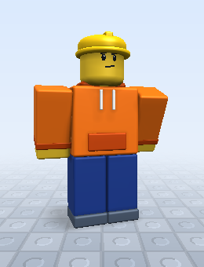
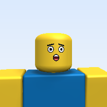

<div align="center">


# roblox-style-skill

[English](../../README.md) · [简体中文](../../README.zh-CN.md) · [繁體中文](README.zh-TW.md) · [日本語](README.ja.md) · **한국어** · [Español](README.es.md) · [Français](README.fr.md) · [Deutsch](README.de.md) · [Português](README.pt-BR.md) · [Русский](README.ru.md)

표준 Roblox R6 및 블록형 아바타 비율을 고정하여 9:16 숏폼 스토리보드와 모델별 비디오 프롬프트를 생성하는 스킬입니다.

</div>

비디오 생성 모델에 단순히 "귀여운 로블록스 캐릭터"라고 입력하거나 `C-shaped claw hands`를 넣으면 사람 손가락 5개, 레고 C자 갈고리 손과 머리 위 돌기(stud), 마인크래프트 각진 복셀, 혹은 운동화를 신은 분리된 다리로 왜곡되기 쉽습니다. `roblox-style-skill`은 애니메이션 생성 전에 Roblox Studio 표준 비율(`2x2x1` 몸통, 빈틈없이 맞닿은 `1x2x1` 다리 블록, 손가락과 갈고리가 없는 `1x2x1` 통블록 손, 평면 2D 데칼 얼굴이 그려진 `1:1` 둥근 원통형 머리, `SmoothPlastic` 재질과 `Studs` 바닥판, 머리 위 `BillboardGui` 말풍선)을 먼저 고정합니다.


## 비주얼 프리뷰 및 6가지 쇼츠 예제

| 3면도 캐릭터 시트 (`0° / 45° / 90°`) | 형태 왜곡 비교 (`FAIL` vs. `PASS`) |
| :---: | :---: |
|  |  |

6가지 템플릿과 6개 비디오 엔진으로 구성한 9:16 세로형 쇼츠 패키지:

| 01 · 월요일 알람 (`Kling`) | 02 · 스카이 오비 (`Hailuo`) | 03 · Y2K vs. 뉴비 (`Seedance`) |
| :---: | :---: | :---: |
|  |  |  |
| [콘티](../../examples/monday-alarm-meltdown/assets/storyboard_contact_sheet.en.png) · [MP4](../../examples/monday-alarm-meltdown/assets/monday_alarm_meltdown.mp4) · [패키지](../../examples/monday-alarm-meltdown/) | [콘티](../../examples/obby-sky-run/assets/obby_storyboard_sheet.en.png) · [MP4](../../examples/obby-sky-run/assets/obby_sky_run.mp4) · [패키지](../../examples/obby-sky-run/) | [콘티](../../examples/duo-bestie-contrast/assets/duo_storyboard_sheet.en.png) · [MP4](../../examples/duo-bestie-contrast/assets/duo_bestie_contrast.mp4) · [패키지](../../examples/duo-bestie-contrast/) |
| **04 · 미니 카페 타이쿤 (`Wan`)** | **05 · 런웨이 변신 (`Sora`)** | **06 · 탄 피자 슬랩스틱 (`Runway`)** |
|  |  |  |
| [콘티](../../examples/cozy-cafe-tycoon/assets/cafe_storyboard_sheet.en.png) · [MP4](../../examples/cozy-cafe-tycoon/assets/cozy_cafe_tycoon.mp4) · [패키지](../../examples/cozy-cafe-tycoon/) | [콘티](../../examples/runway-outfit-drop/assets/runway_storyboard_sheet.en.png) · [MP4](../../examples/runway-outfit-drop/assets/runway_outfit_drop.mp4) · [패키지](../../examples/runway-outfit-drop/) | [콘티](../../examples/burnt-pizza-slapstick/assets/pizza_storyboard_sheet.en.png) · [MP4](../../examples/burnt-pizza-slapstick/assets/burnt_pizza_slapstick.mp4) · [패키지](../../examples/burnt-pizza-slapstick/) |

## 클래식 Roblox 아바타 · 의상 · 표정 라이브러리

[`assets/library/`](../../assets/library/catalog.json) 및 [`references/classic-roblox-catalog.md`](../../references/classic-roblox-catalog.md) 수록 ([아바타 시트](../../assets/showcase/classic_avatars_lineup.en.png) · [표정 시트](../../assets/showcase/classic_faces_atlas.en.png)):

| Classic Noob | Classic Guest | Bacon Hair | Builderman | Speedrunner | Story Hoodie |
| :---: | :---: | :---: | :---: | :---: | :---: |
|  |  |  |  |  |  |

| `Smile :)` | `Chill -_-` | `Check It` | `Grin :D` | `Shocked` | `Tears` | `Bloxxer` | `KO X_X` |
| :---: | :---: | :---: | :---: | :---: | :---: | :---: | :---: |
|  |  |  |  |  |  |  |  |

## 빠른 시작

로컬 Skills 디렉터리에 저장소를 클론합니다(Claude Code, Codex, Cursor, GitHub Copilot 지원):

```bash
git clone https://github.com/yuzhang-zhong/roblox-style-skill.git ~/.codex/skills/roblox-style-skill
```

에이전트에서 `$roblox-style-skill`을 호출합니다:

```text
$roblox-style-skill을 사용해서 Y2K 스트리트 패션 아바타와 클래식 뉴비가 함께 쇼핑하는 15초짜리
9:16 숏폼을 기획해 줘. 캐릭터 카드, 3면도 프롬프트, 4컷 Kling I2V 스토리보드를 작성해 줘.
```

## CLI 도구

모든 스크립트는 외부 패키지 없이 Node.js 18+ 표준 라이브러리로 실행됩니다:

| 스크립트 | 설명 |
| --- | --- |
| [`scripts/avatar_spec.mjs`](../../scripts/avatar_spec.mjs) | 캐릭터 DNA 카드(`BrickColor` 팔레트, `2x2x1`/`1x2x1` 비율 고정) 및 3면도 프롬프트 생성 |
| [`scripts/shot_compiler.mjs`](../../scripts/shot_compiler.mjs) | 9:16 스토리보드 및 `kling`, `seedance`, `hailuo`, `wan`, `sora`, `runway` 맞춤 프롬프트 컴파일 |
| [`scripts/drift_check.mjs`](../../scripts/drift_check.mjs) | 사람 손가락, 레고 갈고리/돌기, 복셀화, 다중 동작 과부하를 점검하고 교정 프롬프트 출력 |
| [`scripts/render_preview.mjs`](../../scripts/render_preview.mjs) | 3D 3면도 시트, 왜곡 비교 보드, 스토리보드 시트 및 `.gif` / `.mp4` 프리뷰 로컬 렌더링 |

```bash
node scripts/avatar_spec.mjs --archetype corporate-worker --rig chibi-blocky --material smooth-plastic --name "Momo" --lang ko
node scripts/shot_compiler.mjs --template daily-meltdown --duration 15 --engine kling --rig chibi-blocky --lang ko
node scripts/drift_check.mjs --prompt "A cute Roblox girl with C-shaped claw hands drinks coffee with five fingers" --engine kling --mode t2v --lang ko
```

## 문서 및 지원 언어

에이전트 응답과 CLI `--lang` 옵션은 10개 언어(`en`, `zh`, `zh-tw`, `ja`, `ko`, `es`, `fr`, `de`, `pt`, `ru`)를 지원합니다. 4~5초 클립당 하나의 핵심 동작만 배치하고, 멀티샷 영상 제작 시 3면도로 첫 프레임을 먼저 고정하세요. 본 프로젝트는 독립 오픈소스 도구이며 Roblox Corporation과 무관합니다.

- [코어 스킬 워크플로 (`SKILL.md`)](../../SKILL.md)
- [아바타 기하 구조, 데칼 얼굴 및 재질 (`references/avatar-geometry-and-materials.md`)](../../references/avatar-geometry-and-materials.md)
- [모델별 프롬프트 플레이북 (`references/model-prompt-playbook.md`)](../../references/model-prompt-playbook.md)
- [스타일 왜곡 진단 및 복구 패치 (`references/rescue-and-anti-drift.md`)](../../references/rescue-and-anti-drift.md)
- [9:16 템포, 조명 및 오디오 큐 (`references/short-video-beats-and-audio.md`)](../../references/short-video-beats-and-audio.md)
- [숏폼 스토리 템플릿 6종 (`references/viral-archetypes-catalog.md`)](../../references/viral-archetypes-catalog.md)
