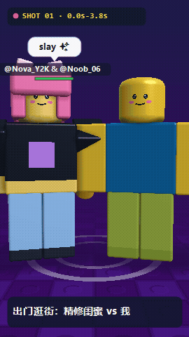
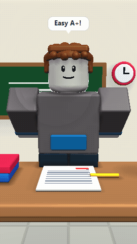

<div align="center">

# Roblox Style Video Skill

Um **Agent Skill** (`SKILL.md` + guias de referência + ferramentas CLI offline sem dependências) para Claude Code, Cursor, GitHub Copilot e Codex que planeja curtas verticais `9:16` de avatares blocky estilo Roblox, trava proporções R6, compila prompts tomada a tomada e renderiza prévias 3D localmente.

[](../../SKILL.md)
[](#fluxo-do-skill-e-início-rápido)
[](../../LICENSE)

**[Exemplos em vídeo](#exemplos-em-vídeo)** · [Pranchas de cenas](#pranchas-de-cenas-e-ritmo-de-tomadas) · [Fluxo do Skill e início rápido](#fluxo-do-skill-e-início-rápido) · [Guia do Skill](../../SKILL.md)

[English](../../README.md) · [简体中文](../../README.zh-CN.md) · [繁體中文](README.zh-TW.md) · [日本語](README.ja.md) · [한국어](README.ko.md) · [Español](README.es.md) · [Français](README.fr.md) · [Deutsch](README.de.md) · **Português** · [Русский](README.ru.md)

</div>

## Exemplos em vídeo

Quando acionado em um agente de código com IA, este Skill transforma uma ideia em um pacote vertical (`9:16`) de 15 segundos e quatro tomadas em 12 formatos clássicos de histórias blocky. Os **MP4s de 4 segundos** e GIFs abaixo são animatics 3D offline renderizados por `scripts/render_preview.mjs` para validar proporções R6, objetos compostos, movimentos de câmera e balões `BillboardGui` antes de gastar créditos em um modelo externo de vídeo.

<p align="center">
  <a href="../../examples/monday-alarm-meltdown/assets/monday_alarm_meltdown.mp4"></a>
  <a href="../../examples/obby-sky-run/assets/obby_sky_run.mp4"></a>
  <a href="../../examples/duo-bestie-contrast/assets/duo_bestie_contrast.mp4"></a>
  <a href="../../examples/cozy-cafe-tycoon/assets/cozy_cafe_tycoon.mp4"></a>
  <a href="../../examples/runway-outfit-drop/assets/runway_outfit_drop.mp4"></a>
  <a href="../../examples/burnt-pizza-slapstick/assets/burnt_pizza_slapstick.mp4"></a>
  <br />
  <a href="../../examples/disaster-tower-tornado/assets/disaster_tower_tornado.mp4"></a>
  <a href="../../examples/brookhaven-police-chase/assets/brookhaven_police_chase.mp4"></a>
  <a href="../../examples/doors-flashlight-hallway/assets/doors_flashlight_hallway.mp4"></a>
  <a href="../../examples/crossroads-sword-duel/assets/crossroads_sword_duel.mp4"></a>
  <a href="../../examples/classroom-exam-panic/assets/classroom_exam_panic.mp4"></a>
  <a href="../../examples/red-light-freeze/assets/red_light_freeze.mp4"></a>
</p>

## Pranchas de cenas e ritmo de tomadas

Modelos de vídeo deformam membros rígidos quando um único prompt de 4–5 segundos empilha três ou quatro verbos em sequência. Cada curta divide a narrativa em quatro batidas de ação única (`0–3.5s` gancho, duas tomadas de escalada e `11.5–15s` desfecho ou loop contínuo):

| Tomada 01 · Gancho (`0–3.5s`) | Tomada 02 · Ação (`3.5–7.5s`) | Tomada 03 · Virada (`7.5–11.5s`) | Tomada 04 · Loop (`11.5–15s`) |
| :---: | :---: | :---: | :---: |
|  |  |  |  |

Folhas de contato de quatro tomadas em seis gêneros clássicos, combinando trocas de câmera e balões de fala em inglês:

| 02 · Sky Obby (`Hailuo` · Speed Coil e Killbrick) | 08 · Brookhaven Police Chase (`Hailuo` · Perseguição urbana) |
| :---: | :---: |
| <a href="../../examples/obby-sky-run/"></a> | <a href="../../examples/brookhaven-police-chase/"></a> |
| **07 · Natural Disaster Tower (`Kling` · Sobrevivência ao tornado)** | **09 · Doors Hotel Hallway (`Sora` · Lanterna e luz piscando)** |
| <a href="../../examples/disaster-tower-tornado/"></a> | <a href="../../examples/doors-flashlight-hallway/"></a> |
| **10 · Crossroads Sword Duel (`Seedance` · Duelo de espadas 1v1)** | **12 · Red Light Freeze (`Runway` · Batatinha Frita 1, 2, 3)** |
| <a href="../../examples/crossroads-sword-duel/"></a> | <a href="../../examples/red-light-freeze/"></a> |

## Fluxo do Skill e início rápido

<p align="center">
  
</p>

### Instalar como Agent Skill

Clone este repositório no diretório de skills do seu agente. Depois de instalado, o agente lê [`SKILL.md`](../../SKILL.md), carrega os guias em [`references/`](../../references/) e executa automaticamente os scripts Node.js. O caminho abaixo é para o Codex; use `~/.copilot/skills/roblox-style-video` no GitHub Copilot ou a pasta de skills configurada no Claude Code e no Cursor.

```bash
git clone https://github.com/yuzhang-zhong/roblox-style-video.git ~/.codex/skills/roblox-style-video
```

Acione o skill `roblox-style-video` no chat do seu agente:

```text
Use $roblox-style-video para planejar um curta vertical 9:16 de 15 segundos em um corredor escuro de hotel (doors-horror):
um avatar R6 de moletom azul ilumina a porta 050 com uma lanterna quando as luzes piscam e se esconde no armário.
Gere a trava geométrica do personagem, um storyboard de 4 tomadas e prompts I2V para Sora / Kling.
```

### Executar diretamente as ferramentas CLI do Skill

Todos os scripts incluídos funcionam de forma independente na raiz do repositório com Node.js 18+ usando apenas a biblioteca padrão (sem `npm install` ou chaves de API).

```bash
node scripts/shot_compiler.mjs --template brookhaven-chase --duration 15 --engine hailuo --rig r6 --lang pt
node scripts/drift_check.mjs --prompt "A cute Roblox girl with C-shaped claw hands drinks coffee with five fingers" --engine kling --mode t2v --lang pt
node scripts/render_preview.mjs --only tornado,chase,doors
```

## Scripts do Skill, verificação anti-desvio e referências

Prompts genéricos costumam gerar dedos humanos, garras em C ou pinos circulares de Lego no chão e cabeças em voxel estilo Minecraft em vez da geometria blocky R6 (`tronco 2x2x1`, pernas `1x2x1` alinhadas sem vão, mãos sólidas sem dedos, cabeça cilíndrica chanfrada `1:1`, pisos lisos e objetos multiparte). O `drift_check.mjs` sinaliza esses desvios antes da geração:

<p align="center">
  
</p>

| Componente do Skill | Saída |
| --- | --- |
| [`SKILL.md`](../../SKILL.md) | Ponto de entrada principal do Agent Skill definindo os 6 modos de produção (`Avatar`, `Storyboard`, `Prompt-Compile`, `Rescue`, `Remix`, `Render`) e 8 invariantes geométricas. |
| [`shot_compiler.mjs`](../../scripts/shot_compiler.mjs) | Escaleta `9:16` e prompts I2V/T2V em 12 modelos de histórias para Kling, Seedance, Hailuo, Wan, Sora e Runway. |
| [`avatar_spec.mjs`](../../scripts/avatar_spec.mjs) | Ficha de DNA do personagem com códigos `BrickColor`, trava de proporções e prompt de [folha turnaround de três vistas](../../assets/showcase/momo_turnaround_sheet.en.png). |
| [`drift_check.mjs`](../../scripts/drift_check.mjs) | Relatório diagnóstico e prompt corrigido contra dedos humanos, peças Lego, logotipos de marca ou excesso de ações por clipe. |
| [`render_preview.mjs`](../../scripts/render_preview.mjs) | Renderização 3D offline de folhas de contato, comparativos, GIFs e MP4s (a composição no Windows utiliza PowerShell `System.Drawing` e `ffmpeg`). |

[Geometria e materiais](../../references/avatar-geometry-and-materials.md) · [Catálogo de itens clássicos](../../references/classic-roblox-catalog.md) · [Manual de prompts por modelo](../../references/model-prompt-playbook.md) · [Correções de desvio](../../references/rescue-and-anti-drift.md) · [Ritmo e áudio](../../references/short-video-beats-and-audio.md) · [12 modelos de histórias](../../references/viral-archetypes-catalog.md)

## Idiomas

As respostas do Agent Skill e a opção `--lang` da CLI oferecem suporte a `en`, `zh`, `zh-tw`, `ja`, `ko`, `es`, `fr`, `de`, `pt` e `ru`.

[English](../../README.md) · [简体中文](../../README.zh-CN.md) · [繁體中文](README.zh-TW.md) · [日本語](README.ja.md) · [한국어](README.ko.md) · [Español](README.es.md) · [Français](README.fr.md) · [Deutsch](README.de.md) · **Português** · [Русский](README.ru.md)

[Licença MIT](../../LICENSE). Agent Skill independente de código aberto com emblemas geométricos triangulares próprios; sem afiliação ou endosso da Roblox Corporation.
