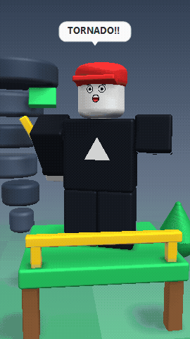
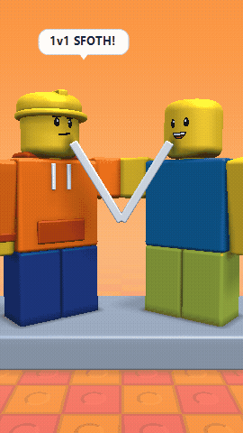

<div align="center">

# Roblox Style Video

Planeje curtas 9:16 estilo Roblox: trave proporções R6, compile prompts por plano e visualize o corte em 3D.

[English](../../README.md) · [简体中文](../../README.zh-CN.md) · [繁體中文](README.zh-TW.md) · [日本語](README.ja.md) · [한국어](README.ko.md) · [Español](README.es.md) · [Français](README.fr.md) · [Deutsch](README.de.md) · **Português** · [Русский](README.ru.md)

</div>

## Exemplos em vídeo (12 curtas animados 9:16)

<p align="center">
  <a href="../../examples/monday-alarm-meltdown/assets/monday_alarm_meltdown.mp4"></a>
  <a href="../../examples/obby-sky-run/assets/obby_sky_run.mp4"></a>
  <a href="../../examples/duo-bestie-contrast/assets/duo_bestie_contrast.mp4"></a>
  <a href="../../examples/cozy-cafe-tycoon/assets/cozy_cafe_tycoon.mp4"></a>
  <a href="../../examples/runway-outfit-drop/assets/runway_outfit_drop.mp4"></a>
  <a href="../../examples/burnt-pizza-slapstick/assets/burnt_pizza_slapstick.mp4"></a>
  <br />
  <a href="../../examples/disaster-tower-tornado/assets/disaster_tower_tornado.mp4"></a>
  <a href="../../examples/brookhaven-police-chase/assets/brookhaven_police_chase.mp4"></a>
  <a href="../../examples/doors-flashlight-hallway/assets/doors_flashlight_hallway.mp4"></a>
  <a href="../../examples/crossroads-sword-duel/assets/crossroads_sword_duel.mp4"></a>
  <a href="../../examples/classroom-exam-panic/assets/classroom_exam_panic.mp4"></a>
  <a href="../../examples/red-light-freeze/assets/red_light_freeze.mp4"></a>
</p>
<p align="center"><sub>Clique em qualquer animação para abrir o MP4.</sub></p>

| Short & prompt format | What happens | Short & prompt format | What happens |
| --- | --- | --- | --- |
| **[01 · Monday Alarm](../../examples/monday-alarm-meltdown/)** · Kling<br>[MP4](../../examples/monday-alarm-meltdown/assets/monday_alarm_meltdown.mp4) · [Prancha](../../examples/monday-alarm-meltdown/assets/storyboard_contact_sheet.en.png) | Slaps a ringing alarm clock, cries at 99+ pings, and face-plants onto the keyboard. | **[07 · Tornado Tower](../../examples/disaster-tower-tornado/)** · Kling<br>[MP4](../../examples/disaster-tower-tornado/assets/disaster_tower_tornado.mp4) · [Prancha](../../examples/disaster-tower-tornado/assets/tornado_storyboard_sheet.en.png) | A Classic Guest clings to a green tower as a dark tornado funnel tears blocks away. |
| **[02 · Sky Obby](../../examples/obby-sky-run/)** · Hailuo<br>[MP4](../../examples/obby-sky-run/assets/obby_sky_run.mp4) · [Prancha](../../examples/obby-sky-run/assets/obby_storyboard_sheet.en.png) | Speed Coil jumps across floating pads, stops short of a red Killbrick, and lands on the checkpoint. | **[08 · Police Chase](../../examples/brookhaven-police-chase/)** · Hailuo<br>[MP4](../../examples/brookhaven-police-chase/assets/brookhaven_police_chase.mp4) · [Prancha](../../examples/brookhaven-police-chase/assets/chase_storyboard_sheet.en.png) | Siren pursuit down an asphalt street ends when the fleeing Noob trips over a yellow hydrant. |
| **[03 · Y2K vs. Noob](../../examples/duo-bestie-contrast/)** · Seedance<br>[MP4](../../examples/duo-bestie-contrast/assets/duo_bestie_contrast.mp4) · [Prancha](../../examples/duo-bestie-contrast/assets/duo_storyboard_sheet.en.png) | A Y2K avatar's 180-degree spin bumps a rigid yellow R6 Noob sideways. | **[09 · Doors Hallway](../../examples/doors-flashlight-hallway/)** · Sora<br>[MP4](../../examples/doors-flashlight-hallway/assets/doors_flashlight_hallway.mp4) · [Prancha](../../examples/doors-flashlight-hallway/assets/doors_storyboard_sheet.en.png) | Flashlight check at Door 050, corridor lights flicker out, glowing eyes appear behind, closet hide. |
| **[04 · Cozy Cafe](../../examples/cozy-cafe-tycoon/)** · Wan<br>[MP4](../../examples/cozy-cafe-tycoon/assets/cozy_cafe_tycoon.mp4) · [Prancha](../../examples/cozy-cafe-tycoon/assets/cafe_storyboard_sheet.en.png) | Snaps a golden croissant onto a pastel tray, slides a hot latte, and pops +999 coins. | **[10 · Sword Duel](../../examples/crossroads-sword-duel/)** · Seedance<br>[MP4](../../examples/crossroads-sword-duel/assets/crossroads_sword_duel.mp4) · [Prancha](../../examples/crossroads-sword-duel/assets/sword_storyboard_sheet.en.png) | Builderman and Noob clash Linked Swords mid-air over lava before calling a Bloxy Cola truce. |
| **[05 · Runway Drop](../../examples/runway-outfit-drop/)** · Sora<br>[MP4](../../examples/runway-outfit-drop/assets/runway_outfit_drop.mp4) · [Prancha](../../examples/runway-outfit-drop/assets/runway_storyboard_sheet.en.png) | Jumps from a plain gray base rig and lands on the beat in neon pink Y2K streetwear. | **[11 · Exam Panic](../../examples/classroom-exam-panic/)** · Wan<br>[MP4](../../examples/classroom-exam-panic/assets/classroom_exam_panic.mp4) · [Prancha](../../examples/classroom-exam-panic/assets/exam_storyboard_sheet.en.png) | Confident smile turns to head-grab shock on Question 1, 2x scribbling, and X_X brain KO. |
| **[06 · Burnt Pizza](../../examples/burnt-pizza-slapstick/)** · Runway<br>[MP4](../../examples/burnt-pizza-slapstick/assets/burnt_pizza_slapstick.mp4) · [Prancha](../../examples/burnt-pizza-slapstick/assets/pizza_storyboard_sheet.en.png) | Presents a pitch-black pizza under a spotlight before tipping 90 degrees onto the floor. | **[12 · Red Light Freeze](../../examples/red-light-freeze/)** · Runway<br>[MP4](../../examples/red-light-freeze/assets/red_light_freeze.mp4) · [Prancha](../../examples/red-light-freeze/assets/redlight_storyboard_sheet.en.png) | Two runners sprint on Green Light, freeze on one blocky leg on Red Light, and dive across the line. |

## Progressão de planos e pranchas por gênero

| Shot 01 (`0–3.5s`) | Shot 02 (`3.5–7.5s`) | Shot 03 (`7.5–11.5s`) | Shot 04 (`11.5–15s`) |
| :---: | :---: | :---: | :---: |
|  |  |  |  |

| 02 · Sky Obby (`Hailuo`) | 08 · Brookhaven Police Chase (`Hailuo`) |
| :---: | :---: |
| <a href="../../examples/obby-sky-run/"></a> | <a href="../../examples/brookhaven-police-chase/"></a> |
| **07 · Natural Disaster Tower (`Kling`)** | **09 · Doors Hotel Hallway (`Sora`)** |
| <a href="../../examples/disaster-tower-tornado/"></a> | <a href="../../examples/doors-flashlight-hallway/"></a> |
| **10 · Crossroads Sword Duel (`Seedance`)** | **12 · Red Light Freeze (`Runway`)** |
| <a href="../../examples/crossroads-sword-duel/"></a> | <a href="../../examples/red-light-freeze/"></a> |

## Início rápido

```bash
git clone https://github.com/yuzhang-zhong/roblox-style-video.git ~/.codex/skills/roblox-style-video
```

```bash
node scripts/shot_compiler.mjs --template brookhaven-chase --duration 15 --engine hailuo --rig r6 --lang pt
node scripts/drift_check.mjs --prompt "A cute Roblox girl with C-shaped claw hands drinks coffee with five fingers" --engine kling --mode t2v --lang pt
node scripts/render_preview.mjs --only tornado,chase,doors
```

## Scripts CLI, checagem geométrica e referências

<p align="center">
  
</p>

- [`SKILL.md`](../../SKILL.md) · [`scripts/shot_compiler.mjs`](../../scripts/shot_compiler.mjs) · [`scripts/avatar_spec.mjs`](../../scripts/avatar_spec.mjs) · [`scripts/drift_check.mjs`](../../scripts/drift_check.mjs) · [`scripts/render_preview.mjs`](../../scripts/render_preview.mjs)
- [`references/avatar-geometry-and-materials.md`](../../references/avatar-geometry-and-materials.md) · [`references/model-prompt-playbook.md`](../../references/model-prompt-playbook.md) · [`references/rescue-and-anti-drift.md`](../../references/rescue-and-anti-drift.md) · [`references/viral-archetypes-catalog.md`](../../references/viral-archetypes-catalog.md) · [`LICENSE`](../../LICENSE)
