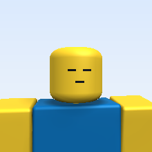
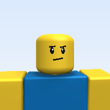

# roblox-style-video

[English](../../README.md) · [简体中文](../../README.zh-CN.md) · [繁體中文](README.zh-TW.md) · [日本語](README.ja.md) · [한국어](README.ko.md) · [Español](README.es.md) · [Français](README.fr.md) · [Deutsch](README.de.md) · **Português** · [Русский](README.ru.md)

Skill de agente e ferramentas CLI em Node.js para planejar vídeos curtos 9:16 no estilo Roblox. Pedir apenas um "personagem de Roblox" costuma gerar cinco dedos humanos, garras em C e pinos de Lego, cubos voxel de Minecraft ou pernas separadas de tênis. `roblox-style-video` trava as proporções padrão do Roblox Studio (torso `2x2x1`, pernas `1x2x1` alinhadas, mãos em bloco sólido, cabeça cilíndrica `1:1` com rosto 2D plano e piso `Studs`), compila prompts para Kling, Seedance, Hailuo, Wan, Sora e Runway, e renderiza prévias 3D locais antes de gastar créditos.

## Início rápido

Clone na sua pasta local de skills (compatível com Codex, Claude Code, Cursor e GitHub Copilot):

```bash
git clone https://github.com/yuzhang-zhong/roblox-style-video.git ~/.codex/skills/roblox-style-video
```

Chame `$roblox-style-video` no agente:

```text
Use $roblox-style-video para planejar um vídeo curto 9:16 de 15 segundos sobre dois amigos fazendo compras:
um avatar streetwear Y2K e um Classic Noob amarelo. Gere os cartões de personagem, prompts de 3 vistas e storyboard Kling I2V de 4 planos.
```

Ou execute os scripts diretamente (requer Node.js 18+, apenas biblioteca padrão, sem `npm install` nem chaves de API):

```bash
node scripts/avatar_spec.mjs --archetype corporate-worker --rig chibi-blocky --material smooth-plastic --name "Momo" --lang pt
node scripts/shot_compiler.mjs --template daily-meltdown --duration 15 --engine kling --rig chibi-blocky --lang pt
node scripts/drift_check.mjs --prompt "A cute Roblox girl with C-shaped claw hands drinks coffee with five fingers" --engine kling --mode t2v --lang pt
```

## Exemplos e prévias 3D locais

Todos os arquivos `.png`, `.gif` e `.mp4` deste repositório são prévias 3D offline geradas por `scripts/render_preview.mjs` para conferir proporções R6, enquadramento e balões de chat; o vídeo final por difusão exige um modelo externo.

| Folha R6 3 vistas (`0° / 45° / 90°`) | Checagem geométrica (`FAIL` vs. `PASS`) |
| :---: | :---: |
|  |  |

Seis pacotes de exemplo de 15 segundos (`9:16`, 4 planos) cobrindo os 6 modelos e 6 motores de vídeo:

| 01 · Despertador (`Kling`) | 02 · Sky Obby (`Hailuo`) | 03 · Y2K vs. Noob (`Seedance`) |
| :---: | :---: | :---: |
|  |  |  |
| [Prancha](../../examples/monday-alarm-meltdown/assets/storyboard_contact_sheet.en.png) · [MP4](../../examples/monday-alarm-meltdown/assets/monday_alarm_meltdown.mp4) · [Arquivos](../../examples/monday-alarm-meltdown/) | [Prancha](../../examples/obby-sky-run/assets/obby_storyboard_sheet.en.png) · [MP4](../../examples/obby-sky-run/assets/obby_sky_run.mp4) · [Arquivos](../../examples/obby-sky-run/) | [Prancha](../../examples/duo-bestie-contrast/assets/duo_storyboard_sheet.en.png) · [MP4](../../examples/duo-bestie-contrast/assets/duo_bestie_contrast.mp4) · [Arquivos](../../examples/duo-bestie-contrast/) |
| **04 · Café Tycoon (`Wan`)** | **05 · Passarela Y2K (`Sora`)** | **06 · Pizza queimada (`Runway`)** |
|  |  |  |
| [Prancha](../../examples/cozy-cafe-tycoon/assets/cafe_storyboard_sheet.en.png) · [MP4](../../examples/cozy-cafe-tycoon/assets/cozy_cafe_tycoon.mp4) · [Arquivos](../../examples/cozy-cafe-tycoon/) | [Prancha](../../examples/runway-outfit-drop/assets/runway_storyboard_sheet.en.png) · [MP4](../../examples/runway-outfit-drop/assets/runway_outfit_drop.mp4) · [Arquivos](../../examples/runway-outfit-drop/) | [Prancha](../../examples/burnt-pizza-slapstick/assets/pizza_storyboard_sheet.en.png) · [MP4](../../examples/burnt-pizza-slapstick/assets/burnt_pizza_slapstick.mp4) · [Arquivos](../../examples/burnt-pizza-slapstick/) |

## Biblioteca clássica de avatares e rostos Roblox

Indexada em [`assets/library/catalog.json`](../../assets/library/catalog.json) e [`references/classic-roblox-catalog.md`](../../references/classic-roblox-catalog.md) ([prancha avatares](../../assets/showcase/classic_avatars_lineup.en.png) · [prancha rostos](../../assets/showcase/classic_faces_atlas.en.png)):

| Classic Noob (2006) | Classic Guest (2008) | Bacon Hair (2014) |
| :---: | :---: | :---: |
|  |  |  |
| **Builderman Hard Hat** | **Obby + Speed Coil** | **Storytime Hoodie** |
|  |  |  |

| `Smile :)` | `Chill -_-` | `Check It` | `Grin :D` |
| :---: | :---: | :---: | :---: |
|  |  |  |  |
| **`Shocked O_O`** | **`Waterfall Tears`** | **`Angry Bloxxer`** | **`KO Dizzy X_X`** |
|  |  |  |  |

## Scripts CLI, limites e referências

- [`scripts/avatar_spec.mjs`](../../scripts/avatar_spec.mjs): gera cartão DNA do personagem (`BrickColor`, travas `2x2x1` / `1x2x1`) e prompt de 3 vistas.
- [`scripts/shot_compiler.mjs`](../../scripts/shot_compiler.mjs): compila storyboards 9:16 e prompts I2V/T2V para `kling`, `seedance`, `hailuo`, `wan`, `sora` e `runway`.
- [`scripts/drift_check.mjs`](../../scripts/drift_check.mjs): verifica dedos humanos, garras Lego, cabeças voxel e excesso de ações, gerando um prompt corrigido.
- [`scripts/render_preview.mjs`](../../scripts/render_preview.mjs): renderiza localmente folhas 3 vistas, comparativos, storyboards e prévias `.gif` / `.mp4`.

Mantenha apenas uma ação principal por clipe de 4 a 5 segundos e gere uma folha de 3 vistas antes de animar múltiplos planos em I2V. Suporta 10 idiomas (`en`, `zh`, `zh-tw`, `ja`, `ko`, `es`, `fr`, `de`, `pt`, `ru`). Projeto independente sob [licença MIT](../../LICENSE), sem vínculo com a Roblox Corporation.

- [`SKILL.md`](../../SKILL.md)
- [`references/avatar-geometry-and-materials.md`](../../references/avatar-geometry-and-materials.md)
- [`references/classic-roblox-catalog.md`](../../references/classic-roblox-catalog.md)
- [`references/model-prompt-playbook.md`](../../references/model-prompt-playbook.md)
- [`references/rescue-and-anti-drift.md`](../../references/rescue-and-anti-drift.md)
- [`references/short-video-beats-and-audio.md`](../../references/short-video-beats-and-audio.md) · [`references/viral-archetypes-catalog.md`](../../references/viral-archetypes-catalog.md)
