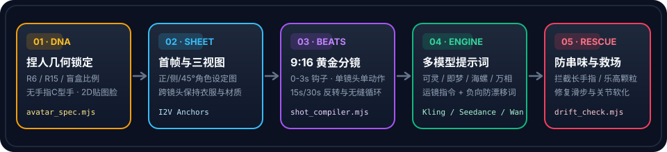

<div align="center">


# roblox-style-skill

[English](../../README.md) · [简体中文](../../README.zh-CN.md) · [繁體中文](README.zh-TW.md) · [日本語](README.ja.md) · [한국어](README.ko.md) · [Español](README.es.md) · [Français](README.fr.md) · [Deutsch](README.de.md) · **Português** · [Русский](README.ru.md)

Gere vídeos curtos 9:16 de avatares estilo Roblox R6 e blocky com proporções stud travadas, storyboards e prompts específicos para cada modelo.

</div>

Pedir a um gerador de vídeo "um personagem fofo de Roblox tomando café" ou incluir `C-shaped claw hands` costuma gerar quatro desvios: cinco dedos humanos, garras em C e pino superior de Lego, voxels quadrados de Minecraft ou pernas separadas usando tênis. `roblox-style-skill` trava a geometria padrão do Roblox Studio antes de animar: torso retangular `2x2x1`, duas pernas `1x2x1` encostadas na mesma largura do torso, mãos `1x2x1` maciças sem dedos nem garras, cabeça cilíndrica chanfrada `1:1` com rosto 2D impresso, acabamento `SmoothPlastic` sobre base `Studs` e balões de chat `BillboardGui`.



## Prévia visual e 6 exemplos de vídeos 9:16

| Folha 3 vistas R6 (`0° / 45° / 90°`) | Verificação geométrica (`FAIL` vs. `PASS`) |
| :---: | :---: |
|  |  |

Seis pacotes verticais 9:16 cobrindo os 6 modelos de roteiro e 6 motores de vídeo:

| 01 · Despertador (`Kling`) | 02 · Sky Obby (`Hailuo`) | 03 · Y2K vs. Noob (`Seedance`) |
| :---: | :---: | :---: |
|  |  |  |
| [Prancha](../../examples/monday-alarm-meltdown/assets/storyboard_contact_sheet.en.png) · [MP4](../../examples/monday-alarm-meltdown/assets/monday_alarm_meltdown.mp4) · [Pacote](../../examples/monday-alarm-meltdown/) | [Prancha](../../examples/obby-sky-run/assets/obby_storyboard_sheet.en.png) · [MP4](../../examples/obby-sky-run/assets/obby_sky_run.mp4) · [Pacote](../../examples/obby-sky-run/) | [Prancha](../../examples/duo-bestie-contrast/assets/duo_storyboard_sheet.en.png) · [MP4](../../examples/duo-bestie-contrast/assets/duo_bestie_contrast.mp4) · [Pacote](../../examples/duo-bestie-contrast/) |
| **04 · Café Tycoon (`Wan`)** | **05 · Passarela Y2K (`Sora`)** | **06 · Pizza queimada (`Runway`)** |
|  |  |  |
| [Prancha](../../examples/cozy-cafe-tycoon/assets/cafe_storyboard_sheet.en.png) · [MP4](../../examples/cozy-cafe-tycoon/assets/cozy_cafe_tycoon.mp4) · [Pacote](../../examples/cozy-cafe-tycoon/) | [Prancha](../../examples/runway-outfit-drop/assets/runway_storyboard_sheet.en.png) · [MP4](../../examples/runway-outfit-drop/assets/runway_outfit_drop.mp4) · [Pacote](../../examples/runway-outfit-drop/) | [Prancha](../../examples/burnt-pizza-slapstick/assets/pizza_storyboard_sheet.en.png) · [MP4](../../examples/burnt-pizza-slapstick/assets/burnt_pizza_slapstick.mp4) · [Pacote](../../examples/burnt-pizza-slapstick/) |

## Biblioteca clássica de avatares, roupas e rostos Roblox

Pré-renderizada em [`assets/library/`](../../assets/library/catalog.json) e [`references/classic-roblox-catalog.md`](../../references/classic-roblox-catalog.md) ([prancha de avatares](../../assets/showcase/classic_avatars_lineup.en.png) · [prancha de rostos](../../assets/showcase/classic_faces_atlas.en.png)):

| Classic Noob | Classic Guest | Bacon Hair | Builderman | Speedrunner | Story Hoodie |
| :---: | :---: | :---: | :---: | :---: | :---: |
|  |  |  |  |  |  |

| `Smile :)` | `Chill -_-` | `Check It` | `Grin :D` | `Shocked` | `Tears` | `Bloxxer` | `KO X_X` |
| :---: | :---: | :---: | :---: | :---: | :---: | :---: | :---: |
|  |  |  |  |  |  |  |  |

## Início rápido

Clone o repositório na sua pasta local de Skills (compatível com Claude Code, Codex, Cursor e GitHub Copilot):

```bash
git clone https://github.com/yuzhang-zhong/roblox-style-skill.git ~/.codex/skills/roblox-style-skill
```

Chame `$roblox-style-skill` no seu agente:

```text
Use $roblox-style-skill para planejar um vídeo curto 9:16 de 15 segundos sobre dois amigos fazendo compras:
um avatar Y2K streetwear e um Noob amarelo clássico. Gere as fichas de personagem, prompts de 3 vistas e um storyboard de 4 planos para Kling I2V.
```

## Ferramentas CLI

Todos os quatro scripts rodam em Node.js 18+ usando apenas a biblioteca padrão:

| Script | Função |
| --- | --- |
| [`scripts/avatar_spec.mjs`](../../scripts/avatar_spec.mjs) | Gera a ficha de DNA do personagem (paleta `BrickColor`, travas `2x2x1`/`1x2x1`) e o prompt de 3 vistas |
| [`scripts/shot_compiler.mjs`](../../scripts/shot_compiler.mjs) | Compila storyboards 9:16 e prompts I2V/T2V para `kling`, `seedance`, `hailuo`, `wan`, `sora` e `runway` |
| [`scripts/drift_check.mjs`](../../scripts/drift_check.mjs) | Detecta dedos humanos, garras Lego, voxels e excesso de ações por corte; retorna o prompt corrigido |
| [`scripts/render_preview.mjs`](../../scripts/render_preview.mjs) | Renderiza localmente folhas 3 vistas, quadros comparativos, storyboards e prévias `.gif` / `.mp4` |

```bash
node scripts/avatar_spec.mjs --archetype corporate-worker --rig chibi-blocky --material smooth-plastic --name "Momo" --lang pt
node scripts/shot_compiler.mjs --template daily-meltdown --duration 15 --engine kling --rig chibi-blocky --lang pt
node scripts/drift_check.mjs --prompt "A cute Roblox girl with C-shaped claw hands drinks coffee with five fingers" --engine kling --mode t2v --lang pt
```

## Documentação e idiomas suportados

As respostas do agente e a opção `--lang` da CLI suportam 10 idiomas: `en`, `zh`, `zh-tw`, `ja`, `ko`, `es`, `fr`, `de`, `pt` e `ru`. Mantenha cada clipe de 4 a 5 segundos com apenas uma ação principal e gere uma folha de 3 vistas antes de animar múltiplos planos I2V. Projeto open-source independente, sem afiliação com a Roblox Corporation.

- [Fluxo principal da Skill (`SKILL.md`)](../../SKILL.md)
- [Geometria, rostos 2D e materiais (`references/avatar-geometry-and-materials.md`)](../../references/avatar-geometry-and-materials.md)
- [Guia de prompts por modelo (`references/model-prompt-playbook.md`)](../../references/model-prompt-playbook.md)
- [Diagnóstico e correção de desvios (`references/rescue-and-anti-drift.md`)](../../references/rescue-and-anti-drift.md)
- [Ritmo 9:16, iluminação e áudio (`references/short-video-beats-and-audio.md`)](../../references/short-video-beats-and-audio.md)
- [Seis modelos de roteiro curto (`references/viral-archetypes-catalog.md`)](../../references/viral-archetypes-catalog.md)
