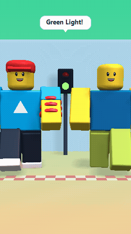
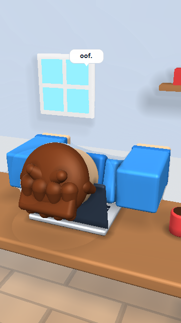
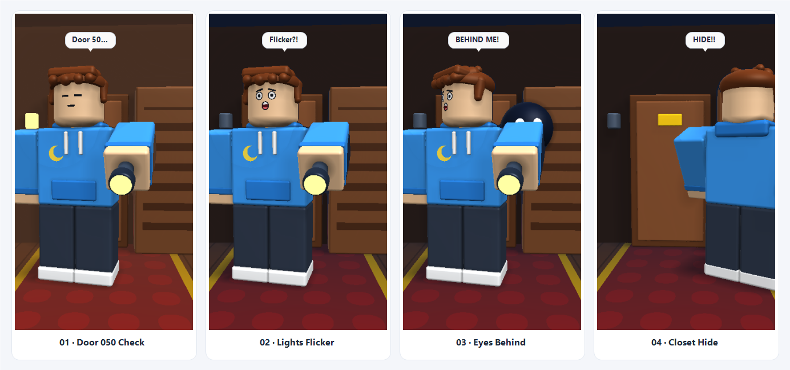

<div align="center">

# Roblox Style Video Skill

**Agent Skill** (`SKILL.md` + справочные руководства + автономные CLI-инструменты без зависимостей) для Claude Code, Cursor, GitHub Copilot и Codex: фиксация пропорций R6, раскадровка вертикальных `9:16` роликов в блочном стиле Roblox, компиляция покадровых промптов и локальный 3D-предпросмотр.

[](../../skills/roblox-style-video/SKILL.md)
[](#рабочий-процесс-skill-и-быстрый-старт)
[](../../LICENSE)

**[Видеопримеры](#видеопримеры)** · [Сцены и ритм кадров](#раскадровки-сцен-и-ритм-монтажа) · [Рабочий процесс и старт](#рабочий-процесс-skill-и-быстрый-старт) · [Руководство Skill](../../skills/roblox-style-video/SKILL.md)

[English](../../README.md) · [简体中文](../../README.zh-CN.md) · [繁體中文](README.zh-TW.md) · [日本語](README.ja.md) · [한국어](README.ko.md) · [Español](README.es.md) · [Français](README.fr.md) · [Deutsch](README.de.md) · [Português](README.pt-BR.md) · **Русский**

</div>

## Видеопримеры

При вызове из ИИ-агента этот Skill превращает идею короткого ролика в 15-секундный вертикальный пакет (`9:16`) из четырёх планов по одному из 12 классических сюжетов. Представленные ниже **4-секундные MP4** и GIF — это офлайн 3D-аниматики, отрендеренные скриптом `scripts/render_preview.mjs` для проверки пропорций R6, составного реквизита, движения камеры и облачков чата `BillboardGui` до траты кредитов во внешней видеомодели.

<p align="center">
  <a href="../../examples/monday-alarm-meltdown/assets/monday_alarm_meltdown.mp4"></a>
  <a href="../../examples/obby-sky-run/assets/obby_sky_run.mp4"></a>
  <a href="../../examples/duo-bestie-contrast/assets/duo_bestie_contrast.mp4"></a>
  <a href="../../examples/cozy-cafe-tycoon/assets/cozy_cafe_tycoon.mp4"></a>
  <a href="../../examples/runway-outfit-drop/assets/runway_outfit_drop.mp4"></a>
  <a href="../../examples/burnt-pizza-slapstick/assets/burnt_pizza_slapstick.mp4"></a>
  <br />
  <a href="../../examples/disaster-tower-tornado/assets/disaster_tower_tornado.mp4"></a>
  <a href="../../examples/brookhaven-police-chase/assets/brookhaven_police_chase.mp4"></a>
  <a href="../../examples/doors-flashlight-hallway/assets/doors_flashlight_hallway.mp4"></a>
  <a href="../../examples/crossroads-sword-duel/assets/crossroads_sword_duel.mp4"></a>
  <a href="../../examples/classroom-exam-panic/assets/classroom_exam_panic.mp4"></a>
  <a href="../../examples/red-light-freeze/assets/red_light_freeze.mp4"></a>
</p>

## Раскадровки сцен и ритм монтажа

Видеомодели «размягчают» жёсткие блочные конечности, когда в один 4–5-секундный промпт помещают три или четыре последовательных действия. Каждый ролик разбит на четыре одношаговых такта (`0–3.5s` хук, два плана развития и `11.5–15s` развязка или бесшовный цикл):

| План 01 · Хук (`0–3.5s`) | План 02 · Действие (`3.5–7.5s`) | План 03 · Поворот (`7.5–11.5s`) | План 04 · Цикл (`11.5–15s`) |
| :---: | :---: | :---: | :---: |
|  |  |  |  |

Четырёхкадровые раскадровки в шести классических игровых жанрах со сменой ракурсов и английскими репликами в облачках чата:

| 02 · Sky Obby (`Hailuo` · Speed Coil и Killbrick) | 08 · Brookhaven Police Chase (`Hailuo` · Уличная погоня) |
| :---: | :---: |
| <a href="../../examples/obby-sky-run/"></a> | <a href="../../examples/brookhaven-police-chase/"></a> |
| **07 · Natural Disaster Tower (`Kling` · Выживание в торнадо)** | **09 · Doors Hotel Hallway (`Sora` · Фонарик и мерцание)** |
| <a href="../../examples/disaster-tower-tornado/"></a> | <a href="../../examples/doors-flashlight-hallway/"></a> |
| **10 · Crossroads Sword Duel (`Seedance` · Дуэль на мечах 1v1)** | **12 · Red Light Freeze (`Runway` · Тише едешь — дальше будешь)** |
| <a href="../../examples/crossroads-sword-duel/"></a> | <a href="../../examples/red-light-freeze/"></a> |

## Рабочий процесс Skill и быстрый старт

<p align="center">
  
</p>

### Установка в качестве Agent Skill

Установите Skill официальной командой GitHub. Самодостаточный пакет находится в [`skills/roblox-style-video/`](../../skills/roblox-style-video/), а точка входа — [`SKILL.md`](../../skills/roblox-style-video/SKILL.md).

```bash
gh skill install yuzhang-zhong/roblox-style-video roblox-style-video@v1.7.0
```

Вызовите skill `roblox-style-video` в чате агента:

```text
Используй $roblox-style-video, чтобы спланировать 15-секундный вертикальный ролик 9:16 в тёмном коридоре отеля (doors-horror):
R6-аватар в синем худи светит фонариком на дверь 050, свет начинает мигать, позади появляются светящиеся глаза, и он прячется в шкаф.
Подготовь фиксацию геометрии персонажа, раскадровку на 4 плана и I2V-промпты для Sora / Kling.
```

### Прямой запуск CLI-инструментов Skill

Все встроенные скрипты работают автономно из корня репозитория на Node.js 18+ только со стандартной библиотекой (без `npm install` и API-ключей).

```bash
node scripts/shot_compiler.mjs --template brookhaven-chase --duration 15 --engine hailuo --rig r6 --lang ru
node scripts/drift_check.mjs --prompt "A cute Roblox girl with C-shaped claw hands drinks coffee with five fingers" --engine kling --mode t2v --lang ru
node scripts/render_preview.mjs --only tornado,chase,doors
```

## Скрипты Skill, проверка геометрии и справочники

Обычные промпты часто приводят к появлению человеческих пальцев, C-образных захватов и круглых штырьков Lego на полу или воксельных кубов Minecraft вместо канонической блочной геометрии R6 (`торс 2x2x1`, плотно сомкнутые ноги `1x2x1`, цельные руки-блоки без пальцев, скруглённая цилиндрическая голова `1:1`, гладкие полы и составной реквизит). Линтер `drift_check.mjs` выявляет эти искажения до генерации:

<p align="center">
  
</p>

| Компонент Skill | Результат |
| --- | --- |
| [`SKILL.md`](../../skills/roblox-style-video/SKILL.md) | Главная точка входа Agent Skill: описывает 6 режимов работы (`Avatar`, `Storyboard`, `Prompt-Compile`, `Rescue`, `Remix`, `Render`) и 8 геометрических инвариантов. |
| [`shot_compiler.mjs`](../../scripts/shot_compiler.mjs) | Раскадровка `9:16` и I2V/T2V-промпты по 12 шаблонам историй для Kling, Seedance, Hailuo, Wan, Sora и Runway. |
| [`avatar_spec.mjs`](../../scripts/avatar_spec.mjs) | Карта ДНК персонажа с кодами `BrickColor`, фиксацией пропорций и промптом для [листа разворота в трёх ракурсах](../../assets/showcase/momo_turnaround_sheet.en.png). |
| [`drift_check.mjs`](../../scripts/drift_check.mjs) | Диагностический отчёт и исправленный промпт при риске появления пальцев, деталей Lego, логотипов брендов или перегрузки действиями. |
| [`render_preview.mjs`](../../scripts/render_preview.mjs) | Офлайн 3D-рендер листов раскадровки, сравнительных таблиц, GIF и MP4 (сборка на Windows использует PowerShell `System.Drawing` и `ffmpeg`). |

[Геометрия и материалы](../../references/avatar-geometry-and-materials.md) · [Каталог классического снаряжения](../../references/classic-roblox-catalog.md) · [Руководство по промптам для моделей](../../references/model-prompt-playbook.md) · [Исправление искажений стиля](../../references/rescue-and-anti-drift.md) · [Ритм и звук](../../references/short-video-beats-and-audio.md) · [12 шаблонов историй](../../references/viral-archetypes-catalog.md)

## Языки

Ответы Agent Skill и флаг CLI `--lang` поддерживают 10 языков: `en`, `zh`, `zh-tw`, `ja`, `ko`, `es`, `fr`, `de`, `pt`, `ru`.

[English](../../README.md) · [简体中文](../../README.zh-CN.md) · [繁體中文](README.zh-TW.md) · [日本語](README.ja.md) · [한국어](README.ko.md) · [Español](README.es.md) · [Français](README.fr.md) · [Deutsch](README.de.md) · [Português](README.pt-BR.md) · **Русский**

[Лицензия MIT](../../LICENSE). Независимый open-source проект Agent Skill с собственной геометрической треугольной эмблемой; не связан с Roblox Corporation и не одобрен ею.
