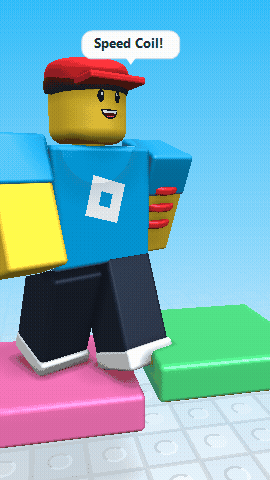
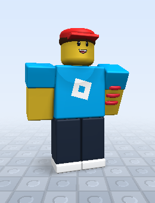
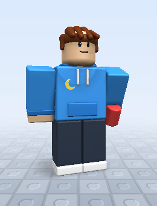

# roblox-style-video

[English](../../README.md) · [简体中文](../../README.zh-CN.md) · [繁體中文](README.zh-TW.md) · [日本語](README.ja.md) · [한국어](README.ko.md) · [Español](README.es.md) · [Français](README.fr.md) · [Deutsch](README.de.md) · [Português](README.pt-BR.md) · **Русский**

Навык агента (Agent Skill) и CLI-утилиты на Node.js для планирования вертикальных 9:16 роликов в стиле Roblox. Общий запрос «персонаж Roblox» часто приводит к появлению пяти человеческих пальцев, С-образных клешней и штырьков Lego, воксельных кубов Minecraft или раздельных ног в кроссовках. `roblox-style-video` фиксирует стандартные пропорции Roblox Studio (торс `2x2x1`, сомкнутые ноги `1x2x1`, цельные руки-блоки, цилиндрическая голова `1:1` с плоской 2D-декалью лица и плита `Studs`), собирает покадровые промпты для Kling, Seedance, Hailuo, Wan, Sora и Runway и рендерит локальные 3D-превью до траты кредитов видеомодели.

## Быстрый старт

Склонируйте репозиторий в локальную папку навыков (поддерживаются Codex, Claude Code, Cursor и GitHub Copilot):

```bash
git clone https://github.com/yuzhang-zhong/roblox-style-video.git ~/.codex/skills/roblox-style-video
```

Вызовите `$roblox-style-video` в чате с агентом:

```text
Используй $roblox-style-video, чтобы спланировать 15-секундный ролик 9:16 о двух друзьях на шопинге:
Y2K-аватар и классический жёлтый Нуб. Выдай карточки персонажей, промпты 3 ракурсов и раскадровку из 4 кадров для Kling I2V.
```

Или запускайте CLI-скрипты напрямую (нужен Node.js 18+, только стандартная библиотека, без `npm install` и API-ключей):

```bash
node scripts/avatar_spec.mjs --archetype corporate-worker --rig chibi-blocky --material smooth-plastic --name "Momo" --lang ru
node scripts/shot_compiler.mjs --template daily-meltdown --duration 15 --engine kling --rig chibi-blocky --lang ru
node scripts/drift_check.mjs --prompt "A cute Roblox girl with C-shaped claw hands drinks coffee with five fingers" --engine kling --mode t2v --lang ru
```

## Примеры и локальные 3D-превью

Все файлы `.png`, `.gif` и `.mp4` в репозитории — это офлайн 3D-превью из `scripts/render_preview.mjs` для проверки пропорций R6, ракурсов и облачков чата; финальное видео генерируется во внешней диффузионной модели.

| Лист 3 ракурсов R6 (`0° / 45° / 90°`) | Проверка геометрии (`FAIL` vs. `PASS`) |
| :---: | :---: |
|  |  |

Шесть 15-секундных пакетов (`9:16`, 4 кадра) для всех 6 сюжетных шаблонов и 6 видеодвижков:

| 01 · Будильник (`Kling`) | 02 · Sky Obby (`Hailuo`) | 03 · Y2K vs. Нуб (`Seedance`) |
| :---: | :---: | :---: |
|  |  |  |
| [Лист](../../examples/monday-alarm-meltdown/assets/storyboard_contact_sheet.en.png) · [MP4](../../examples/monday-alarm-meltdown/assets/monday_alarm_meltdown.mp4) · [Файлы](../../examples/monday-alarm-meltdown/) | [Лист](../../examples/obby-sky-run/assets/obby_storyboard_sheet.en.png) · [MP4](../../examples/obby-sky-run/assets/obby_sky_run.mp4) · [Файлы](../../examples/obby-sky-run/) | [Лист](../../examples/duo-bestie-contrast/assets/duo_storyboard_sheet.en.png) · [MP4](../../examples/duo-bestie-contrast/assets/duo_bestie_contrast.mp4) · [Файлы](../../examples/duo-bestie-contrast/) |
| **04 · Кафе-тайкун (`Wan`)** | **05 · Подиум Y2K (`Sora`)** | **06 · Сгоревшая пицца (`Runway`)** |
|  |  |  |
| [Лист](../../examples/cozy-cafe-tycoon/assets/cafe_storyboard_sheet.en.png) · [MP4](../../examples/cozy-cafe-tycoon/assets/cozy_cafe_tycoon.mp4) · [Файлы](../../examples/cozy-cafe-tycoon/) | [Лист](../../examples/runway-outfit-drop/assets/runway_storyboard_sheet.en.png) · [MP4](../../examples/runway-outfit-drop/assets/runway_outfit_drop.mp4) · [Файлы](../../examples/runway-outfit-drop/) | [Лист](../../examples/burnt-pizza-slapstick/assets/pizza_storyboard_sheet.en.png) · [MP4](../../examples/burnt-pizza-slapstick/assets/burnt_pizza_slapstick.mp4) · [Файлы](../../examples/burnt-pizza-slapstick/) |

## Классическая библиотека аватаров и лиц Roblox

Собрана в [`assets/library/catalog.json`](../../assets/library/catalog.json) и [`references/classic-roblox-catalog.md`](../../references/classic-roblox-catalog.md) ([лист аватаров](../../assets/showcase/classic_avatars_lineup.en.png) · [лист лиц](../../assets/showcase/classic_faces_atlas.en.png)):

| Classic Noob (2006) | Classic Guest (2008) | Bacon Hair (2014) |
| :---: | :---: | :---: |
|  |  |  |
| **Builderman Hard Hat** | **Obby + Speed Coil** | **Storytime Hoodie** |
|  |  |  |

| `Smile :)` | `Chill -_-` | `Check It` | `Grin :D` |
| :---: | :---: | :---: | :---: |
|  |  |  |  |
| **`Shocked O_O`** | **`Waterfall Tears`** | **`Angry Bloxxer`** | **`KO Dizzy X_X`** |
|  |  |  |  |

## CLI-скрипты, ограничения и документация

- [`scripts/avatar_spec.mjs`](../../scripts/avatar_spec.mjs): создаёт карточку персонажа (`BrickColor`, фиксация `2x2x1` / `1x2x1`) и промпт листа 3 ракурсов.
- [`scripts/shot_compiler.mjs`](../../scripts/shot_compiler.mjs): компилирует 9:16 раскадровки и I2V/T2V промпты для `kling`, `seedance`, `hailuo`, `wan`, `sora` и `runway`.
- [`scripts/drift_check.mjs`](../../scripts/drift_check.mjs): проверяет черновики на человеческие пальцы, клешни Lego, воксельные головы и перегрузку действиями.
- [`scripts/render_preview.mjs`](../../scripts/render_preview.mjs): локально рендерит 3D-ракурсы, сравнительные листы, раскадровки и `.gif` / `.mp4` превью.

Оставляйте одно основное действие на клип 4–5 секунд и фиксируйте лист 3 ракурсов перед многокадровым I2V. Поддерживаются 10 языков (`en`, `zh`, `zh-tw`, `ja`, `ko`, `es`, `fr`, `de`, `pt`, `ru`). Независимый проект под [лицензией MIT](../../LICENSE), не связанный с Roblox Corporation.

- [`SKILL.md`](../../SKILL.md)
- [`references/avatar-geometry-and-materials.md`](../../references/avatar-geometry-and-materials.md)
- [`references/classic-roblox-catalog.md`](../../references/classic-roblox-catalog.md)
- [`references/model-prompt-playbook.md`](../../references/model-prompt-playbook.md)
- [`references/rescue-and-anti-drift.md`](../../references/rescue-and-anti-drift.md)
- [`references/short-video-beats-and-audio.md`](../../references/short-video-beats-and-audio.md) · [`references/viral-archetypes-catalog.md`](../../references/viral-archetypes-catalog.md)
