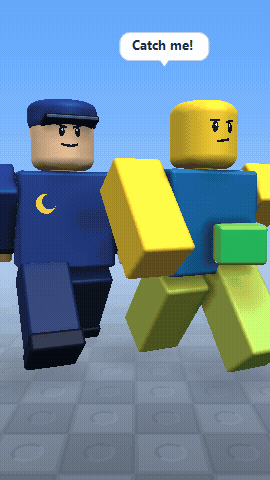
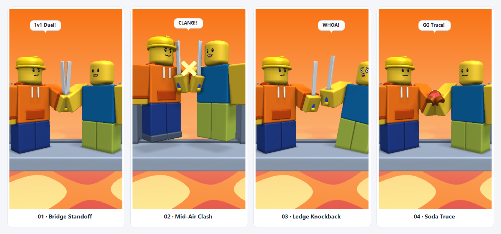
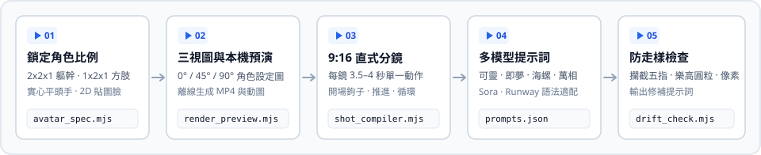

<div align="center">

# Roblox Style Video Skill

一套面向 Claude Code、Cursor、GitHub Copilot 與 Codex 的 **Agent Skill**（`SKILL.md` + 領域參考手冊 + 零依賴命令列腳本）：鎖住 R6 方塊比例、拆解 9:16 直式四鏡分鏡、逐鏡編譯影片提示詞，並在本機離線預演動態成片。

[](../../skills/roblox-style-video/SKILL.md)
[](#skill-工作流與安裝使用)
[](../../LICENSE)

**[短片範例](#短片範例)** · [分鏡與場景圖](#分鏡拆解與多題材場景表) · [Skill 工作流與安裝](#skill-工作流與安裝使用) · [Skill 指南](../../skills/roblox-style-video/SKILL.md)

[English](../../README.md) · [简体中文](../../README.zh-CN.md) · **繁體中文** · [日本語](README.ja.md) · [한국어](README.ko.md) · [Español](README.es.md) · [Français](README.fr.md) · [Deutsch](README.de.md) · [Português](README.pt-BR.md) · [Русский](README.ru.md)

</div>

## 短片範例

作為可掛載的 Agent Skill，本專案可在對話中將短影音點子轉化為 15 秒、4 鏡頭（`9:16` 直式）的完整短片包，內建 12 套經典方塊短劇模板。下方的 **4 秒 MP4** 與動圖均由本 Skill 內附的 `scripts/render_preview.mjs` 在本機離線渲染，用來在呼叫外部付費影片模型前，先確認 R6 比例、多部件場景道具、運鏡切換與頭頂 `BillboardGui` 對話氣泡。

<p align="center">
  <a href="../../examples/monday-alarm-meltdown/assets/monday_alarm_meltdown.mp4"></a>
  <a href="../../examples/obby-sky-run/assets/obby_sky_run.mp4"></a>
  <a href="../../examples/duo-bestie-contrast/assets/duo_bestie_contrast.mp4"></a>
  <a href="../../examples/cozy-cafe-tycoon/assets/cozy_cafe_tycoon.mp4"></a>
  <a href="../../examples/runway-outfit-drop/assets/runway_outfit_drop.mp4"></a>
  <a href="../../examples/burnt-pizza-slapstick/assets/burnt_pizza_slapstick.mp4"></a>
  <br />
  <a href="../../examples/disaster-tower-tornado/assets/disaster_tower_tornado.mp4"></a>
  <a href="../../examples/brookhaven-police-chase/assets/brookhaven_police_chase.mp4"></a>
  <a href="../../examples/doors-flashlight-hallway/assets/doors_flashlight_hallway.mp4"></a>
  <a href="../../examples/crossroads-sword-duel/assets/crossroads_sword_duel.mp4"></a>
  <a href="../../examples/classroom-exam-panic/assets/classroom_exam_panic.mp4"></a>
  <a href="../../examples/red-light-freeze/assets/red_light_freeze.mp4"></a>
</p>

## 分鏡拆解與多題材場景表

影片生成模型若在單個 4 至 5 秒片段內塞入三四個連續動作，很容易導致剛性方塊四肢軟化或穿模。每支 15 秒短片固定拆為四個單動作節拍（`0–3.5s` 開場鉤子、兩鏡動作推進、`11.5–15s` 反轉或無縫循環收尾）：

| 鏡頭 01 · 開場鉤子 (`0–3.5s`) | 鏡頭 02 · 動作推進 (`3.5–7.5s`) | 鏡頭 03 · 情緒升級 (`7.5–11.5s`) | 鏡頭 04 · 循環收尾 (`11.5–15s`) |
| :---: | :---: | :---: | :---: |
|  |  |  |  |

六種常見遊戲與短劇題材的四格分鏡聯繫表，同步呈現運鏡切換與頭頂英文對話氣泡：

| 02 · 天空跑酷闖關 (`Hailuo` · 加速彈簧與紅磚急停) | 08 · 小鎮警匪追逐 (`Hailuo` · 警車追擊與消防栓絆倒) |
| :---: | :---: |
| <a href="../../examples/obby-sky-run/"></a> | <a href="../../examples/brookhaven-police-chase/"></a> |
| **07 · 自然災害高塔龍捲風 (`Kling` · 護欄掀飛與孤柱存活)** | **09 · 驚悚飯店閃燈走廊 (`Sora` · 手電筒掃光與躲櫃)** |
| <a href="../../examples/disaster-tower-tornado/"></a> | <a href="../../examples/doors-flashlight-hallway/"></a> |
| **10 · 十字路口長劍對決 (`Seedance` · 熔岩石橋拼刀與汽水言和)** | **12 · 木頭人極限急停 (`Runway` · 紅綠燈單腿定格)** |
| <a href="../../examples/crossroads-sword-duel/"></a> | <a href="../../examples/red-light-freeze/"></a> |

## Skill 工作流與安裝使用

<p align="center">
  
</p>

### 作為 Agent Skill 安裝呼叫

使用 GitHub 官方 Skill 命令安裝，自包含套件位於 [`skills/roblox-style-video/`](../../skills/roblox-style-video/)，入口為 [`SKILL.md`](../../skills/roblox-style-video/SKILL.md)。

```bash
gh skill install yuzhang-zhong/roblox-style-video roblox-style-video@v1.7.0
```

在 Agent 對話中呼叫 `roblox-style-video` Skill：

```text
使用 $roblox-style-video 規劃一支 15 秒 9:16 直式短片，場景使用驚悚飯店走廊（doors-horror）：
穿藍連帽衫的 R6 小人舉著手電筒走過 050 號木門時壁燈突然閃爍，身後出現發光白眼，最後躲進百葉木衣櫃。
請提供角色比例鎖定表、4 鏡頭分鏡表，以及 Sora / Kling 圖生影片提示詞。
```

### 直接執行 Skill 內建命令列腳本

Skill 內附的四支腳本亦可在儲存庫根目錄獨立執行，僅依賴 Node.js 18+ 標準庫，無需 `npm install` 或 API 金鑰。

```bash
node scripts/shot_compiler.mjs --template brookhaven-chase --duration 15 --engine hailuo --rig r6 --lang zh-tw
node scripts/drift_check.mjs --prompt "A cute Roblox girl with C-shaped claw hands drinks coffee with five fingers" --engine kling --mode t2v --lang zh-tw
node scripts/render_preview.mjs --only tornado,chase,doors
```

## Skill 腳本、防走樣檢查與參考文件

直接輸入籠統提示詞常會長出真人五指、樂高 C 型夾爪或地面/頭頂圓粒凸起，或退化為直角體素方塊頭。本 Skill 鎖定標準 R6 方塊比例（`2×2×1` 軀幹、並攏同寬 `1×2×1` 方腿、實心平頭方手、`1:1` 圓角桶狀頭）以及平整無凸粒的木板、地磚、柏油材質與多部件場景道具。`drift_check.mjs` 會在生成前攔截這些走樣風險：

<p align="center">
  
</p>

| Skill 組件 | 輸出內容 |
| --- | --- |
| [`SKILL.md`](../../skills/roblox-style-video/SKILL.md) | Agent Skill 主入口定義，涵蓋 6 種工作模式（角色設定、分鏡、提示詞編譯、翻車修復、二創、3D 預演）與 8 項幾何不變量。 |
| [`shot_compiler.mjs`](../../scripts/shot_compiler.mjs) | 內建 12 套短片模板，編譯適配 Kling、Seedance、Hailuo、Wan、Sora 與 Runway 的 9:16 分鏡與 I2V/T2V 提示詞。 |
| [`avatar_spec.mjs`](../../scripts/avatar_spec.mjs) | 角色 DNA 設定卡、`BrickColor` 色號、方塊比例鎖與首幀[三視圖參考卡](../../assets/showcase/momo_turnaround_sheet.en.png)提示詞。 |
| [`drift_check.mjs`](../../scripts/drift_check.mjs) | 檢查真人手指、樂高圓粒/夾爪、品牌浮水印與單鏡多動作超載，並輸出修補後的提示詞。 |
| [`render_preview.mjs`](../../scripts/render_preview.mjs) | 離線渲染 3D 分鏡聯繫表、對比圖、GIF 與 MP4 預覽（Windows 合成使用 PowerShell `System.Drawing` 與 `ffmpeg`）。 |

[角色比例與材質](../../references/avatar-geometry-and-materials.md) · [經典道具詞庫](../../references/classic-roblox-catalog.md) · [各模型提示詞手冊](../../references/model-prompt-playbook.md) · [走樣修復指南](../../references/rescue-and-anti-drift.md) · [鏡頭節奏與音效](../../references/short-video-beats-and-audio.md) · [12 套分鏡模板](../../references/viral-archetypes-catalog.md)

## 語言支援

Agent Skill 回覆與命令列 `--lang` 支援 `en`、`zh`、`zh-tw`、`ja`、`ko`、`es`、`fr`、`de`、`pt`、`ru`。

[English](../../README.md) · [简体中文](../../README.zh-CN.md) · **繁體中文** · [日本語](README.ja.md) · [한국어](README.ko.md) · [Español](README.es.md) · [Français](README.fr.md) · [Deutsch](README.de.md) · [Português](README.pt-BR.md) · [Русский](README.ru.md)

[MIT 授權條款](../../LICENSE)。獨立開源 Agent Skill 專案，內建原創幾何三角形徽章，不使用官方商標，與 Roblox Corporation 無隸屬或背書關係。
