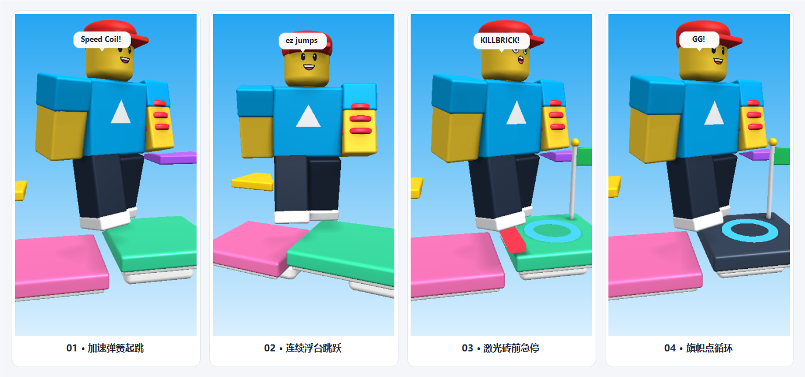
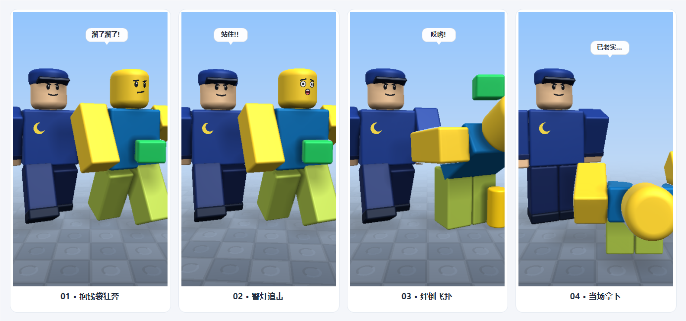
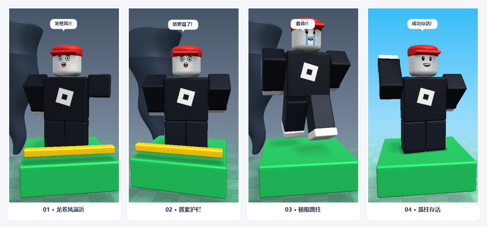
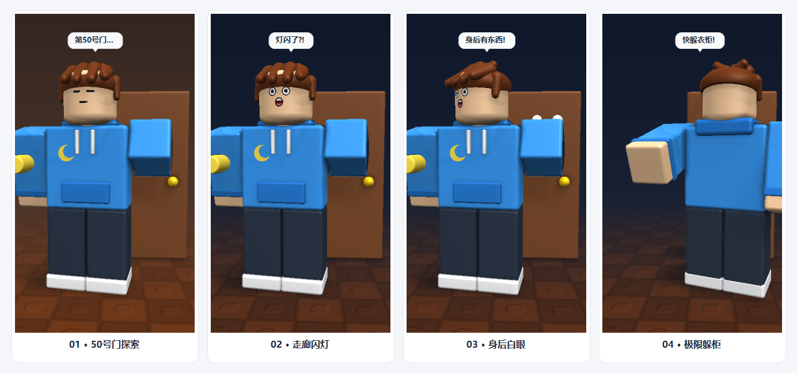
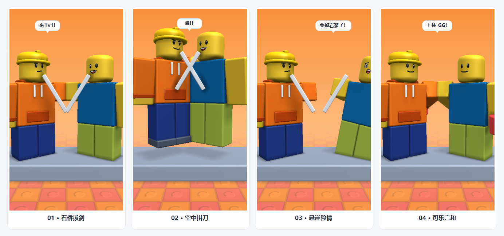
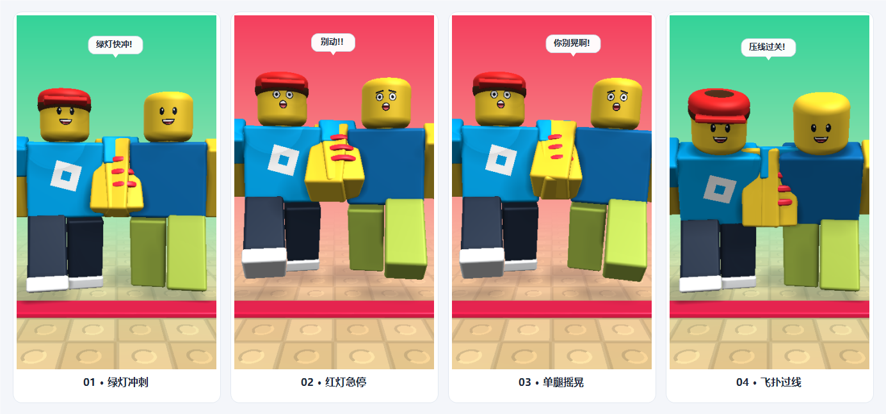
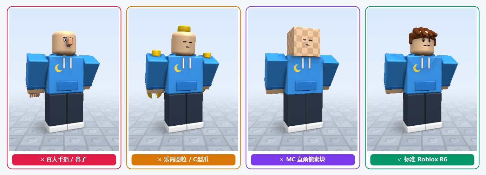

<div align="center">

# Roblox Style Video

規劃 9:16 Roblox 直式短片：鎖定方塊比例、逐鏡編譯提示詞，先在本機預覽動態分鏡。

[English](../../README.md) · [简体中文](../../README.zh-CN.md) · **繁體中文** · [日本語](README.ja.md) · [한국어](README.ko.md) · [Español](README.es.md) · [Français](README.fr.md) · [Deutsch](README.de.md) · [Português](README.pt-BR.md) · [Русский](README.ru.md)

</div>

## 短片範例（12 支 9:16 動畫預覽）

<p align="center">
  <a href="../../examples/monday-alarm-meltdown/assets/monday_alarm_meltdown.mp4"></a>
  <a href="../../examples/obby-sky-run/assets/obby_sky_run.mp4"></a>
  <a href="../../examples/duo-bestie-contrast/assets/duo_bestie_contrast.mp4"></a>
  <a href="../../examples/cozy-cafe-tycoon/assets/cozy_cafe_tycoon.mp4"></a>
  <a href="../../examples/runway-outfit-drop/assets/runway_outfit_drop.mp4"></a>
  <a href="../../examples/burnt-pizza-slapstick/assets/burnt_pizza_slapstick.mp4"></a>
  <br />
  <a href="../../examples/disaster-tower-tornado/assets/disaster_tower_tornado.mp4"></a>
  <a href="../../examples/brookhaven-police-chase/assets/brookhaven_police_chase.mp4"></a>
  <a href="../../examples/doors-flashlight-hallway/assets/doors_flashlight_hallway.mp4"></a>
  <a href="../../examples/crossroads-sword-duel/assets/crossroads_sword_duel.mp4"></a>
  <a href="../../examples/classroom-exam-panic/assets/classroom_exam_panic.mp4"></a>
  <a href="../../examples/red-light-freeze/assets/red_light_freeze.mp4"></a>
</p>
<p align="center"><sub>點擊任一動圖可直接開啟對應的 MP4 預覽短片。</sub></p>

| 短片与适配模型 | 看点 | 短片与适配模型 | 看点 |
| --- | --- | --- | --- |
| **[01 · 早八闹钟破防](../../examples/monday-alarm-meltdown/)** · 可灵<br>[MP4](../../examples/monday-alarm-meltdown/assets/monday_alarm_meltdown.mp4) · [分鏡圖](../../examples/monday-alarm-meltdown/assets/storyboard_contact_sheet.zh.png) | 拍扁闹钟、面对 99+ 消息流泪，最后 90 度直挺挺扑倒在键盘上。 | **[07 · 高塔龙卷风](../../examples/disaster-tower-tornado/)** · 可灵<br>[MP4](../../examples/disaster-tower-tornado/assets/disaster_tower_tornado.mp4) · [分鏡圖](../../examples/disaster-tower-tornado/assets/tornado_storyboard_sheet.zh.png) | 经典红帽游客在高塔遭遇黑色龙卷风，护栏掀飞后跳上孤柱存活。 |
| **[02 · 天空跑酷闯关](../../examples/obby-sky-run/)** · 海螺<br>[MP4](../../examples/obby-sky-run/assets/obby_sky_run.mp4) · [分鏡圖](../../examples/obby-sky-run/assets/obby_storyboard_sheet.zh.png) | 佩戴红色加速弹簧跃过浮空跳台，在红色激光砖前急停并落向存档点。 | **[08 · 小镇警匪追逐](../../examples/brookhaven-police-chase/)** · 海螺<br>[MP4](../../examples/brookhaven-police-chase/assets/brookhaven_police_chase.mp4) · [分鏡圖](../../examples/brookhaven-police-chase/assets/chase_storyboard_sheet.zh.png) | 抱绿色钱袋狂奔的黄皮新手被警官追击，绊到黄色消防栓平地飞扑。 |
| **[03 · 潮人与黄皮新手](../../examples/duo-bestie-contrast/)** · 即梦<br>[MP4](../../examples/duo-bestie-contrast/assets/duo_bestie_contrast.mp4) · [分鏡圖](../../examples/duo-bestie-contrast/assets/duo_storyboard_sheet.zh.png) | Y2K 潮人转身时误撞经典黄皮 R6 新手，新手保持笔直刚体侧倾。 | **[09 · 惊悚酒店闪灯](../../examples/doors-flashlight-hallway/)** · Sora<br>[MP4](../../examples/doors-flashlight-hallway/assets/doors_flashlight_hallway.mp4) · [分鏡圖](../../examples/doors-flashlight-hallway/assets/doors_storyboard_sheet.zh.png) | 50 号木门前壁灯骤灭，回头撞见黑暗中白眼，转身躲进木衣柜。 |
| **[04 · 微缩甜品小店](../../examples/cozy-cafe-tycoon/)** · 通义万相<br>[MP4](../../examples/cozy-cafe-tycoon/assets/cozy_cafe_tycoon.mp4) · [分鏡圖](../../examples/cozy-cafe-tycoon/assets/cafe_storyboard_sheet.zh.png) | 可颂摆盘特写切到热拿铁滑过吧台，收银台弹出金币完成循环。 | **[10 · 十字剑石桥对决](../../examples/crossroads-sword-duel/)** · 即梦<br>[MP4](../../examples/crossroads-sword-duel/assets/crossroads_sword_duel.mp4) · [分鏡圖](../../examples/crossroads-sword-duel/assets/sword_storyboard_sheet.zh.png) | 岩浆石桥上双人跃起拼剑，险些坠崖后举起可乐罐碰杯言和。 |
| **[05 · 走秀卡点换装](../../examples/runway-outfit-drop/)** · Sora<br>[MP4](../../examples/runway-outfit-drop/assets/runway_outfit_drop.mp4) · [分鏡圖](../../examples/runway-outfit-drop/assets/runway_storyboard_sheet.zh.png) | 灰色基础模起跳蓄力，踩中重音落地瞬间切换粉色皇冠穿搭。 | **[11 · 考场发卷宕机](../../examples/classroom-exam-panic/)** · 通义万相<br>[MP4](../../examples/classroom-exam-panic/assets/classroom_exam_panic.mp4) · [分鏡圖](../../examples/classroom-exam-panic/assets/exam_storyboard_sheet.zh.png) | 发卷前自信微笑，看清第一题抱头震惊，狂写后响铃进入 X_X 宕机。 |
| **[06 · 烤焦披萨翻车](../../examples/burnt-pizza-slapstick/)** · Runway<br>[MP4](../../examples/burnt-pizza-slapstick/assets/burnt_pizza_slapstick.mp4) · [分鏡圖](../../examples/burnt-pizza-slapstick/assets/pizza_storyboard_sheet.zh.png) | 端出乌黑披萨遭遇冷白顶光，左臂脱落并直挺挺侧倒拍地。 | **[12 · 木头人急停](../../examples/red-light-freeze/)** · Runway<br>[MP4](../../examples/red-light-freeze/assets/red_light_freeze.mp4) · [分鏡圖](../../examples/red-light-freeze/assets/redlight_storyboard_sheet.zh.png) | 绿灯双人冲刺、红灯瞬间单腿金鸡独立定格，最后飞扑压过终点线。 |

## 分鏡拆解與多題材場景表

| Shot 01 (`0–3.5s`) | Shot 02 (`3.5–7.5s`) | Shot 03 (`7.5–11.5s`) | Shot 04 (`11.5–15s`) |
| :---: | :---: | :---: | :---: |
|  |  |  |  |

| 02 · Sky Obby (`Hailuo`) | 08 · Brookhaven Police Chase (`Hailuo`) |
| :---: | :---: |
| <a href="../../examples/obby-sky-run/"></a> | <a href="../../examples/brookhaven-police-chase/"></a> |
| **07 · Natural Disaster Tower (`Kling`)** | **09 · Doors Hotel Hallway (`Sora`)** |
| <a href="../../examples/disaster-tower-tornado/"></a> | <a href="../../examples/doors-flashlight-hallway/"></a> |
| **10 · Crossroads Sword Duel (`Seedance`)** | **12 · Red Light Freeze (`Runway`)** |
| <a href="../../examples/crossroads-sword-duel/"></a> | <a href="../../examples/red-light-freeze/"></a> |

## 安裝與開始

```bash
git clone https://github.com/yuzhang-zhong/roblox-style-video.git ~/.codex/skills/roblox-style-video
```

```bash
node scripts/shot_compiler.mjs --template brookhaven-chase --duration 15 --engine hailuo --rig r6 --lang zh-tw
node scripts/drift_check.mjs --prompt "A cute Roblox girl with C-shaped claw hands drinks coffee with five fingers" --engine kling --mode t2v --lang zh-tw
node scripts/render_preview.mjs --only tornado,chase,doors
```

## 命令列腳本、防走樣檢查與參考文件

<p align="center">
  
</p>

- [`SKILL.md`](../../SKILL.md) · [`scripts/shot_compiler.mjs`](../../scripts/shot_compiler.mjs) · [`scripts/avatar_spec.mjs`](../../scripts/avatar_spec.mjs) · [`scripts/drift_check.mjs`](../../scripts/drift_check.mjs) · [`scripts/render_preview.mjs`](../../scripts/render_preview.mjs)
- [`references/avatar-geometry-and-materials.md`](../../references/avatar-geometry-and-materials.md) · [`references/model-prompt-playbook.md`](../../references/model-prompt-playbook.md) · [`references/rescue-and-anti-drift.md`](../../references/rescue-and-anti-drift.md) · [`references/viral-archetypes-catalog.md`](../../references/viral-archetypes-catalog.md) · [`LICENSE`](../../LICENSE)
