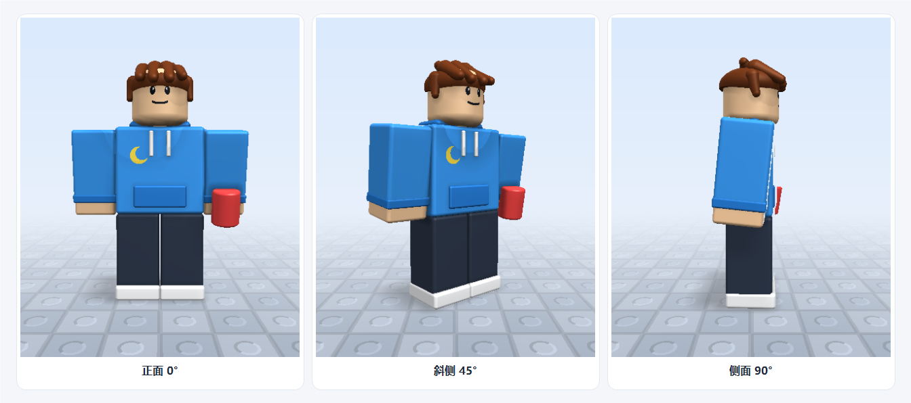

<p></p>

# roblox-style-video

[English](../../README.md) · [简体中文](../../README.zh-CN.md) · **繁體中文** · [日本語](README.ja.md) · [한국어](README.ko.md) · [Español](README.es.md) · [Français](README.fr.md) · [Deutsch](README.de.md) · [Português](README.pt-BR.md) · [Русский](README.ru.md)

用於規劃 9:16 Roblox 風格直式短片的 Agent Skill 與 Node.js 命令列工具。直接讓影片模型產生「Roblox 小人」或寫入 `C-shaped claw hands`，常會長出五根真人手指、變成樂高 C 型鉤爪與頭頂凸粒、退化成《Minecraft》直角像素塊，或雙腿分叉穿上運動鞋。`roblox-style-video` 在產生動畫前先鎖住標準 Roblox Studio 幾何（`2×2×1` 軀幹、並攏同寬的 `1×2×1` 方腿、實心平頭方手、`1:1` 圓角桶狀頭配平面 2D 貼圖五官與 `Studs` 底板），編譯對應 Kling、Seedance、Hailuo、Wan、Sora 與 Runway 的分鏡提示詞，並支援在本機先算繪 3D 預覽。

## 安裝與開始

複製到本機 Skills 目錄（支援 Codex、Claude Code、Cursor 與 GitHub Copilot）：

```bash
git clone https://github.com/yuzhang-zhong/roblox-style-video.git ~/.codex/skills/roblox-style-video
```

在對話中呼叫 `$roblox-style-video`：

```text
使用 $roblox-style-video 規劃一支 15 秒 9:16 直式短片，主題是「和好友逛街：Y2K 潮人 vs 黃皮新手」，
請提供雙人角色設定卡、三視圖提示詞與 4 鏡頭 Kling I2V 分鏡表。
```

也可直接執行腳本（需 Node.js 18+，僅使用標準庫，無需 `npm install` 或 API Key）：

```bash
node scripts/avatar_spec.mjs --archetype corporate-worker --rig chibi-blocky --material smooth-plastic --name "Momo" --lang zh-tw
node scripts/shot_compiler.mjs --template daily-meltdown --duration 15 --engine kling --rig chibi-blocky --lang zh-tw
node scripts/drift_check.mjs --prompt "A cute Roblox girl with C-shaped claw hands drinks coffee with five fingers" --engine kling --mode t2v --lang zh-tw
```

## 範例與本機 3D 預覽

儲存庫內的 `.png`、`.gif` 與 `.mp4` 均由 `scripts/render_preview.mjs` 在本機離線算繪，用來在呼叫外部付費影片模型前檢查 R6 比例、鏡位與頭頂 `BillboardGui` 對話氣泡；最終擴散影片需在對應影片平台產生。

| 角色三視圖設定卡 (`0° / 45° / 90°`) | 幾何防走樣對比 (`× 走樣` vs. `✓ 標準 R6`) |
| :---: | :---: |
|  |  |

六組短片範例的分鏡都按 15 秒（`9:16`，4 鏡頭）規劃；每支 MP4 都是 4 秒的本機預覽。

| 01 · 週一鬧鐘破防 (`Kling`) | 02 · 天空跑酷闖關 (`Hailuo`) | 03 · 潮人與新手 (`Seedance`) |
| :---: | :---: | :---: |
|  |  |  |
| [分鏡圖](../../examples/monday-alarm-meltdown/assets/storyboard_contact_sheet.zh.png) · [MP4](../../examples/monday-alarm-meltdown/assets/monday_alarm_meltdown.mp4) · [檔案](../../examples/monday-alarm-meltdown/) | [分鏡圖](../../examples/obby-sky-run/assets/obby_storyboard_sheet.zh.png) · [MP4](../../examples/obby-sky-run/assets/obby_sky_run.mp4) · [檔案](../../examples/obby-sky-run/) | [分鏡圖](../../examples/duo-bestie-contrast/assets/duo_storyboard_sheet.zh.png) · [MP4](../../examples/duo-bestie-contrast/assets/duo_bestie_contrast.mp4) · [檔案](../../examples/duo-bestie-contrast/) |
| **04 · 微縮甜點小店 (`Wan`)** | **05 · 走秀卡點換裝 (`Sora`)** | **06 · 烤焦披薩翻車 (`Runway`)** |
|  |  |  |
| [分鏡圖](../../examples/cozy-cafe-tycoon/assets/cafe_storyboard_sheet.zh.png) · [MP4](../../examples/cozy-cafe-tycoon/assets/cozy_cafe_tycoon.mp4) · [檔案](../../examples/cozy-cafe-tycoon/) | [分鏡圖](../../examples/runway-outfit-drop/assets/runway_storyboard_sheet.zh.png) · [MP4](../../examples/runway-outfit-drop/assets/runway_outfit_drop.mp4) · [檔案](../../examples/runway-outfit-drop/) | [分鏡圖](../../examples/burnt-pizza-slapstick/assets/pizza_storyboard_sheet.zh.png) · [MP4](../../examples/burnt-pizza-slapstick/assets/burnt_pizza_slapstick.mp4) · [檔案](../../examples/burnt-pizza-slapstick/) |

## 命令列腳本、限制與參考文件

- [`scripts/avatar_spec.mjs`](../../scripts/avatar_spec.mjs)：輸出角色 DNA 設定卡（`BrickColor` 色號、`2×2×1` / `1×2×1` 比例鎖）與三視圖提示詞。
- [`scripts/shot_compiler.mjs`](../../scripts/shot_compiler.mjs)：編譯 9:16 分鏡與對應 `kling`、`seedance`、`hailuo`、`wan`、`sora`、`runway` 的 I2V/T2V 提示詞。
- [`scripts/drift_check.mjs`](../../scripts/drift_check.mjs)：檢查真人五指、樂高鉤爪/頭頂凸粒、像素方頭與單鏡多動作超載，並輸出修補提示詞。
- [`scripts/render_preview.mjs`](../../scripts/render_preview.mjs)：本機算繪 3D 三視圖、對比圖、雙語分鏡表與 `.gif` / `.mp4` 預覽短片。

每個 4 至 5 秒片段建議只安排 1 個核心動作；多鏡頭短片請先以三視圖固定首幀再跑 I2V。Agent 回覆與 `--lang` 支援 10 種語言（`en`、`zh`、`zh-tw`、`ja`、`ko`、`es`、`fr`、`de`、`pt`、`ru`）。獨立開源專案，採用 [MIT 授權條款](../../LICENSE)，與 Roblox Corporation 無關。

- [`SKILL.md`](../../SKILL.md)
- [`references/avatar-geometry-and-materials.md`](../../references/avatar-geometry-and-materials.md)
- [`references/model-prompt-playbook.md`](../../references/model-prompt-playbook.md)
- [`references/rescue-and-anti-drift.md`](../../references/rescue-and-anti-drift.md)
- [`references/short-video-beats-and-audio.md`](../../references/short-video-beats-and-audio.md) · [`references/viral-archetypes-catalog.md`](../../references/viral-archetypes-catalog.md)
