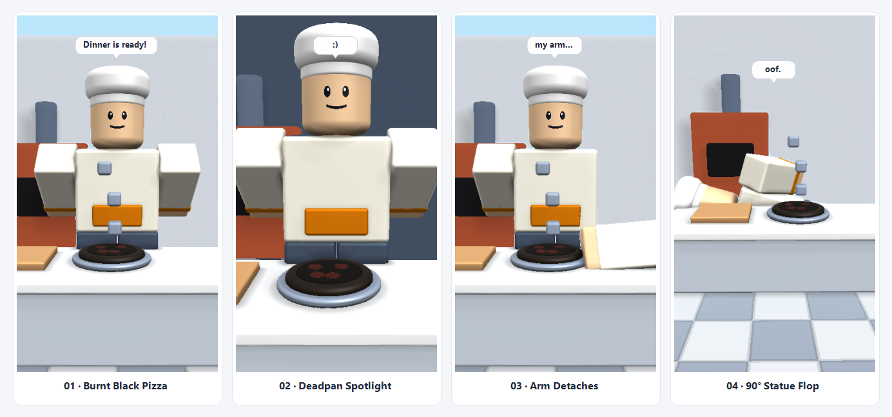

# 06 · Burnt Pizza R6 Slapstick / 焦黑披萨厨房刚体翻车

15-second (`9:16`, 4-shot) Roblox-style short-video package compiled with `--template meme-slapstick --engine runway --rig r6`.

| 9:16 Animated Preview | 4-Shot Storyboard Contact Sheet |
| :---: | :---: |
|  |  |

## Package contents

- [`assets/burnt_pizza_slapstick.mp4`](assets/burnt_pizza_slapstick.mp4): offline 3D preview video (`H.264 MP4`)
- [`assets/pizza_storyboard_sheet.en.png`](assets/pizza_storyboard_sheet.en.png) · [`zh`](assets/pizza_storyboard_sheet.zh.png): English and Chinese 4-shot contact sheets
- [`character_card.md`](character_card.md): Character DNA card and 3-view turnaround prompt (`bacon-hair`)
- [`storyboard.md`](storyboard.md) · [`prompts.json`](prompts.json): shot-by-shot first-frame and `runway` motion prompts

## Reproduce

```bash
node scripts/avatar_spec.mjs --archetype bacon-hair --rig r6 --material smooth-plastic --name "Baco" --lang en > examples/burnt-pizza-slapstick/character_card.md
node scripts/shot_compiler.mjs --template meme-slapstick --duration 15 --engine runway --rig r6 --lang en > examples/burnt-pizza-slapstick/storyboard.md
```
