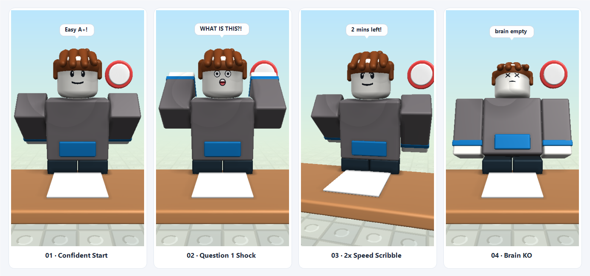

# 11 · Classroom Pop-Quiz Meltdown / 考场发卷大脑宕机记

15-second (`9:16`, 4-shot) Roblox-style short-video package compiled with `--template school-panic --engine wan --rig r6`.

| 9:16 Animated Preview | 4-Shot Storyboard Contact Sheet |
| :---: | :---: |
|  |  |

## Package contents

- [`assets/classroom_exam_panic.mp4`](assets/classroom_exam_panic.mp4): offline 3D preview video (`H.264 MP4`)
- [`assets/exam_storyboard_sheet.en.png`](assets/exam_storyboard_sheet.en.png) · [`zh`](assets/exam_storyboard_sheet.zh.png): English and Chinese 4-shot contact sheets
- [`character_card.md`](character_card.md): Character DNA card and 3-view turnaround prompt (`bacon-hair`)
- [`storyboard.md`](storyboard.md) · [`prompts.json`](prompts.json): shot-by-shot first-frame and `wan` motion prompts

## Reproduce

```bash
node scripts/avatar_spec.mjs --archetype bacon-hair --rig r6 --material smooth-plastic --name "Quizzy" --lang en > examples/classroom-exam-panic/character_card.md
node scripts/shot_compiler.mjs --template school-panic --duration 15 --engine wan --rig r6 --lang en > examples/classroom-exam-panic/storyboard.md
```
