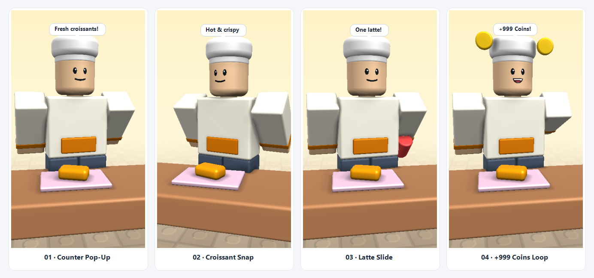

# 04 · Cozy Miniature Cafe Tycoon / 微缩羊角包甜品店经营

15-second (`9:16`, 4-shot) Roblox-style short-video package compiled with `--template mini-tycoon --engine wan --rig chibi-blocky`.

| 9:16 Animated Preview | 4-Shot Storyboard Contact Sheet |
| :---: | :---: |
|  |  |

## Package contents

- [`assets/cozy_cafe_tycoon.mp4`](assets/cozy_cafe_tycoon.mp4): offline 3D preview video (`H.264 MP4`)
- [`assets/cafe_storyboard_sheet.en.png`](assets/cafe_storyboard_sheet.en.png) · [`zh`](assets/cafe_storyboard_sheet.zh.png): English and Chinese 4-shot contact sheets
- [`character_card.md`](character_card.md): Character DNA card and 3-view turnaround prompt (`cozy-chef`)
- [`storyboard.md`](storyboard.md) · [`prompts.json`](prompts.json): shot-by-shot first-frame and `wan` motion prompts

## Reproduce

```bash
node scripts/avatar_spec.mjs --archetype cozy-chef --rig chibi-blocky --material clay-soft --name "Coco" --lang en > examples/cozy-cafe-tycoon/character_card.md
node scripts/shot_compiler.mjs --template mini-tycoon --duration 15 --engine wan --rig chibi-blocky --lang en > examples/cozy-cafe-tycoon/storyboard.md
```
