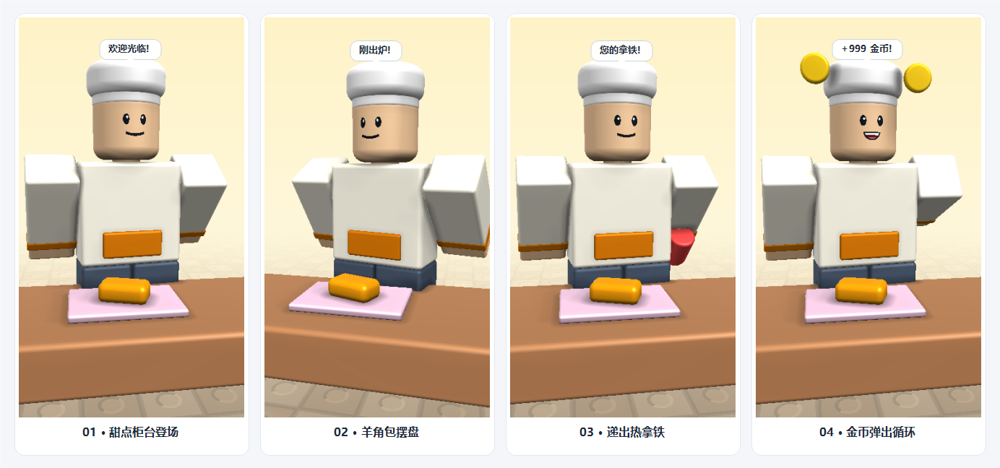

# Example 4: Cozy Miniature Cafe Tycoon / 微缩甜品店经营剧场

This folder contains a 15-second (`9:16` vertical, 4 shots) miniature bakery tycoon short-video package compiled for Wan (`wan`) with a `chibi-blocky` clay-soft chef avatar (`"Coco"`).



## Files in this package

| File | Description |
| --- | --- |
| [`assets/cozy_cafe_tycoon.gif`](assets/cozy_cafe_tycoon.gif) | 4-shot 9:16 vertical animation loop |
| [`assets/cozy_cafe_tycoon.mp4`](assets/cozy_cafe_tycoon.mp4) | H.264 `.mp4` with oven ding, tray clack, and cash register audio |
| [`assets/cafe_storyboard_sheet.zh.png`](assets/cafe_storyboard_sheet.zh.png) · [`en`](assets/cafe_storyboard_sheet.en.png) | 4-shot contact sheet with timecodes and Wan I2V prompts |
| [`character_card.md`](character_card.md) | `"Coco"` (`cozy-chef`, `chibi-blocky`, `clay-soft`) |
| [`storyboard.md`](storyboard.md) · [`prompts.json`](prompts.json) | Bilingual first-frame and Wan motion prompts |

<p align="center">
  
</p>

## Reproduce from the repository root

```bash
node scripts/avatar_spec.mjs --archetype cozy-chef --rig chibi-blocky --material clay-soft --name "Coco" --lang zh-en > examples/cozy-cafe-tycoon/character_card.md
node scripts/shot_compiler.mjs --template mini-tycoon --duration 15 --engine wan --rig chibi-blocky --lang zh-en > examples/cozy-cafe-tycoon/storyboard.md
```
