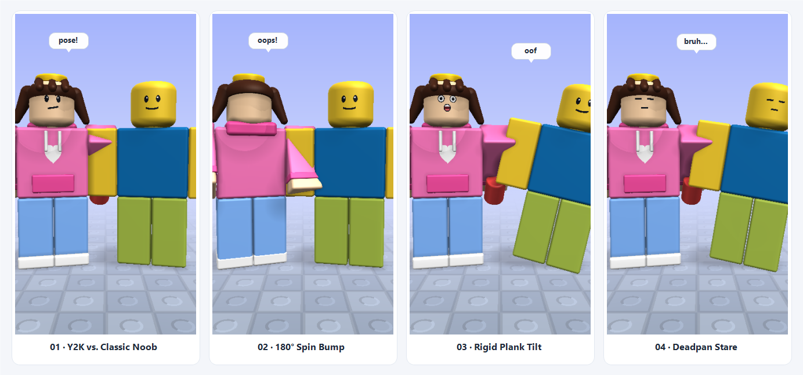

# 03 · Y2K Streetwear vs. Classic Noob / Y2K 潮人搭子与黄皮新手

15-second (`9:16`, 4-shot) Roblox-style short-video package compiled with `--template duo-comedy --engine seedance --rig r15`.

| 9:16 Animated Preview | 4-Shot Storyboard Contact Sheet |
| :---: | :---: |
|  |  |

## Package contents

- [`assets/duo_bestie_contrast.mp4`](assets/duo_bestie_contrast.mp4): offline 3D preview video (`H.264 MP4`)
- [`assets/duo_storyboard_sheet.en.png`](assets/duo_storyboard_sheet.en.png) · [`zh`](assets/duo_storyboard_sheet.zh.png): English and Chinese 4-shot contact sheets
- [`character_card.md`](character_card.md): Character DNA card and 3-view turnaround prompt (`ugc-streetwear`)
- [`storyboard.md`](storyboard.md) · [`prompts.json`](prompts.json): shot-by-shot first-frame and `seedance` motion prompts

## Reproduce

```bash
node scripts/avatar_spec.mjs --archetype ugc-streetwear --rig r15 --material glossy-vinyl --name "Nova" --lang en > examples/duo-bestie-contrast/character_card.md
node scripts/shot_compiler.mjs --template duo-comedy --duration 15 --engine seedance --rig r15 --lang en > examples/duo-bestie-contrast/storyboard.md
```
