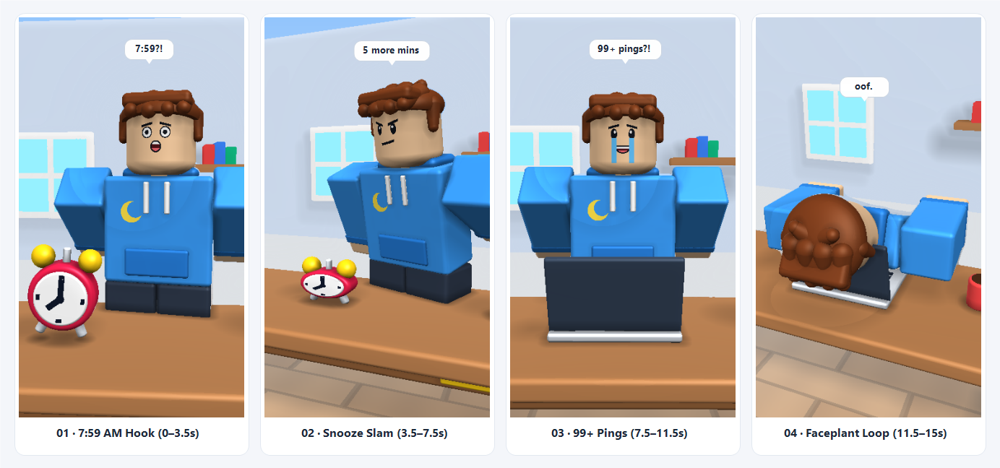

# 01 · Monday 8 AM Alarm Meltdown / 周一早八闹钟破防记

15-second (`9:16`, 4-shot) Roblox-style short-video package compiled with `--template daily-meltdown --engine kling --rig chibi-blocky`.

| 9:16 Animated Preview | 4-Shot Storyboard Contact Sheet |
| :---: | :---: |
|  |  |

## Package contents

- [`assets/monday_alarm_meltdown.mp4`](assets/monday_alarm_meltdown.mp4): offline 3D preview video (`H.264 MP4`)
- [`assets/storyboard_contact_sheet.en.png`](assets/storyboard_contact_sheet.en.png) · [`zh`](assets/storyboard_contact_sheet.zh.png): English and Chinese 4-shot contact sheets
- [`character_card.md`](character_card.md): Character DNA card and 3-view turnaround prompt (`corporate-worker`)
- [`storyboard.md`](storyboard.md) · [`prompts.json`](prompts.json): shot-by-shot first-frame and `kling` motion prompts

## Reproduce

```bash
node scripts/avatar_spec.mjs --archetype corporate-worker --rig chibi-blocky --material smooth-plastic --name "Momo" --lang en > examples/monday-alarm-meltdown/character_card.md
node scripts/shot_compiler.mjs --template daily-meltdown --duration 15 --engine kling --rig chibi-blocky --lang en > examples/monday-alarm-meltdown/storyboard.md
```
