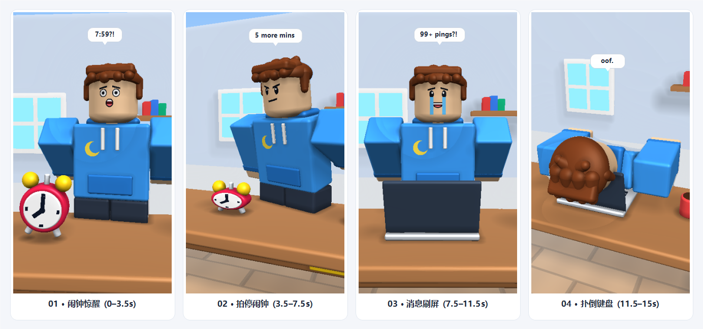

# Example 1: Monday 8 AM Alarm Meltdown / 周一早八闹钟破防记

This folder contains a 15-second (`9:16` vertical, 4 shots) short-video package generated with the `roblox-style-video` CLI scripts. It includes 3-view character turnaround sheets, 4 shot keyframes, localized storyboard contact sheets, a drift report, and `.gif` / `.mp4` previews.



## Files in this package

| File | Description |
| --- | --- |
| [`assets/monday_alarm_meltdown.gif`](assets/monday_alarm_meltdown.gif) | 4-shot 9:16 animated preview loop |
| [`assets/monday_alarm_meltdown.mp4`](assets/monday_alarm_meltdown.mp4) | H.264 `.mp4` with alarm buzz, plastic clack, ping, and `"Oof!"` audio cues |
| [`../../assets/showcase/momo_turnaround_sheet.zh.png`](../../assets/showcase/momo_turnaround_sheet.zh.png) · [`en`](../../assets/showcase/momo_turnaround_sheet.en.png) | 0° Front, 45° Three-Quarter, and 90° Side Profile reference sheet |
| [`assets/storyboard_contact_sheet.zh.png`](assets/storyboard_contact_sheet.zh.png) · [`en`](assets/storyboard_contact_sheet.en.png) | 4-shot 9:16 contact sheet with timecodes and Kling I2V prompts |
| [`shot_01_hook.png`](assets/shot_01_hook.png) · [`shot_02_slam.png`](assets/shot_02_slam.png) · [`shot_03_tears.png`](assets/shot_03_tears.png) · [`shot_04_faceplant.png`](assets/shot_04_faceplant.png) | First-Frame I2V anchor stills (`540x960`) |
| [`character_card.md`](character_card.md) | Output from `node scripts/avatar_spec.mjs` |
| [`storyboard.md`](storyboard.md) · [`prompts.json`](prompts.json) | Output from `node scripts/shot_compiler.mjs` |
| [`drift_report.md`](drift_report.md) | Output from `node scripts/drift_check.mjs` |

<p align="center">
  
</p>

## Reproduce from the repository root

```bash
node scripts/avatar_spec.mjs --archetype corporate-worker --rig chibi-blocky --material glossy-vinyl --name "Momo" --lang zh-en > examples/monday-alarm-meltdown/character_card.md
node scripts/shot_compiler.mjs --template daily-meltdown --duration 15 --engine kling --rig chibi-blocky --lang zh-en > examples/monday-alarm-meltdown/storyboard.md
node scripts/shot_compiler.mjs --template daily-meltdown --duration 15 --engine kling --rig chibi-blocky --json > examples/monday-alarm-meltdown/prompts.json
```
