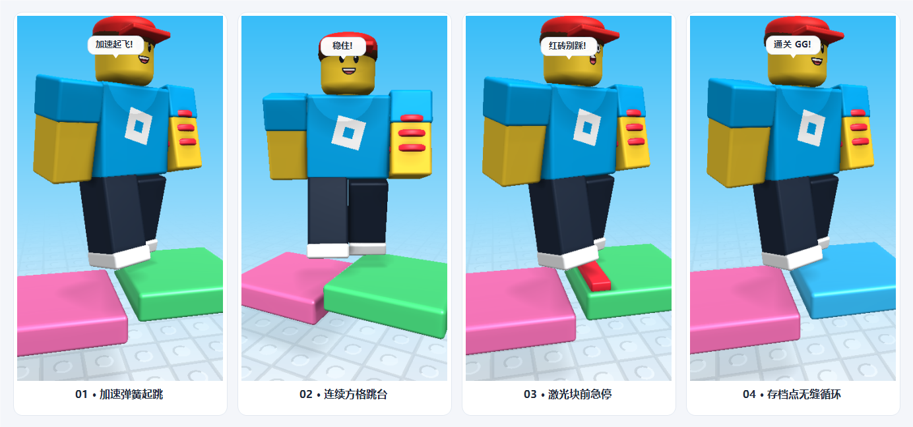

# Example 2: Pastel Sky Obby Parkour / 天空跑酷闯关

This folder contains a 15-second (`9:16` vertical, 4 shots) R6 Obby parkour short-video package compiled for Hailuo MiniMax (`I2V-01-Director`) with bracketed camera commands (`[Push in, Tilt up]`, `[Pan right]`, `[Tilt down]`).



## Files in this package

| File | Description |
| --- | --- |
| [`assets/obby_sky_run.gif`](assets/obby_sky_run.gif) | 4-shot 9:16 vertical animation loop |
| [`assets/obby_sky_run.mp4`](assets/obby_sky_run.mp4) | H.264 `.mp4` with jump spring and checkpoint chime audio |
| [`assets/obby_storyboard_sheet.zh.png`](assets/obby_storyboard_sheet.zh.png) · [`en`](assets/obby_storyboard_sheet.en.png) | 4-shot contact sheet with timecodes and Hailuo camera tags |
| [`character_card.md`](character_card.md) | R6 runner `"SkyHop"` with red visor and right-arm `Speed Coil` |
| [`storyboard.md`](storyboard.md) · [`prompts.json`](prompts.json) | Bilingual first-frame and Hailuo Director motion prompts |

<p align="center">
  
</p>

## Reproduce from the repository root

```bash
node scripts/avatar_spec.mjs --archetype obby-runner --rig r6 --material matte-abs --name "SkyHop" --lang zh-en > examples/obby-sky-run/character_card.md
node scripts/shot_compiler.mjs --template obby-storytime --duration 15 --engine hailuo --rig r6 --lang zh-en > examples/obby-sky-run/storyboard.md
```
