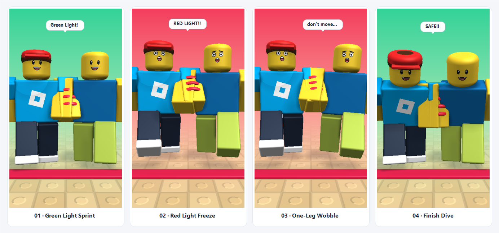

# 12 · Red Light Green Light Freeze / 一二三木头人极限急停

15-second (`9:16`, 4-shot) Roblox-style short-video package compiled with `--template red-light-game --engine runway --rig r6`.

| 9:16 Animated Preview | 4-Shot Storyboard Contact Sheet |
| :---: | :---: |
|  |  |

## Package contents

- [`assets/red_light_freeze.mp4`](assets/red_light_freeze.mp4): offline 3D preview video (`H.264 MP4`)
- [`assets/redlight_storyboard_sheet.en.png`](assets/redlight_storyboard_sheet.en.png) · [`zh`](assets/redlight_storyboard_sheet.zh.png): English and Chinese 4-shot contact sheets
- [`character_card.md`](character_card.md): Character DNA card and 3-view turnaround prompt (`obby-runner`)
- [`storyboard.md`](storyboard.md) · [`prompts.json`](prompts.json): shot-by-shot first-frame and `runway` motion prompts

## Reproduce

```bash
node scripts/avatar_spec.mjs --archetype obby-runner --rig r6 --material smooth-plastic --name "Dash" --lang en > examples/red-light-freeze/character_card.md
node scripts/shot_compiler.mjs --template red-light-game --duration 15 --engine runway --rig r6 --lang en > examples/red-light-freeze/storyboard.md
```
