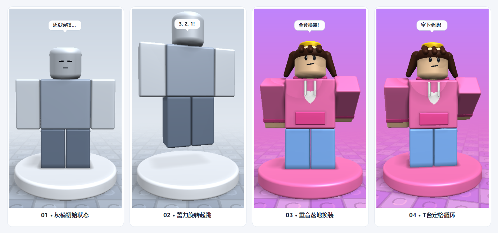

# Example 5: Dress-to-Impress Runway Outfit Drop / 走秀换装卡点

This folder contains a 15-second (`9:16` vertical, 4 shots) runway outfit transition short-video package compiled for Sora (`sora`) with an `r15` glossy-vinyl streetwear avatar (`"Lumi"`).



## Files in this package

| File | Description |
| --- | --- |
| [`assets/runway_outfit_drop.gif`](assets/runway_outfit_drop.gif) | 4-shot 9:16 vertical animation loop |
| [`assets/runway_outfit_drop.mp4`](assets/runway_outfit_drop.mp4) | H.264 `.mp4` with camera flash and beat-drop transition audio |
| [`assets/runway_storyboard_sheet.zh.png`](assets/runway_storyboard_sheet.zh.png) · [`en`](assets/runway_storyboard_sheet.en.png) | 4-shot contact sheet with timecodes and Sora I2V prompts |
| [`character_card.md`](character_card.md) | `"Lumi"` (`ugc-streetwear`, `r15`, `glossy-vinyl`) |
| [`storyboard.md`](storyboard.md) · [`prompts.json`](prompts.json) | Bilingual first-frame and Sora motion prompts |

<p align="center">
  
</p>

## Reproduce from the repository root

```bash
node scripts/avatar_spec.mjs --archetype ugc-streetwear --rig r15 --material glossy-vinyl --name "Lumi" --lang zh-en > examples/runway-outfit-drop/character_card.md
node scripts/shot_compiler.mjs --template outfit-drop --duration 15 --engine sora --rig r15 --lang zh-en > examples/runway-outfit-drop/storyboard.md
```
