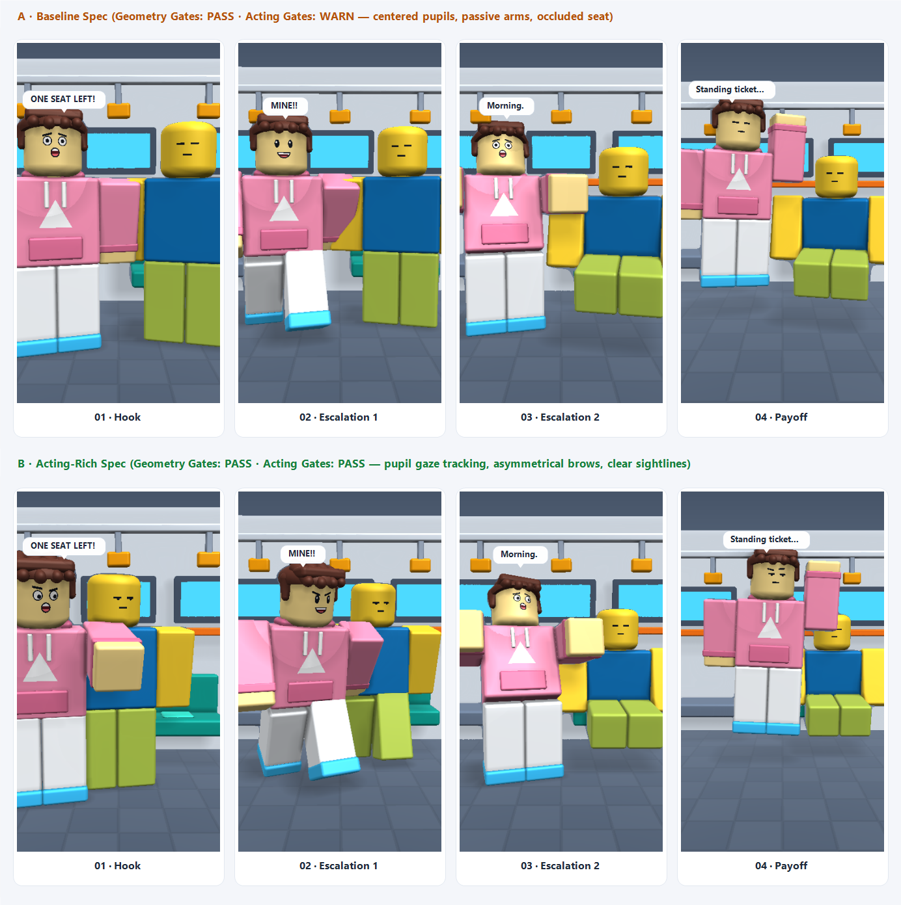

# Controlled Comparison: Geometry-Only Baseline vs. Acting-Rich Spec (`v1.7.0`)

This folder demonstrates a **strict single-variable controlled experiment**:
- **Held constant**: identical cast Visual DNA (`Mo` `chibi-blocky` `commuter` + `Noob` `r6` `noob`), identical `subway_car` SmoothPlastic stage & lighting, identical camera presets (`push_in`, `medium`, `medium`, `wide_two_shot`), identical `15.0s` timing (`3.5s / 4.0s / 4.0s / 3.5s`), and identical `chatEn` bubbles.
- **Single variable changed**: adding the **`v1.7.0` Acting & Readability Grammar** (`performanceDNA`, `beatIntent`, `audienceRead`, `actingAnchor`, `performance.gazeTarget` + asymmetrical `eyebrows` + `bodyAttitude`, camera-facing `interaction`, and sightline-clean `actors[]` placement).

## Audit Results (`drift_check.mjs --pack`)

| Variant | Geometry Gates (1–8) | Acting & Readability Gates (9–10) | Key Visual Difference |
| --- | :---: | :---: | --- |
| [`baseline_spec.json`](baseline_spec.json) | **`PASS`** | **`WARN`** | Valid Roblox proportions, but dead-center pupils, symmetrical brows, passive arms, and default 2-cast placement partially hides `empty_seat` in Shot 01. |
| [`acting_rich_spec.json`](acting_rich_spec.json) | **`PASS`** | **`PASS`** | Pupils actively track `empty_seat` -> `noob`, asymmetrical brows signal hesitation/side-eye, Mo's right block arm points camera-facing at the open seat, and `empty_seat` + `center_strap` contact read cleanly at thumbnail size. |

## Deliverables Generated by `acting_rich_spec.json`

1. **Geometry Sheet**: [`assets/acting_rich/turnaround_sheet.en.png`](assets/acting_rich/turnaround_sheet.en.png)
2. **Cast Acting Sheet** (`Identity + Signature Acting Moment`): [`assets/acting_rich/cast_acting_sheet.en.png`](assets/acting_rich/cast_acting_sheet.en.png)
3. **256×256 Avatar Crops**: [`assets/acting_rich/avatars/mo_avatar.png`](assets/acting_rich/avatars/mo_avatar.png), [`assets/acting_rich/avatars/noob_avatar.png`](assets/acting_rich/avatars/noob_avatar.png)
4. **Shot Keyframe Sheet & Videos**: [`assets/acting_rich/storyboard_sheet.en.png`](assets/acting_rich/storyboard_sheet.en.png), [`assets/acting_rich/subway_acting_rich.mp4`](assets/acting_rich/subway_acting_rich.mp4), [`assets/baseline/subway_baseline.mp4`](assets/baseline/subway_baseline.mp4)
